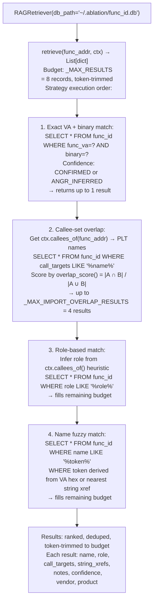

# Prior Finding Retrieval

Retrieve relevant prior RE findings from `func_id.db` to inject into the LLM analyst loop as context — using four ranked retrieval strategies (exact VA match, callee-set overlap, role-based match, name fuzzy match) entirely in SQLite without requiring a vector database.

---

## Why this exists

1. **LLM analysis quality degrades significantly without relevant context — a model analyzing an unnamed function called `fn_0x1234` with no prior evidence produces generic output, while the same model given three prior confirmed findings from similar functions in the same product family produces targeted, accurate hypotheses.** `RAGRetriever` bridges the gap by automatically retrieving the most relevant prior records from `func_id.db` before each `AgentLoop.run()` call.

2. **Four retrieval strategies ranked by signal strength ensure the highest-quality context is always retrieved first** — exact VA + binary match (the same function confirmed before, highest signal), callee-set overlap (functions in the same family by import usage), role-based match (same functional role class), and name fuzzy match (LIKE search on the name column). Results from stronger strategies take priority and weaker strategies fill remaining context budget.

3. **`RAGRetriever` operates entirely on SQLite queries with no vector database requirement** — retrieval runs in milliseconds on `func_id.db` even with thousands of records. This keeps the RE workflow offline-capable and eliminates the operational overhead of running a vector store.

---

## How it works



---

## Usage

`RAGRetriever` is used internally by `AgentLoop` — it is not typically called directly. The following shows direct use for custom LLM integration:

```python
from ablation.analyzers.llm_analyst.rag_retriever import RAGRetriever
from ablation.analyzers.binary_context import BinaryContext

ctx = BinaryContext.load_or_build('/path/to/target.elf')
retriever = RAGRetriever('~/.ablation/func_id.db')

# Retrieve prior context for a specific function
prior_records = retriever.retrieve(func_addr=0x1000, ctx=ctx)
for record in prior_records:
    print(f"  [{record['confidence']}] {record['name']}  role={record['role']}")
    print(f"    callees: {record['call_targets'][:80]}")

# Use retrieved records as LLM system context
context_str = '\n'.join(
    f"Prior finding: {r['name']} ({r['role']}) — {r['notes']}"
    for r in prior_records
)
```

---

## Example output

The following illustrates retrieval output format. Actual records are database-specific.

```
retrieve(func_addr=<va>, ctx=...):
  Strategy 1 (exact VA): 0 matches  (new binary)
  Strategy 2 (callee overlap): 3 matches
    [CONFIRMED] http_request_parser  role=network  overlap=0.75
      callees: recv, strncmp, send, malloc
    [CONFIRMED] tls_read_handler  role=network  overlap=0.60
  Strategy 3 (role): 2 matches
  Strategy 4 (name): 1 match

Total: 6 records (budget 8, 2 remaining)
```

---

## False positives

**Callee-set overlap may retrieve records from completely different products that happen to use the same PLT functions** — two functions both calling `recv`, `malloc`, and `free` may be in entirely different roles. The LLM receives the retrieved records as context but should not be assumed to weight them correctly. High-overlap records from confirmed findings in the same vendor/product are the most reliable; low-overlap records from different vendors are context noise.

**Role-based matching uses a simple LIKE query** — a function heuristically classified as `network` role retrieves all `network`-role records, which may include thousands of records in a mature database. The budget cap (8 records) limits context size, but the 8 records may not be the most relevant.

---

## Pipeline position

`RAGRetriever.retrieve()` is called internally by `AgentLoop.run()` at the start of every analysis call. It is not part of the analyst-facing RE workflow — it is infrastructure that improves LLM analysis quality transparently. To improve retrieval quality, ensure that confirmed findings are registered with `FindingRegistry.register()` promptly after validation.

---

## See also

- [Function Identity Database](function-identity-database.md) — `func_id.db` and `FindingRegistry` that RAGRetriever queries
- [LLM Analyst Loop](llm-analyst-loop.md) — `AgentLoop` that calls `RAGRetriever` internally
- [Assisted Vulnerability Hypotheses](assisted-vulnerability-hypotheses.md) — primary consumer of retrieved context
