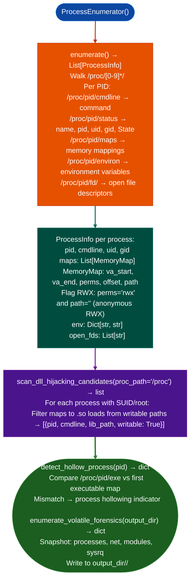

# Process and Memory Map Inventory

Enumerate running processes, loaded shared libraries, executable/RWX memory regions, open file descriptors, and environment variables: providing the live process surface map needed to identify injection targets, privilege escalation conditions, and DLL hijacking candidates: via `modules/process_enum.py`.

---

## Why this exists

1. `ProcessEnumerator` reads `/proc/<pid>/maps`, `/proc/<pid>/environ`, and `/proc/<pid>/fd/`: providing the complete memory layout and open file descriptors for every process the current user can read. RWX memory regions (`rwx` in `/proc/pid/maps` without a backing file) are flagged as potential shellcode injection targets: a process with an anonymous RWX region may be a shellcode host or JIT compiler.

2. **`scan_dll_hijacking_candidates()`** enumerates processes with shared library loads from writable directories: a common misconfiguration where a privileged process `root`, SUID loads a `.so` from `/tmp/` or a user-writable path. If the calling user can write to the load path, they can substitute a malicious library and execute code at the privilege level of the target process.

3. **`enumerate_volatile_forensics()`** captures volatile system state: process list, network connections, loaded kernel modules (`/proc/modules`), and `/proc/sysrq-trigger` accessibility: to a timestamped output directory. This is the standard pre-rootkit-analysis capture step: volatile state is collected before any analysis tools potentially modify the system.

---

## How it works



---

## Usage

```python
from modules.process_enum import ProcessEnumerator, scan_dll_hijacking_candidates

# List all processes: each entry is {'pid': int, 'name': str, 'cmdline': str}
enumerator = ProcessEnumerator()
processes = enumerator.list_all_processes()

# Per-PID memory map inspection
for proc in processes:
    pid_enum = ProcessEnumerator(pid=proc['pid'])
    maps = pid_enum.get_memory_maps()
    for m in maps:
        # m: dict with 'start', 'end', 'perms', 'offset', 'device', 'inode', 'path'
        if 'x' in m.get('perms', '') and not m.get('path', ''):
            print(f"  PID {proc['pid']} ({proc['cmdline'][:40]}): anonymous RWX {m['start']}-{m['end']}")

# DLL hijacking candidates — returns [{severity, title, detail, host, port}]
for finding in scan_dll_hijacking_candidates():
    if finding['title'] == 'DLL_HIJACK_WRITABLE_PATH':
        print(f"  [{finding['severity']}] {finding['title']}: {finding['detail']}")
```

---

## Example output

The following illustrates process and memory map inventory output format.

```
ProcessEnumerator:

PID 1042 (node /app/server.js):
  Anonymous RWX: 0x7f4a00000000-0x7f4a00100000  (JIT heap)

PID 1200 (/usr/bin/suid-helper):
  Loads: /tmp/libhelper.so  ← writable path (hijacking candidate)

scan_dll_hijacking_candidates:
  1 hijacking candidate: /tmp/libhelper.so (writable, loaded by root process)
```

---

## False positives

**Anonymous RWX regions in JIT runtimes**: Node.js, Java JVM, Python via ctypes, and V8-based applications use anonymous RWX pages for JIT-compiled code. These are not shellcode; they are expected behavior. Filter JIT runtime processes by their `cmdline` before reporting RWX as a finding.

**`detect_hollow_process()`**: certain anti-cheat and DRM systems deliberately remap the process image at runtime. A hollowed process indicator does not definitively indicate malware; verify by examining the actual mapped content.

---

## Pipeline position

Run process and memory map inventory after `host-platform-inventory` establishes the OS and security settings. Anonymous RWX findings feed injection target selection; DLL hijacking candidates feed privilege escalation attempts.

---

## Reading findings

`ProcessEnumerator.scan()` returns a list of finding dicts:

| Field | Content |
|:---|:---|
| `severity` | `HIGH` RWX mapping or writable hijack path / `MEDIUM` suspicious load path |
| `title` | Finding code for example `ANONYMOUS_RWX_MAPPING`, `DLL_HIJACK_CANDIDATE` |
| `pid` | Process ID |
| `process` | Process executable path |
| `detail` | Memory range, loaded library path, or writable directory description |

`ProcessEnumerator.scan_dll_hijacking_candidates()` returns `List[{pid, process, writable_path, library}]`.

---

## See also

- [Linux Privilege Escalation Triage](linux-privilege-escalation-triage.md): `PrivescEnumerator` for SUID, capabilities, and sudo paths
- [Host Platform Inventory](host-platform-inventory.md): OS/kernel/libc baseline that informs which exploit paths apply
