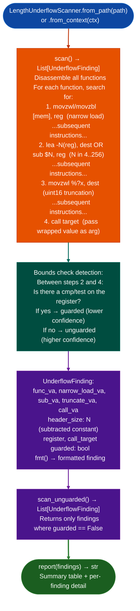

# Protocol Length Underflow Detection

Detect C12-class integer underflow bugs in protocol parsers across any x86-64 binary: finding the `narrow_load → subtract_header → uint16_truncate → call` pattern that wraps small user-controlled length values to 65523–65535, enabling out-of-bounds reads in DNS, GRE, PPTP, SCTP, Diameter, and similar protocol parsers.

---

## Why this exists

1. **Protocol parsers that strip a fixed header size from a user-supplied length field are vulnerable to integer underflow when the supplied length is smaller than the header.** The C12-class pattern is: `movzwl [mem], reg` narrow load of user-supplied length, `lea -N(reg), dest` or `sub $N, reg` subtract header size N, `movzwl %?x, dest` uint16 truncation, `call target` pass wrapped value. When `length < N`, the subtraction underflows and the truncation wraps to `65535 - N - length - 1`: a value the caller interprets as a large length, causing OOB read.

2. **The pattern generalizes across protocols.** DNS subtract 12-byte header, GRE subtract 4-byte header, PPTP subtract 8-byte header, SCTP subtract 12-byte common header, Diameter subtract 20-byte base AVP header all use this pattern. `LengthUnderflowScanner` detects any subtraction of a constant N in [4..256] from a narrow-loaded register, covering the full range of fixed protocol header sizes without protocol-specific configuration.

3. **`scan_unguarded()` filters to only those instances where no prior `cmp`/`test` bounds check was found on the loaded register after the subtraction.** Many parsers do check for `length >= N` before proceeding: `scan_unguarded()` eliminates guarded instances that are not vulnerabilities, reducing false positives from the broader `scan()` output.

---

## How it works



---

## Usage

```python
from ablation.analyzers.length_underflow import LengthUnderflowScanner
from ablation.analyzers.binary_context import BinaryContext

ctx = BinaryContext.load_or_build('/path/to/target.elf')
scanner = LengthUnderflowScanner.from_context(ctx)

# All underflow pattern matches
findings = scanner.scan()
print(scanner.report(findings))

# Unguarded only (highest confidence)
unguarded = scanner.scan_unguarded()
print(f"Unguarded underflow candidates: {len(unguarded)}")
for f in unguarded:
    print(f.fmt())
```

---

## Example output

The following illustrates the finding format. Actual addresses and targets are binary-specific.

```
[UNGUARDED] Length underflow at <va>
  narrow_load:  movzwl [rbp-0x18], edx    ; user-supplied chunk_length
  subtract:     lea -0x10(rdx), edx       ; strip 16-byte header
  truncate:     movzwl dx, edx            ; uint16: values 1..15 → 65521..65535
  call:         call proto_parse_field    ; called with rdx=65521+  → OOB read
  header_size:  16  (0x10)
  guarded:      False  (no bounds check on edx between subtract and call)
```

---

## False positives

**The `cmp`/`test` bounds check detection looks in a fixed instruction window**: a bounds check implemented as a table lookup or a called function (rather than a direct `cmp/test`) will not be detected, and the finding will be marked `guarded=False` when it is actually guarded. Manual verification should check for calls to validation functions between the subtract and call sites.

**`movzwl` zero-extend word and `movzbl` zero-extend byte are both matched as narrow loads**: in some parsers, the narrow load is a legitimate protocol field width, not a user-supplied length. Confirm that the loaded value comes from a network-received buffer (via `TaintTracker`) before treating the finding as a vulnerability.

---

## Pipeline position

Run `LengthUnderflowScanner` as part of the SemanticSearcher-guided sweep on protocol parser binaries. Pair with `TaintTracker.run_on_function_seeded()` to confirm that the narrow-loaded value comes from a network source, and with `PathSolver` to confirm feasibility of the underflow condition (`input_length < header_size`).

---

## Reading findings

`LengthUnderflowScanner.scan()` returns a list of finding dicts:

| Field | Content |
|:---|:---|
| `severity` | `HIGH` unguarded / `MEDIUM` potentially guarded |
| `title` | `LENGTH_UNDERFLOW_UNGUARDED` or `LENGTH_UNDERFLOW_GUARDED` |
| `narrow_load_va` | VA of the narrow load instruction such as `movzwl` |
| `subtract_va` | VA of the header-size subtraction |
| `truncate_va` | VA of the zero-extension that enables wraparound |
| `call_va` | VA of the downstream call using the underflowed length |
| `header_size` | Integer: the header size being subtracted |
| `guarded` | `False` if no bounds check was found between subtract and call |

---

## See also

- [Taint Analysis](taint-analysis.md): confirms that the narrow-loaded value is user-controlled
- [Sink Argument Classifier](sink-argument-classifier.md): classifies the call target at step 4
- [Format String Scanning](format-string-scanning.md): complementary scanner for a different vulnerability class in the same parser functions
