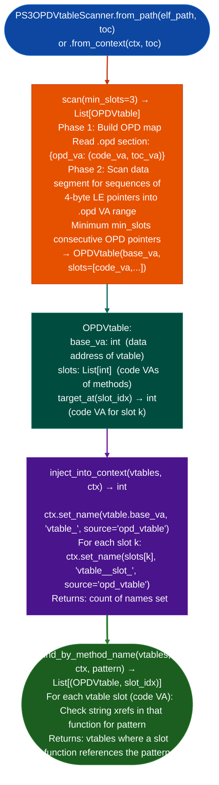

# PS3 OPD Virtual Tables

Reconstruct C++ vtables in PS3 Cell PPU (PPC64) binaries: finding all virtual dispatch tables that use PPC64 ELFv1 OPD Official Procedure Descriptor indirect pointers rather than direct `.text` code addresses, enabling identification of `processPacket`, `handleMessage`, and other virtual dispatch entry points in stripped PS3 game binaries with inline-linked C++ libraries.

---

## Why this exists

1. **PS3 Cell PPU binaries use PPC64 ELF ABI v1 function descriptors (OPDs): every vtable slot is a 4-byte pointer into the data segment that resolves to an 8-byte `{code_va, toc_va}` OPD entry.** `CppVtableReconstructorAnalyzer` the generic vtable reconstructor scans for RELA relocations and direct 8-byte text pointers, finding zero vtables in PS3 binaries because there are no RELA sections and no direct text pointers. `PS3OPDVtableScanner` understands OPD indirection and finds all vtables correctly.

2. **Demonware BD and similar inline-linked C++ class libraries in PS3 game binaries cannot be located without vtable reconstruction**: without vtables there is no way to find `processPacket`, `handleMessage`, or other virtual methods that are the primary network attack surface. `PS3OPDVtableScanner.find_by_method_name()` searches vtable targets for methods matching a name pattern after cross-referencing string literals in the method functions.

3. **`PS3OPDVtableScanner.inject_into_context()` registers discovered vtable base addresses and method VAs in `BinaryContext`**: after injection, `ctx.plt_namemethod_va` returns the slot-based name for example `vtable_0x1234_slot_3`, enabling all downstream analysis tools to show method names instead of raw VAs.

---

## How it works



---

## Usage

```python
from ablation.analyzers.ps3_opd_vtable_scanner import PS3OPDVtableScanner
from ablation.analyzers.binary_context import BinaryContext

ctx = BinaryContext.load_or_build('/path/to/ps3_game.elf')
scanner = PS3OPDVtableScanner.from_context(ctx)

# Scan for all vtables
vtables = scanner.scan(min_slots=3)
print(scanner.report(vtables))

# Find vtables containing a network packet handler
results = scanner.find_by_method_name(vtables, ctx, 'processPacket')
for vtable, slot_idx in results:
    method_va = vtable.target_at(slot_idx)
    print(f"processPacket: vtable={vtable.base_va:#x}  slot={slot_idx}  code={method_va:#x}")

# Register in BinaryContext for downstream analysis
n = scanner.inject_into_context(vtables, ctx)
print(f"Registered {n} vtable method names")
```

---

## Example output

The following illustrates the vtable discovery output format. Actual addresses and slot counts are binary-specific.

```
PS3OPDVtableScanner: ps3_game.elf  (PPC64 BE ELFv1)

OPD entries: <N>
Vtables found: <M>  (min_slots=3)

OPDVtable at <base_va>:
  slots: <K>
  slot 0: code_va=<va>  (5 string xrefs)
  slot 1: code_va=<va>
  slot 2: code_va=<va>  (xref: "processPacket")
```

---

## False positives

**`scan()` finds sequences of OPD-range pointers: data arrays containing OPD VAs by coincidence may be detected as vtables.** Filter by minimum slot count (`min_slots >= 4`) and by requiring that the first slot's function has a return instruction code pointer validation. The `inject_into_context()` call names all discovered vtable bases, so false positives appear as named entries in `FuncProfiler` output.

**`find_by_method_name()` uses string xref matching**: a function containing `processPacket` as a log string will match even if it does not implement the packet processing. Verify by inspecting the matched method's disassembly before treating it as the attack entry point.

---

## Pipeline position

Run `PS3OPDVtableScanner.scan()` after `BinaryContext.load_or_build()` and before `SemanticSearcher.build_corpus()` on PS3 Cell PPU binaries. Inject vtable names into context so that `FuncProfiler` and `TaintTracker` output shows method names instead of raw VAs.

---

## Reading output

`PS3OPDVtableScanner.scan()` returns a list of `OPDVtable` objects:

| Attribute | Content |
|:---|:---|
| `va` | VA of the first vtable slot past the RTTI header |
| `slots` | Number of virtual method slots |
| `method_vas` | `List[int]`: resolved code VAs per slot |
| `null_slots` | `List[int]`: slot indices not code VAs of null-stub slots |
| `rtti_offset` | Bytes before `va` where the RTTI header starts 0 if not found |
| `class_hint` | Nearest string evidence for class name empty string if none |

---

## See also

- [PPC32/PPC476 Dedicated Lifting](ppc32-ppc476-dedicated-lifting.md): PPC32/PPC64 instruction lifting and decompilation
- [PPC64 ELFv1 Resolution](ppc64-elfv1-resolution.md): PLT patching for ELFv1 binaries
- [ARM64 Virtual Call Resolution](arm64-virtual-call-resolution.md): ARM64 equivalent vtable reconstruction
