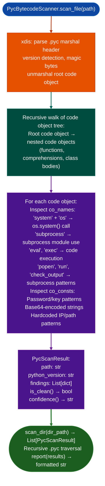

# Python .pyc Scanning

Scan Python bytecode (`.pyc`) files for dangerous patterns: parsing code object trees directly using `xdis` for cross-version compatibility, without requiring decompilation, to detect `os.system()`, `subprocess`, `exec()`, hardcoded credentials, and dangerous attribute access across Python 3.4–3.12+.

---

## Why this exists <sup>[↑](#python-pyc-scanning)</sup>

1. **FortiSwitch and similar appliances ship only compiled `.pyc` bytecode on the management plane: no `.py` source files.** `PycBytecodeScanner` was built to close `FSW-PYC-GAP`: without it, the entire Python layer of FortiSwitch firmware was opaque to static analysis. `xdis` parses the marshalled code object tree across Python versions 3.4–3.12+, which Python's built-in `marshal.loads()` cannot do when the `.pyc` was compiled by a different Python version than the analysis host.

2. **Every `.pyc` file stores `co_names` in each code object: the list of all attribute and global names referenced by `LOAD_ATTR`, `LOAD_GLOBAL`, and `STORE_ATTR` opcodes.** If a module calls `os.system()`, the string `"system"` appears in `co_names` and `"os"` appears in `co_names`. This provides reliable signal without decompilation, no AST reconstruction, no control-flow analysis, just co_names inspection. The approach is version-agnostic and handles all Python bytecode formats including 3.12's new opcode encoding.

3. `PycBytecodeScanner.scan_dir()` processes an entire directory tree of `.pyc` files in a single pass: the typical firmware structure places `.pyc` files in `/opt/pyc/` or alongside application code. Scanning the directory produces a `List[PycScanResult]` that can be filtered by confidence and finding type without individual per-file invocations.

---

## How it works <sup>[↑](#python-pyc-scanning)</sup>



---

## Usage <sup>[↑](#python-pyc-scanning)</sup>

```python
from ablation.analyzers.pyc_bytecode_scanner import PycBytecodeScanner

scanner = PycBytecodeScanner()

# Scan a single .pyc file
result = scanner.scan_file('/path/to/module.pyc')
print(result.confidence())
for finding in result.findings:
    print(f"  {finding}")

# Scan a directory tree
results = scanner.scan_dir('/mnt/firmware/opt/pyc/')
print(scanner.report(results))

# Filter to non-clean results
dirty = [r for r in results if not r.is_clean()]
print(f"{len(dirty)}/{len(results)} files with findings")

# Scan raw bytes (in-memory)
with open('/path/to/module.pyc', 'rb') as f:
    pyc_bytes = f.read()
result_raw = scanner.scan_raw(pyc_bytes, name='module.pyc')
```

---

## Example output <sup>[↑](#python-pyc-scanning)</sup>

The following illustrates the scan report format. Actual findings are firmware-specific.

```
PycBytecodeScanner report:
  /path/to/<module>.pyc  [Python <version>]  CLEAN
  /path/to/<module>.pyc  [Python <version>]
    os.system(): 'system' in co_names  (module: <module_name>)
    subprocess:  'subprocess' import detected
  ...
  Total: <N> files, <M> with findings
```

---

## False positives <sup>[↑](#python-pyc-scanning)</sup>

**`co_names` inspection detects the presence of attribute names, not confirmed call sites.** A module that imports `os` and uses `os.path.system` unlikely but possible would trigger `os.system` detection even if it never calls `os.system()`. Confirm with decompilation (`uncompyle6`) or bytecode inspection (`dis`) on flagged files before reporting.

**`is_clean()` returns `True` when no dangerous `co_names` patterns are found, but a module could contain dangerous logic implemented through ctypes, cffi, or dynamic attribute lookup that does not use predictable name strings.** `is_clean()` means no detected patterns, not confirmed safety.

---

## Pipeline position <sup>[↑](#python-pyc-scanning)</sup>

Run `PycBytecodeScanner.scan_dir()` as the first pass on any firmware with a Python management layer: before source auditing or dynamic analysis. The scan completes in seconds and identifies which modules need deeper analysis. For flagged modules, proceed to `uncompyle6` decompilation or manual bytecode inspection with `dis`.

---

## Reading output <sup>[↑](#python-pyc-scanning)</sup>

`PycBytecodeScannerdangerous_names.scan_file(path)` returns a `PycScanResult` not a list of findings. See [pyc-bytecode-scanner](pyc-bytecode-scanner.md) for the full field reference.

| Attribute | Content |
|:---|:---|
| `path` | Path to the `.pyc` file |
| `filename` | Original `.py` source path from the code object |
| `python_version` | Detected Python version for example `'3.11'` |
| `danger_hits` | `FrozenSet[str]`: dangerous names found in bytecode |
| `confidence` | Property: `'clean'` / `'HIGH'` os module + danger hits / `'LOW'` danger hits only |
| `error` | `None` on success, error string on parse failure |

Use `scan_dir(path)` to scan a directory tree and return `List[PycScanResult]`.

`PycBytecodeScanner.reportfindings` returns a formatted scan summary string.

---

## See also <sup>[↑](#python-pyc-scanning)</sup>

- [Source Code Auditing](source-code-auditing.md): for `.py` source; complement to .pyc scanning
- [Fortinet Build Track Classification](fortinet-build-track-classification.md): FortiSwitch firmware analysis context
- [Firmware Extraction](firmware-extraction.md): extract `.pyc` files from firmware image before scanning
