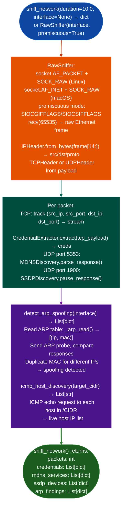

# Raw Packet Capture

Capture live network traffic with a raw socket (`AF_PACKET` / `AF_INET` + `SOCK_RAW`), parse IPv4/TCP/UDP headers, and detect credential patterns, ARP spoofing, and mDNS/SSDP service announcements: without `libpcap`, `tcpdump`, or Scapy: via `modules/net_sniffer.py`.

---

## Why this exists

1. **`RawSniffer` operates without any external network capture dependency.** Using `socket.socketsocket.AF_PACKET, socket.SOCK_RAW, socket.ntohs(0x0003)` (Linux) or `socket.socketsocket.AF_INET, socket.SOCK_RAW, socket.IPPROTO_RAW` (macOS), `RawSniffer` captures all Ethernet frames on the specified interface in pure Python. `tcpdump`, `Wireshark`, and `libpcap` are not required: only root privileges and a network interface name.

2. **`CredentialExtractor` performs pattern-based credential extraction from live TCP streams**: HTTP Basic Auth `Authorization: Basic` headers, FTP `USER`/`PASS` sequences, and SMTP `AUTH PLAIN` values are identified in real-time as packets are captured. This is suitable for post-compromise network monitoring without installing additional tools.

3. **`MDNSDiscovery` and `SSDPDiscovery`** listen on multicast addresses mDNS: `224.0.0.251:5353`, SSDP: `239.255.255.250:1900` and parse service announcements passively. `MDNSDiscovery` returns `PTR` records with service instance names; `SSDPDiscovery` returns device type, friendly name, and USN from `M-SEARCH` responses. Both run without sending probe packets.

---

## How it works



---

## Usage

```python
from modules.net_sniffer import (
    sniff_network, RawSniffer,
    MDNSDiscovery, SSDPDiscovery,
    icmp_host_discovery, detect_arp_spoofing
)

# 10-second passive capture
results = sniff_network(duration=10.0, interface='eth0')
print(f"Packets: {results['packets']}")
print(f"Credentials found: {len(results['credentials'])}")
for c in results['credentials']:
    print(f"  [{c['proto']}] {c['src']} → {c['credential']}")

# ICMP host discovery
live_hosts = icmp_host_discovery('10.0.0.0/24', timeout=1.0)
print(f"Live hosts: {live_hosts}")
```

---

## Example output

The following is a schematic example showing output structure and field names. Values are illustrative.

```
sniff_network: eth0 (10.0s)

Packets captured: <N>

Credentials:
  [HTTP Basic] <src-ip>:<port> → <user>:<password>

mDNS services:
  _http._tcp.local → DeviceA.local (<host-1>)
  _ssh._tcp.local  → DeviceB.local (<host-2>)

SSDP devices:
  MediaServer (<host-3>): urn:schemas-upnp-org:device:MediaServer:1

ARP spoofing: none detected
```

---

## False positives

**`detect_arp_spoofing()` requires a reference ARP table**, it reads the current ARP table via `_arp_read()` and compares subsequent ARP responses. If the ARP table is already poisoned when the sniffer starts, the poisoned entries become the reference baseline and the attack will not be detected.

**`RawSniffer` promiscuous mode requires root**: without root (or `CAP_NET_RAW`), `RawSniffer` falls back to non-promiscuous capture, which only captures packets addressed to the local interface. Non-promiscuous mode misses broadcast, multicast, and traffic to/from other hosts on the same segment.

---

## Pipeline position

Run `RawSniffer` during post-compromise dwell operations to map internal network communications. Use `sniff_network()` for short captures 10–60 seconds; save the result to PCAP format and feed to `PCAPAnalyzer` for structured analysis.

---

## Reading output

`RawSnifferinterface.sniff(duration=10.0)` returns a plain `dict`:

| Key | Content |
|:---|:---|
| `packets` | Integer: total packets captured |
| `credentials` | `List[dict]`: cleartext credentials detected protocol, source, credential fragment |
| `connections` | `List[tuple]`: unique `src_ip, dst_ip, dst_port` tuples observed |
| `error` | Error string if the socket was unavailable; absent on success |

For mDNS and SSDP service discovery, use `MDNSDiscovery` and `SSDPDiscovery` from the same `modules/net_sniffer.py` module: they are separate classes from `RawSniffer`. The convenience wrapper `sniff_network()` combines all three and also returns `mdns_services`, `ssdp_devices`, and `arp_findings`.

---

## See also

- [PCAP Inspection](pcap-inspection.md): `PCAPAnalyzer` for offline PCAP analysis
- [Local Network Inventory](local-network-inventory.md): `NetworkAnalyzer` for interface and connection state enumeration
