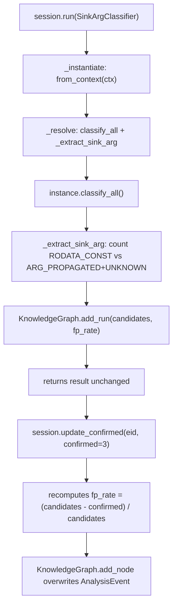

# RE Session

Wrap every Ablation tool call so outcomes are recorded to the KnowledgeGraph automatically, without a manual `add_run()` call after each tool.

---

## Why this exists

1. **`add_run()` called manually after every tool run.** The self-evolution flywheel in `get_gap_candidates()` depends on `AnalysisEvent` nodes accumulating over sessions. Manual calls are skipped under pressure, starving the flywheel and preventing gap detection from ever firing.

2. **`fp_rate` for `SinkArgClassifier` runs is computable from result verdicts but never computed.** Without it, the most important classifier in the pipeline contributes nothing to gap detection. `RESession` computes it automatically: `fp_rate = RODATA_CONST_count / total_sinks`. A classifier that eliminates 90% of sinks on `ppc32/XCOFF` as RODATA_CONST is a KnownGap candidate.

3. **`confirmed` count is unknown at classify time but knowable after `TaintTracker`.** `update_confirmed()` closes this loop: once PathSolver or TaintTracker confirms findings from an earlier `run()`, the AnalysisEvent record gains a real `fp_rate` rather than staying at 0.0.

---

## How it works



### Registry

`_resolve()` maps class name string → `(method_name, extractor_fn)`. Class names are used as keys to avoid importing every analyzer.

| Class name pattern | Canonical method | Extractor |
|---|---|---|
| `SinkArgClassifier*` | `classify_all` | Counts RODATA_CONST/UNICODE_WRAPPER as FP, computes fp_rate |
| `SemanticSearcher` | `query` | `len(result)` |
| `FuncProfiler` | `profile_many` | `len(result)` |
| `CorpusBuilder` | `build` | `len(result)` |
| `PatternLibrary` | `sweep` | `len(result)` |
| `*TaintTracker*` / `PPC32*` | `run` | `len(result)` |
| Unknown | `run` | `len(result)` |

### fp_rate semantics

- **SinkArgClassifier**: `fp_rate = eliminated_count / total_sinks`. Proxy computed at classify time. True fp_rate (after TaintTracker confirmation) set via `update_confirmed()`.
- **All other tools**: `fp_rate = 0.0` at run time. Call `update_confirmed()` after confirmation to refine.

---

## RESession

```python
from ablation.analyzers.re_session import RESession

with RESession(ctx, arch='ppc32', session_id='session://ibm-iplrom') as s:
    classifications = s.run(SinkArgClassifier)
    paths           = s.run(PPC32TaintTracker)
    hits            = s.run(SemanticSearcher,
                            description='stack overflow in recv', top_k=10)
    # After PathSolver confirms 3 of the TaintTracker paths:
    s.update_confirmed(s.last_event_id(), confirmed=3)
```

### Constructor

```python
RESession(ctx, arch, session_id, graph=None)
```

| Parameter | Type | Description |
|---|---|---|
| `ctx` | `BinaryContext` | Active binary context for this session |
| `arch` | `str` | Canonical arch string (`ppc32`, `arm64`, etc.) |
| `session_id` | `str` | Session node ID to link events to (`session://name`) |
| `graph` | `KnowledgeGraph` | Optional; opens default graph if not provided |

### Methods

```python
result = s.run(tool_cls, method=None, root_cause='', **method_kwargs)
```

Instantiates `tool_cls` via `from_context(ctx)`, calls `method` (or the canonical default), records an `AnalysisEvent` node, returns the result unchanged.

- `method`: override the canonical method name (e.g. `'profile'` instead of `'profile_many'`)
- `root_cause`: stored on the AnalysisEvent (e.g. `'XCOFF_no_plt'`)
- `**method_kwargs`: passed through to the method (e.g. `description=...`, `top_k=...`)

```python
s.update_confirmed(event_id, confirmed)
```

Refines a previously recorded AnalysisEvent with a confirmed finding count. Recomputes `fp_rate = (candidates - confirmed) / candidates` and overwrites the node.

```python
eid  = s.last_event_id()   # event_id from the most recent run()
eids = s.event_ids()       # all event_ids in call order
```

---

## Usage

### Standard session start

```python
from ablation.analyzers.re_session import RESession
from ablation.analyzers.binary_context import BinaryContext
from ablation.analyzers.sink_arg_classifier import SinkArgClassifier
from ablation.analyzers.taint_tracker_ppc32 import PPC32TaintTracker
from ablation.analyzers.semantic_search import SemanticSearcher

ctx = BinaryContext.load_or_build('/path/to/target')

with RESession(ctx, arch='ppc32', session_id='session://ibm-iplrom') as s:
    # SemanticSearcher sweep — pass description and top_k as kwargs
    hits = s.run(SemanticSearcher, description='command injection via system()', top_k=15)

    # SinkArgClassifier — fp_rate computed automatically from verdict distribution
    classifications = s.run(SinkArgClassifier, root_cause='')

    # TaintTracker on ARG_PROPAGATED / UNKNOWN sinks only
    paths = s.run(PPC32TaintTracker)

    # After PathSolver confirms 2 of the taint paths:
    s.update_confirmed(s.last_event_id(), confirmed=2)
```

### Method override

```python
# FuncProfiler.profile() instead of the default profile_many()
profile = s.run(FuncProfiler, method='profile', va=0x3208c, window=200)
```

### Bringing an existing graph

```python
from ablation.analyzers.knowledge_graph import KnowledgeGraph

g = KnowledgeGraph.open()
ctx_str = g.get_context_for_binary(arch='ppc32', fmt='xcoff32')
# prepend ctx_str to session prompt...

ctx = BinaryContext.load_or_build('/path/to/target')
with RESession(ctx, arch='ppc32', session_id='session://ibm-iplrom', graph=g) as s:
    s.run(SinkArgClassifier)
# Note: graph is closed when the with block exits.
```

---

## False positives

**`run()` raises `AttributeError`.** Either the tool class lacks `from_context` and `path`-based instantiation, or the canonical method is absent. Check the registry or pass `method=` explicitly.

**`update_confirmed()` logs a warning and does nothing.** The event_id is not in the current session's event list. This happens when an event_id from a previous session is passed. Only events created by this session instance can be updated.

**`fp_rate` stays 0.0 for TaintTracker runs.** Expected — fp_rate for non-classifier tools is only known after confirmation. Call `update_confirmed()` after PathSolver.

---

## Pipeline position

**Before this module:** `KnowledgeGraph.get_context_for_binary()` to select the tool sequence. `BinaryContext.load_or_build()` to build the session foundation.

**After this module:** All analysis tools, called via `session.run()`. `get_gap_candidates()` at session end to surface modules needing KnownGap entries.

The canonical session sequence:

```python
g    = KnowledgeGraph.open()
ctx  = BinaryContext.load_or_build(path)
with RESession(ctx, arch=arch, session_id=sid, graph=g) as s:
    s.run(SemanticSearcher, description=task, top_k=15)
    s.run(SinkArgClassifier)
    s.run(arch_taint_tracker_cls)
    s.update_confirmed(s.last_event_id(), confirmed=n)
gaps = g.get_gap_candidates()
```

---

## See also

- [Knowledge Graph](knowledge-graph.md): the graph that RESession writes to; `get_gap_candidates()` reads these AnalysisEvent nodes
- [Binary Context](binary-context.md): session foundation passed to RESession
- [SinkArgClassifier](sink-arg-classifier.md): primary classifier; fp_rate computed by `_extract_sink_arg`
- [Taint Analysis](taint-analysis.md): confirms findings; call `update_confirmed()` after
