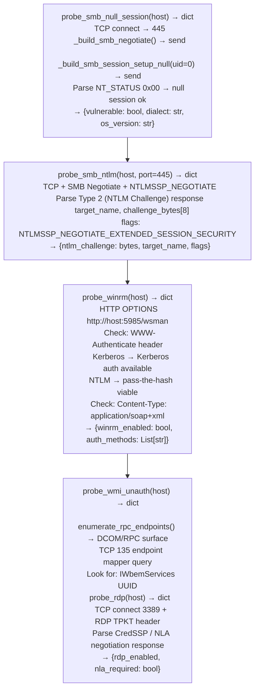

# Remote Management and Identity Probes

Probe SMB for null sessions and NTLM challenge-response exposure, test WinRM authentication surfaces, detect RDP service presence, enumerate WMI unauthenticated access, probe Active Directory LDAP for anonymous bind acceptance, and extract NTLM challenge tokens for offline cracking — via `modules/lateral_movement.py`.

---

## Why this exists

1. **`probe_smb_null_session()` and `probe_smb_ntlm()` map the Windows lateral movement surface** — null session testing (SMBv1 empty credentials) reveals legacy share and user enumeration access. `probe_smb_ntlm()` sends an SMB NTLM Negotiate request and captures the NTLM Challenge message: the 8-byte server challenge embedded in the Type 2 message is used with captured NTLMv2 hashes for offline relay or cracking attacks. NTLM challenge capture requires only a TCP connection to port 445 — no credentials are needed.

2. **`probe_winrm()` tests whether Windows Remote Management is accessible from the network** — WinRM (port 5985 HTTP, port 5986 HTTPS) is the PowerShell remoting and `Invoke-Command` transport. `probe_winrm()` sends an HTTP OPTIONS request to the WinRM endpoint and checks for `WWW-Authenticate: Kerberos, NTLM` in the response headers — confirming that PowerShell remoting is enabled on the target and that NTLM-based authentication is accepted. Combined with captured NTLM hashes, this confirms pass-the-hash lateral movement is viable.

3. **`probe_wmi_unauth()` tests WMI DCOM exposure** — WMI over DCOM (port 135 + dynamic RPC) can be probed for `IWbemServices` interface availability via `enumerate_rpc_endpoints()`. WMI unauthenticated enumeration is prevented by modern Windows versions, but the probe confirms whether the endpoint mapper is accessible and whether WMI namespaces respond to anonymous bind attempts — a prerequisite for pass-the-hash WMI lateral movement.

---

## How it works



---

## Usage

```python
from modules.lateral_movement import (
    NetworkDiscovery, CredentialHarvester  # containing class
)

# SMB null session and NTLM probe (via host object)
# Direct function access:
from modules.lateral_movement import (
    _build_smb_negotiate, _build_smb_session_setup_null
)

# Lateral movement recon for a target host
nd = NetworkDiscovery()
# The class wraps probe_smb_null_session, probe_wmi_unauth, probe_winrm, probe_rdp
for host in nd.scan_subnet_parallel('10.0.0.0/24', ports=[445, 5985, 3389, 135]):
    print(f"  {host['ip']}: open={host['open_ports']}")
    # Run targeted probes:
    import modules.lateral_movement as lm
    # Access probe methods through the appropriate class instances
```

---

## Example output

The following illustrates remote management probe output format.

```
probe_smb_null_session: 10.0.0.5:445

  null_session: True  dialect: NT LM 0.12  OS: Windows Server 2012

probe_smb_ntlm: 10.0.0.5:445

  NTLM Challenge: 0x4a3b2c1d8e7f6a5b  target: CORP  (NTLMv2 relay/crack target)

probe_winrm: 10.0.0.5:5985

  WinRM enabled  auth_methods: [Kerberos, NTLM]  (pass-the-hash viable)

probe_rdp: 10.0.0.5:3389

  RDP enabled  NLA required: True  (requires valid credentials, no CredSSP bypass)
```

---

## False positives

**`probe_smb_null_session()` dialect negotiation** — Windows Server 2019 and later with SMBv1 disabled will reject the negotiate request. A failed null session probe may indicate SMBv1 is disabled rather than that null sessions are blocked. Test SMBv2 capabilities separately.

**`probe_winrm()` NTLM in `WWW-Authenticate`** — NTLM in the WinRM auth header does not mean pass-the-hash will succeed if Kerberos delegation is enforced and NTLM is restricted via Group Policy (`Network Security: LAN Manager Authentication Level = NTLMv2 only`). Confirm NTLM authentication policy before attempting relay attacks.

---

## Pipeline position

Run remote management probes during lateral movement planning after internal network discovery identifies live Windows hosts. NTLM challenge capture from SMB is the highest-priority finding; combine with captured hashes from `CredentialHarvester` for relay or cracking.

---

## See also

- [Credential Testing Helpers](credential-testing-helpers.md) — SSH/FTP credential spray for Linux hosts
- [Credential/Token/Key Discovery](credential-token-key-discovery.md) — filesystem credential enumeration for Windows targets via `CredentialHarvester`
