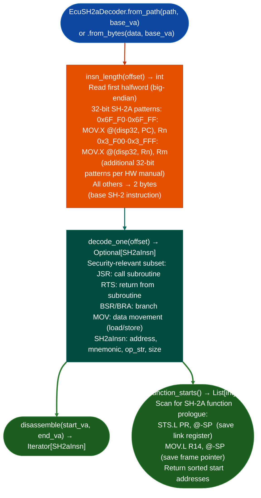

# Renesas SH-2A Decoding

Decode Renesas SH-2A firmware for SH7058/SH7059 MCUs: distinguishing 16-bit fixed-width SH-2 base instructions from 32-bit SH-2A extended instructions by first-halfword pattern analysis, providing `function_starts()` for seeding taint analysis pipelines against Honda, Subaru, and Japanese OEM ECU firmware.

---

## Why this exists

1. **Capstone 5.0.7 does not support SH-2A.** The SH-2A ISA extends the 16-bit SH-2 base with 32-bit instructions, identified by specific first-halfword patterns from the Renesas SH2A Hardware Manual Rev.2.00. Without `EcuSH2aDecoder`, SH-2A firmware cannot be disassembled by any existing Capstone-based pipeline: manual byte parsing or commercial tools are the only options.

2. **SH-2A is the core in Renesas SH7058/SH7059 MCUs found in Honda CBR250RR ECU type 38770-K87-J01 and Subaru targets in the EcuFlash corpus.** `EcuSH2aDecoder` provides the same `function_starts()` interface as `EcuM68kDecoder` and `EcuVLEDecoder`: allowing the same downstream taint analysis pipeline to process SH-2A targets without ISA-specific dispatch.

3. SH-2A instruction width discrimination is first-halfword-based: the upper 4 bits of the first 16-bit halfword identify whether the full instruction is 32-bit. `EcuSH2aDecoder.insn_length(offset)` performs this check in O(1), enabling efficient sequential decoding of large flat ROM images.

---

## How it works



---

## Usage

```python
from ablation.analyzers.ecu_sh2a_decoder import EcuSH2aDecoder

decoder = EcuSH2aDecoder.from_path('/path/to/honda_cbr250rr.bin', base_va=0x00000000)

starts = decoder.function_starts()
print(f"Found {len(starts)} SH-2A functions")

# Disassemble first function
if len(starts) >= 2:
    for insn in decoder.disassemble(starts[0], starts[1]):
        print(f"  {insn.address:#x} ({insn.size}B): {insn.mnemonic} {insn.op_str}")
```

---

## Example output

The following illustrates SH-2A disassembly output format. Actual addresses are ROM-specific.

```
EcuSH2aDecoder: honda_cbr250rr.bin  (base_va=0x00000000)

function_starts(): <N> SH-2A functions found

Disassembly at 0x00000200:
  0x0200 (2B): sts.l  pr, @-sp
  0x0202 (2B): mov.l  r14, @-sp
  0x0204 (4B): mov.l  @(0x1234, r0), r1    (32-bit extended)
  0x0208 (2B): jsr    @r2
```

---

## False positives

**32-bit SH-2A instruction first-halfword patterns may appear in data**: a 16-bit data word matching a 32-bit SH-2A first-halfword causes the decoder to misread the next 2 bytes as part of the instruction. Use `function_starts()` to anchor decode position to validated function entry points.

**`function_starts()` heuristic requires the full `STS.L PR, @-SP` prologue**: leaf functions that do not save the link register no calls inside will not be detected. These functions are present in the binary but not in `function_starts()`; the caller must supplement with call-graph reachability from detected starts.

---

## Pipeline position

Run `EcuSH2aDecoder` after `EcuArchDetector` confirms `sh2a` architecture. Chain with `EcuA2LParser` for Honda/Subaru calibration data analysis. Taint analysis on SH-2A targets requires porting `TaintTracker` patterns to SH-2A ABI R4–R7 argument registers.

---

## Reading output

`EcuSH2aDecoder.function_starts()` returns `List[int]`: VA list of SH-2A functions.

`EcuSH2aDecoder.disassembleva, size` returns a list of `SH2AInstruction` objects:

| Attribute | Content |
|:---|:---|
| `va` | Virtual address |
| `size` | Instruction size in bytes 2 or 4 for 32-bit extended instructions |
| `mnemonic` | SH-2A mnemonic for example `sts.l`, `jsr`, `mov.l` |
| `operands` | Operand string |

---

## See also

- [Flat ROM Function Discovery](flat-rom-function-discovery.md): `EcuArchDetector` that identifies SH-2A architecture
- [M68K CPU32 Decoding](m68k-cpu32-decoding.md): M68K equivalent for GM PCM targets
- [Calibration Parsers](calibration-parsers.md): A2L/open_damos for Honda/Subaru calibration maps
