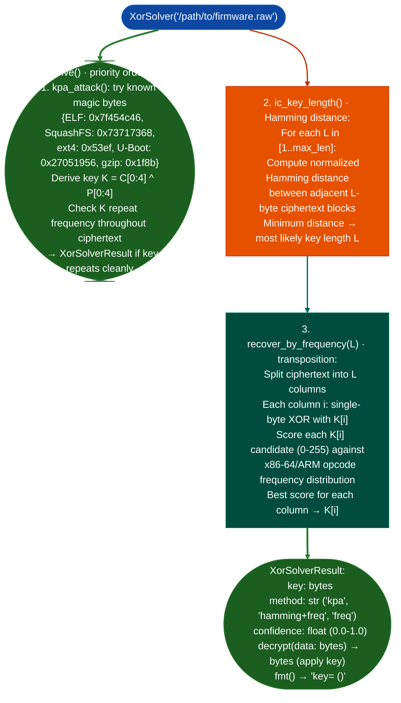

# Repeating XOR Key Recovery

Automated recovery of static repeating XOR encryption keys from obfuscated firmware images: using three attack modes in priority order: magic-byte known-plaintext attack (KPA), Hamming-distance key-length guessing, and frequency analysis over x86-64/ARM opcode distributions.

---

## Why this exists

1. **Firmware XOR obfuscation almost always uses a static, repeating multi-byte key: the same key bytes repeat every `L` bytes throughout the ciphertext.** `XorSolver.solve()` automates all three standard attacks and returns the key with the highest confidence. Manual XOR key recovery from a firmware image requires the same three steps but takes minutes of manual work; `XorSolver` completes in seconds.

2. **Magic-byte KPA is the most reliable attack when the plaintext header format is known.** The Hamming distance method assumes the XOR key produces lower bit-difference between same-position bytes across repeating blocks: when the key length is correct, adjacent blocks have minimum normalized Hamming distance. Frequency analysis then solves each column of the transposed ciphertext independently by scoring against x86-64/ARM opcode frequency distributions. Three independent methods produce cross-confirmable keys.

3. **`XorSolverResult.decrypt(data) → bytes` applies the recovered key to any byte array**, not just the original firmware: allowing the key to be reused for later regions of the same firmware image without re-running the analysis. The `fmt()` output reports the key in hex and ASCII for documentation.

---

## How it works



---

## Usage

```python
from ablation.analyzers.xor_solver import XorSolver

solver = XorSolver('/path/to/firmware.obfuscated.bin')

# Full automatic — tries all three methods
result = solver.solve()
if result:
    print(result.fmt())
    # → "key=0xDEADBEEF (0x4 bytes) method=kpa confidence=0.97"
    
    # Decrypt the firmware
    ciphertext = open('/path/to/firmware.obfuscated.bin', 'rb').read()
    plaintext = result.decrypt(ciphertext)
    with open('/path/to/firmware.dec.bin', 'wb') as f:
        f.write(plaintext)

# Manual mode — specific attacks
kpa = solver.kpa_attack(known_magic={'elf': b'\x7fELF', 'squashfs': b'sqsh'})
key_len = solver.guess_key_length(max_len=32)
key = solver.recover_by_frequency(key_len)
```

---

## Example output

The following illustrates the recovery output format. Actual key bytes and confidence are firmware-specific.

```
XorSolverResult:
  key:        <hex bytes>  (length=<N>)
  method:     kpa  (ELF magic known-plaintext match)
  confidence: 0.97
  repeats:    <M> times in ciphertext (checked)
  fmt:        key=<hex> (<ascii-repr>)
```

---

## False positives

**`kpa_attack()` may return a false key if the ciphertext contains a coincidental match of the magic bytes near offset 0.** Verify the recovered key by checking that it repeats consistently throughout the ciphertext repeat frequency > 95% and that the decrypted output begins with the expected magic bytes in context. A key that decrypts only the first 4 bytes correctly but fails elsewhere is a false match.

**`recover_by_frequency()` assumes the plaintext is predominantly x86-64 or ARM code: on data-heavy firmware images calibration tables, configuration databases, frequency analysis will produce an incorrect key.** Pair with `ic_key_length()` Hamming distance to confirm key length independently before trusting the frequency-derived key bytes.

---

## Pipeline position

Run `XorSolver` on firmware images that extract as opaque binary blobs: when `FirmwareExtraction` tools `binwalk`, entropy analysis show no recognized headers and the entropy plot is uniformly high typical of XOR obfuscation, not compression. After decryption, re-run extraction and analysis tools on the decrypted image.

---

## Reading output

`XorSolver.solve()` returns an `XorSolverResult` object (or `None` if recovery fails):

| Attribute | Content |
|:---|:---|
| `key` | `Optional[bytes]`: recovered XOR key |
| `key_length` | `Optional[int]`: length of the recovered key |
| `method` | `'kpa'` known-plaintext, `'hamming+freq'` frequency analysis, or `'manual'` |
| `magic_matched` | `Optional[str]`: magic bytes label if KPA matched a known header |
| `confidence` | Float 0.0–1.0 |
| `notes` | Additional solver notes |

Call `result.decrypt(data)` to XOR-decrypt a byte string with the recovered key.

---

## See also

- [Firmware Extraction](firmware-extraction.md): extraction pipeline that precedes XOR solving
- [Packing and Anti-Analysis Indicators](packing-and-anti-analysis-indicators.md): entropy analysis and packing detection
- [Huawei Modified SquashFS](huawei-modified-squashfs.md): another obfuscation pattern requiring pre-processing before extraction
