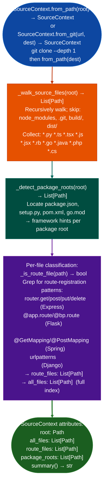

# Repository Ingestion and Search

Build a lightweight `SourceContext` index over a local or remote git repository: categorizing source files by language, identifying route files, and enabling fast text/pattern search: as the source-code analog of `BinaryContext` consumed by all downstream source analyzers, via `ablation/analyzers/source_ingestion.py`.

---

## Why this exists

1. **`BinaryContext` is the session cache for binary analysis; `SourceContext` is the equivalent for source RE.** Without `SourceContext`, each source analyzer would independently walk the repository tree, re-read every file, and detect language/framework independently. `SourceContext.from_path()` builds a cached index of all source files, classified by language and type, in a single pass: consuming ~110ms for a typical medium-size repo (50k LOC).

2. **`SourceContext.route_files`** identifies files that define HTTP routes: Express `router.get/post`, FastAPI `@app.route`, Flask `@bp.route`, Django `urlpatterns`, Spring `@GetMapping/@PostMapping`. `SourceSinkScanner` and `PreAuthRouteAuditor` both query `route_files` as their primary candidate list, rather than scanning the full tree for every session.

3. `SourceContext.from_git()` enables shallow remote cloning: pass a GitHub HTTPS URL and a local destination path; `SourceContext` performs a `git clone --depth 1` and indexes the result. This makes it feasible to analyze a remote dependency or third-party service in seconds without a full clone.

---

## How it works



---

## Usage

```python
from ablation.analyzers.source_ingestion import SourceContext

# From an existing local clone
ctx = SourceContext.from_path('/tmp/langfuse')
print(ctx.summary())

# Clone from remote (shallow)
ctx = SourceContext.from_git('https://github.com/langfuse/langfuse', '/tmp/langfuse')
print(ctx.summary())

# Feed to downstream analyzers
from ablation.analyzers.source_sink_scanner import SourceSinkScanner
scanner = SourceSinkScanner.from_source_context(ctx)
results = scanner.scan()
```

---

## Example output

The following illustrates SourceContext output format.

```
SourceContext: /tmp/langfuse

all_files: <N> source files
route_files: <M> route-defining files
package_roots: <K> (package.json × 2, pom.xml × 1)

Route files (sample):
  src/routes/auth.ts
  src/api/tracing/index.ts
  packages/shared/src/server/routers/...
```

---

## False positives

**`_is_route_file()` is a grep-based heuristic**: files that contain route-registration strings in comments or string literals will be classified as route files. `SourceSinkScanner` applies a second-pass filter when reading route files; the false-positive rate for downstream tools is low.

**`from_git()` requires network access**: if the repository is private or behind a firewall, `git clone` will fail. Use `from_path()` with an existing clone in that case.

---

## Pipeline position

`SourceContext` is always the first step in any source RE session, it replaces `BinaryContext.load_or_build()` for source-code targets. All downstream source analyzers `SourceSinkScanner`, `SourceIsolationChecker`, `PreAuthRouteAuditor`, `MCPToolTaintScanner` accept a `SourceContext` rather than a `BinaryContext`.

---

## Reading output

`SourceContext.from_path(path)` returns a `SourceContext` object:

| Attribute | Content |
|:---|:---|
| `repo_root` | `Path`: root directory of the repository |
| `all_files` | `List[Path]`: all source files, filtered by language extension |
| `route_files` | `List[Path]`: files identified as HTTP route handlers |
| `lang_map` | `Dict[str, List[Path]]`: language name → list of source files |
| `package_roots` | `List[Path]`: monorepo workspace roots (directories with `package.json`) |

---

## See also

- [Source Code Auditing](source-code-auditing.md): `SourceSinkScanner` that consumes `SourceContext`
- [Tenant Isolation Checks](tenant-isolation-checks.md): `SourceIsolationChecker` that uses `route_files` from `SourceContext`
- [Route Authentication Classification](route-authentication-classification.md): `PreAuthRouteAuditor` that queries `SourceContext.route_files`
