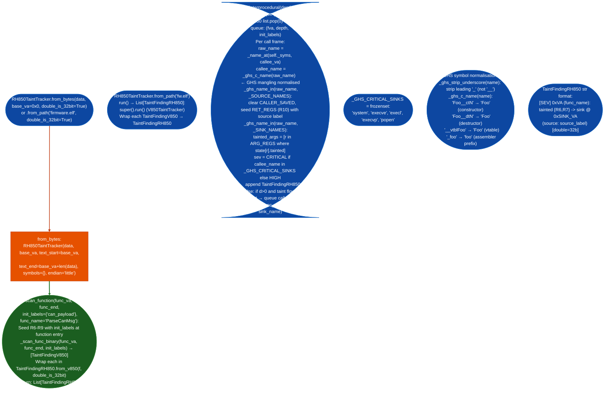

# RH850 Taint Analysis

Tracks user-controlled data from source registers R6–R9 through GHS CC-RH / IAR RH850 ABI binaries to dangerous sinks `system`, `execve`, and `popen` across interprocedural BFS chains. Includes flat-ROM support for ECU firmware dumps and GHS old-style symbol normalisation for `__ct`/`__dt` constructor/destructor call sites.

---

## Why this exists

1. **V850TaintTracker requires a well-formed ELF binary. Denso RH850/G3M and Bosch GS327 ECU firmware ships as flat ROM dumps without ELF headers.** The V850 tracker uses `_load_elf()` which calls `lief.parse()`, which returns `None` for raw binary blobs. `RH850TaintTracker.from_bytesdata, base_va=0x0` skips ELF loading and creates the tracker directly from flat bytes, taking the base virtual address as an explicit parameter. The caller provides function boundaries to `scan_function()` rather than relying on symbol table discovery.

2. **GHS CC-RH and IAR default to `double = 32 bits`, not 64 bits as GCC assumes.** Reference: GHS-RE-REFERENCE.md §2.7. In the GHS CC-RH ABI, a `double` argument occupies one arg register, R6, R7, R8, or R9, not a register pair. V850TaintTracker models the GCC ABI where `double = 64 bits` occupies a pair (R6:R7). For a function `foochar *s, double d`, V850TaintTracker incorrectly marks R7 as the high half of the double, leaving R7 as the taint destination instead of tracking it as the independent argument `d`. `double_is_32bit=True` the default corrects this.

3. **GHS MULTI uses GCC 2.9.x name mangling: constructors are `Foo__ctN`, destructors `Foo__dtN`, which V850TaintTracker's source/sink resolver does not recognise.** A call to `Foo::Foo()` compiled by GHS appears as `CALL Foo__ct1Foo` in the binary. The V850 resolver checks the symbol name against sink/source tables verbatim: `Foo__ct1Foo` is not in `_SINK_NAMES`. `_ghs_c_name()` strips the `__ctN` suffix to recover `Foo`, which can then match a sink pattern. This prevents constructor calls to dangerous classes from being silently ignored.

---

## How it works



### GHS CC-RH ABI

| Register | Role |
|---|---|
| R6, R7, R8, R9 | Argument registers (4 × 32-bit or 4 × 32-bit double when `double_is_32bit=True`) |
| R10 | Return value scalar/pointer; R10:R11 for 64-bit return |
| R31 (LP) | Link register |
| R3 (SP) | Stack pointer |
| R1, R6–R19, LP | Caller-saved |
| R2, R4 (GP), R5 (TP), R20–R29, EP (R30) | Callee-saved |

---

## Usage

```python
from ablation.analyzers.taint_tracker_rh850 import RH850TaintTracker, TaintFindingRH850
from pathlib import Path

# --- Flat ROM usage (ECU firmware dump without ELF) ---
rom = Path('/media/cowboy/research/ECU/denso_rh850_g3m.bin').read_bytes()
tracker = RH850TaintTracker.from_bytes(rom, base_va=0x00000000, double_is_32bit=True)

# Scan one function — caller provides boundaries from prior analysis
findings = tracker.scan_function(
    func_va=0x0001A4C0,
    func_end=0x0001A5F8,
    init_labels={'can_rx_buffer', 'uds_request'},
    func_name='ParseDiagRequest',
)
print(tracker.report(findings))

# --- ELF usage (firmware with symbols) ---
tracker2 = RH850TaintTracker.from_path('/firmware/bosch_gs327.elf', double_is_32bit=True)

# Intraprocedural scan (all symbol-known functions)
all_findings = tracker2.run()

# Interprocedural BFS (follow taint across callee boundaries, depth 4)
chain_findings = tracker2.run_interprocedural(depth=4)
print(tracker2.report(chain_findings))

# Check for CRITICAL sinks specifically
critical = [f for f in chain_findings if f.severity == 'CRITICAL']
for f in critical:
    print(f"[CRITICAL] {f.func_name} → {f.sink_name} @ 0x{f.sink_va:x}")
    print(f"  tainted: {f.tainted_args}  source: {f.source_name}")

# When firmware uses --double=64 (uncommon; verify from compiler flags)
tracker3 = RH850TaintTracker.from_bytes(rom, base_va=0x0, double_is_32bit=False)
```

---

## Example output

```
RH850 taint: 3 finding(s)  [double=32b]

[HIGH] 0x1a4c0 (ParseDiagRequest): tainted {R6, R7} -> snprintf @ 0x1a508
  (source: can_rx_buffer) [double=32b]

[CRITICAL] 0x1a4c0 (ParseDiagRequest): tainted {R6} -> system @ 0x1a5c4
  (source: uds_request) [double=32b]

[HIGH] 0x1b200 (HandleOtaCommand): tainted {R6, R7, R8} -> memcpy @ 0x1b2f0
  (source: uds_request) [double=32b]
```

---

## False positives

**`scan_function()` does not follow calls. Taint may flow into a callee that eventually reaches a sink.** `scan_function()` is intraprocedural only: when a call instruction is encountered, the callee's return registers are marked clean caller-saved are cleared. Taint that flows through a helper function into a sink in that helper is not reported. Use `run_interprocedural(depth=4)` for full chain analysis; reserve `scan_function()` for targeted analysis of specific functions where boundaries are known.

**GHS symbol normalisation `_ghs_c_name()` strips `__ct` / `__dt` suffixes that appear in non-constructor symbols.** Any symbol containing `__ct`, for example `extract_data`, or `__dt`, for example `get_data_length`, will be incorrectly normalised. The implementation searches for the first occurrence of `__ct` or `__dt` as a substring: `extract_data` would become `extra` because `__ct` never appears in that name (it's `ct` without the double underscore). In practice the GHS mangling uses double-underscore separators, but verify manually if a sink matching `extra` or similar appears unexpectedly in findings.

**Flat ROM `from_bytes()` produces zero findings from `run()` because there are no symbols.** `run()` iterates over symbol-discovered function starts from `self._syms`, which is `{}` for flat ROM instances. `run()` returns `[]` silently. Use `scan_function()` with explicit VA ranges, or populate `self._syms` manually: `tracker._syms[va] = 'func_name'` for each function identified from prior analysis.

---

## Pipeline position

**Before this module:** For flat ROM: use `EcuArchDetector` to confirm the binary is RH850. The expected arch string `rh850` is not yet in the detector; use `ppc32` as a placeholder and verify manually. Identify function start addresses using `FuncProfiler.profile()` or a custom prologue scanner for the GHS CC-RH ABI: `push R20`/`push R21`/`movea -N, sp, sp` prologue pattern. For ELF: confirm `e_machine == 0x70` (EM_V850); LIEF reports RH850 under the V850 `e_machine` value.

**After this module:** For `CRITICAL` findings (`system`/`execve`/`popen`): confirm that the taint source is reachable from an external input such as CAN bus, UDS diagnostic interface, or OBD-II port before reporting. Use `PathSolver.solve_path()` for feasibility confirmation. Write findings to `re/<vendor>/<target>_re.py` with the specific register taint path, for example: "R6 = can_rx_buffer + 0x10 flows into system() via ParseDiagRequest → HandleCmd → system".

---

## Reading findings

| Field | Content |
|:---|:---|
| `finding.func_va` | Virtual address of the function containing the taint source and sink |
| `finding.func_name` | Symbol name for `func_va`, or `fn_0x<hex>` if no symbol |
| `finding.sink_va` | Virtual address of the dangerous call instruction |
| `finding.sink_name` | GHS-normalised C name of the called function, for example `system` rather than `_system` |
| `finding.tainted_args` | Arg registers (`R6`–`R9`) that were tainted at the call site |
| `finding.source_name` | Taint label string from `init_labels` that seeded the taint |
| `finding.severity` | `CRITICAL` (in `_GHS_CRITICAL_SINKS`) or `HIGH` |
| `finding.double_is_32bit` | `True` by default; indicates whether double=32b ABI was active |

---

## See also

- [ECU Architecture Detector](ecu-architecture-detector.md): confirm the binary is RH850 before running this tracker
- [V850 Taint Analysis](taint-analysis.md): parent class; provides the intraprocedural scan engine
- [Taint Analysis](taint-analysis.md): general taint tracking reference for ARM/x86/LA64 targets
