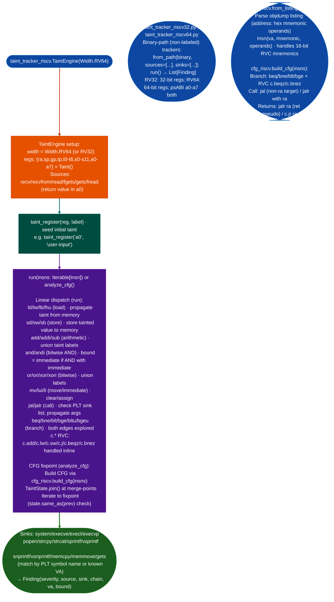

# RISCVTaintTracker

Labeled-taint analysis, CFG-fixpoint dataflow, and structural lifting for RISC-V 32-bit and 64-bit binaries: covering RV32I/M/A/C and RV64GC Linux psABI targets.

---

## Why this exists <sup>[↑](#riscvtainttracker)</sup>

1. RISC-V has two distinct calling convention variants with different register widths. RV32 uses `a0-a7` as 32-bit argument slots; RV64 uses the same register names with 64-bit slots. A tracker that confuses them produces incorrect taint bounds and misses sink arguments. `taint_tracker_riscv32.py` and `taint_tracker_riscv64.py` provide independent ABI-correct implementations. `taint_tracker_riscv.py` adds a labeled-taint `TaintEngine` with a `Width` enum that selects the correct variant at construction.

2. The labeled-taint model in `taint_tracker_riscv.py` provides two capabilities the binary-path trackers lack. Label provenance records which source function tainted each register. Bound tracking records `andi`/`ori` immediate masks in a `bound` field, gating out-of-bounds index findings. `TaintState.join()` merges taint from CFG merge-points, and `analyze_cfg()` runs a fixpoint analysis over `cfg_riscv.py` basic blocks, finding flows that linear traversal misses on loops and conditional branches.

3. RISC-V compressed instructions (RVC, 16-bit `c.*` mnemonics) appear in GCC-compiled RV64GC binaries. A decoder that handles only 32-bit instructions silently skips 16-bit instructions and produces incorrect CFG edges. `insn_riscv.py` handles both encodings in the same decoder. `cfg_riscv.py` correctly resolves `c.j`, `c.beqz`, and `c.bnez` branch instructions to build complete CFGs.

---

## How it works <sup>[↑](#riscvtainttracker)</sup>



### Module inventory <sup>[↑](#riscvtainttracker)</sup>

| Module | Role |
|:---|:---|
| `taint_tracker_riscv.py` | Labeled-taint `TaintEngine` with `Width` enum; CFG fixpoint via `analyze_cfg()`; TCL3 qualified |
| `taint_tracker_riscv32.py` | Binary-path taint tracker for RV32 targets |
| `taint_tracker_riscv64.py` | Binary-path taint tracker for RV64 targets |
| `insn_riscv.py` | RV32/RV64 + RVC instruction decoder; `from_listing()` and `from_capstone()` |
| `cfg_riscv.py` | RISC-V CFG builder: branch/call/return edges; RVC-aware |
| `isa_riscv.py` | ISA constant tables: register names, ABI roles, psABI calling convention |
| `analysis_riscv.py` | `analyze_cfg()`: CFG fixpoint dataflow for labeled taint |

---

## Usage <sup>[↑](#riscvtainttracker)</sup>

```python
from ablation.analyzers.taint_tracker_riscv import TaintEngine, Width

# RISCVTaintTracker
from ablation.analyzers.insn_riscv import from_listing
eng = TaintEngine(Width.RV64)
eng.taint_register("a0", "user")
findings = eng.run(from_listing(objdump_text))
for f in findings:
    print(f"{f.address:#x} [{f.kind}] {f.detail} <- {sorted(f.labels)}")

# RISCVTaintTracker
from ablation.analyzers.analysis_riscv import analyze_cfg
from ablation.analyzers.taint_tracker_riscv import TaintState

init = TaintState(Width.RV64)
init.taint_reg("a0", "user")
result = analyze_cfg(insns, Width.RV64, initial=init)

# RISCVTaintTracker
from ablation.analyzers.taint_tracker_riscv64 import RV64TaintTracker
tracker = RV64TaintTracker.from_path('/path/to/riscv64.elf')
findings = tracker.run()

# RISCVTaintTracker
from ablation.analyzers.binary_lifter import BinaryLifter
lifter = BinaryLifter.from_path('/path/to/rv64.elf', arch='rv64')
print(lifter.lift_function(0x10430))

# RISCVTaintTracker
lifter32 = BinaryLifter.from_path('/path/to/rv32.elf', arch='rv32')
print(lifter32.lift_function(0x10000))
```

---

## Example output <sup>[↑](#riscvtainttracker)</sup>

The following illustrates the format for representative taint findings. Actual values reflect the specific binary.

```
[CRITICAL] read → execve @ <va>
  Chain: read(a0) → addi a1, a0, 0 → jal execve
  Width: RV64; Taint: a0 label={'user'}, bound=None

[HIGH] fgets → sprintf @ <va>
  Chain: fgets(a0) → mv a1, a0 → jal sprintf(a0=<fmt>, a1=tainted)
  Width: RV64; Taint: a1 label={'user'}, bound=None
  Sink: sprintf arg-1 - format string candidate

CFG fixpoint (analyze_cfg):
  Block <va>: a0 = Taint({'user'}, None)
  Block <va> (merge): a0 = join(Taint({'user'}, None), Taint()) = Taint({'user'}, None)
  Block <va>: sink jal strcpy - a1 tainted
```

---

## False positives <sup>[↑](#riscvtainttracker)</sup>

**`andi` with an immediate bounds the taint but does not clear it.** A tainted register masked with `andi a0, a0, 0x3f` has `bound=0x3f` maximum value 63. This is not a false positive, it constrains which sinks are reachable, but a tainted index bounded to 63 can still cause a buffer overflow if the destination buffer is fewer than 64 bytes. The bound is a taint-narrowing signal, not a safe-access guarantee.

**CFG fixpoint analysis on loops may report the same taint path multiple times if the loop body contains a sink.** Each fixpoint iteration that visits a basic block with a sink generates a finding. Deduplicate by `source, sink, va` before reporting.

**`taint_tracker_riscv.py` the labeled-taint TCL3 module and `taint_tracker_riscv64.py` binary-path module have different source/sink lists.** The labeled-taint module's source/sink configuration is in `SOURCES`/`SINKS` constants at module level; the binary-path module accepts `sources=` and `sinks=` constructor arguments. Confirm which module is in use before interpreting findings.

---

## Pipeline position <sup>[↑](#riscvtainttracker)</sup>

**Before this module:** For RVC compressed instruction binaries, confirm that `insn_riscv.from_listing()` or `from_capstone()` parses the 16-bit instructions correctly: `objdump --disassemble-all -M no-aliases` is the recommended listing input for RISC-V. For bare-metal RV32 targets no OS, no glibc, define custom source/sink lists in the binary-path tracker constructor.

**After this module:** Feed confirmed findings into `FindingRegistry.register()`. For CFG fixpoint findings, verify that the taint path is reachable in one concrete execution by checking whether the basic blocks in the chain are connected in the CFG.

---

## Reading findings <sup>[↑](#riscvtainttracker)</sup>

`RISCV64TaintTracker.from_context(ctx).run()` returns `List[TaintFindingRISCV64]`.

| Field | Type | Content |
|:---|:---|:---|
| `binary` | `str` | Binary path |
| `func_va` | `int` | VA of the function containing the sink call |
| `func_name` | `str` | Name of the function (from `ctx`) |
| `sink_va` | `int` | VA of the sink call instruction |
| `sink_name` | `str` | Sink function name for example `system`, `execve` |
| `tainted_args` | `List[int]` | 0-indexed argument positions that are tainted at the call |
| `source_name` | `str` | Taint source label for example `read`, `recv` |

The RISC-V 32-bit tracker (`taint_tracker_riscv32.py`) returns `TaintFindingRISCV32` with the same fields. bound from andi/ori: `int` or `None` if unbounded |

---

## See also <sup>[↑](#riscvtainttracker)</sup>

- [Binary Lifter](binary-lifter.md): `arch='rv32'`/`'rv64'` structural lifting
- [Taint Analysis](taint-analysis.md): general labeled-taint model documentation
- [RH850 Taint Analysis](rh850-taint-analysis.md): V850/RH850 variant; same labeled-taint model
