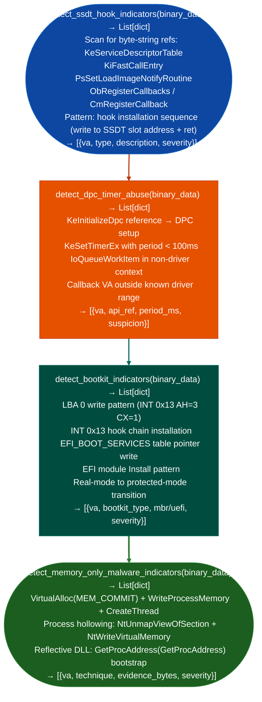

# Rootkit/Bootkit Indicators

Detect kernel hook installation patterns SSDT, KiFastCallEntry, notify callbacks, DPC/timer abuse for persistent kernel execution, bootloader tampering signatures MBR/VBR overwrite, UEFI module injection, and memory-only malware indicators: all through static binary analysis without running the sample: via `modules/forensics_enum.py`.

---

## Why this exists

1. **`detect_ssdt_hook_indicators()` identifies Windows kernel rootkit patterns statically**, it scans binary data for string references to `KeServiceDescriptorTable`, `KiFastCallEntry`, `PsSetLoadImageNotifyRoutine`, `ObRegisterCallbacks`, and `CmRegisterCallback`. These are the hook installation points used by kernel-mode rootkits to intercept system calls, hide processes, and monitor object creation. Presence of these references in a non-driver binary is a strong rootkit indicator.

2. **`detect_dpc_timer_abuse()` identifies covert persistence mechanisms**: kernel rootkits use Deferred Procedure Calls `KeInitializeDpc`, `KeSetTimerEx` and work items (`IoQueueWorkItem`) to schedule malicious callbacks without a visible thread. `detect_dpc_timer_abuse()` scans for these API references alongside suspicious patterns: timer periods below 100ms polling cadence typical of rootkit checkins, callbacks to non-standard driver sections, and `KeSetTimerEx` calls with negative due times immediate execution.

3. **`detect_bootkit_indicators()` covers MBR, VBR, and UEFI-layer persistence**, it scans for disk sector write patterns to LBA 0 MBR overwrite, `INT 0x13` hook installation real-mode bootloader intercept, `EFI_BOOT_SERVICES` table manipulation, and UEFI module installation patterns. Bootkits survive OS reinstallation; detecting them statically from a memory image or disk sector dump is the only analysis path that does not require running the bootkit.

---

## How it works



---

## Usage

```python
from modules.forensics_enum import (
    detect_ssdt_hook_indicators,
    detect_dpc_timer_abuse,
    detect_bootkit_indicators,
    detect_memory_only_malware_indicators
)

data = open('suspicious.sys', 'rb').read()

# All functions return [{severity, title, detail, host, port}]
for h in detect_ssdt_hook_indicators(data):
    print(f"  [{h['severity']}] {h['title']}: {h['detail'][:80]}")

for d in detect_dpc_timer_abuse(data):
    print(f"  [{d['severity']}] {d['title']}: {d['detail'][:80]}")

for b in detect_bootkit_indicators(data):
    print(f"  [{b['severity']}] {b['title']}: {b['detail'][:80]}")
```

---

## Example output

The following illustrates rootkit and bootkit indicator output format.

```
detect_ssdt_hook_indicators: suspicious.sys

  [SSDT] SSDT_OVERWRITE: KeServiceDescriptorTable ref + write sequence at 0x12040
  [SSDT] NOTIFY_CALLBACK: PsSetLoadImageNotifyRoutine ref at 0x13200

detect_dpc_timer_abuse:

  [DPC] KeSetTimerEx: period=50ms (polling rootkit cadence)

detect_bootkit_indicators:

  [BOOTKIT] MBR_OVERWRITE: INT 0x13 AH=3 to LBA 0 at 0x1000
```

---

## False positives

**Security products use the same kernel hooks**: endpoint detection software, antivirus kernel drivers, and game anti-cheat all use `ObRegisterCallbacks` and `PsSetLoadImageNotifyRoutine` for legitimate monitoring. `detect_ssdt_hook_indicators()` flags the pattern without knowing whether the binary is malicious. Correlate with the binary's signing certificate and module path before concluding.

**DPC period thresholds**: legitimate kernel drivers use short DPC periods for hardware polling NIC drivers, storage controllers. Filter DPC findings by driver category system32/drivers vs. non-standard paths before concluding that a short timer period indicates malicious activity.

---

## Pipeline position

Run rootkit/bootkit indicator analysis on any kernel driver binary (`*.sys`), memory image, or disk sector dump obtained from a potentially compromised host. Results feed into `detect_windows_forensic_artifacts()` for timeline correlation.

---

## Reading findings

`detect_ssdt_hook_indicators()`, `detect_dpc_timer_abuse()`, and `detect_bootkit_indicators()` return `List[{severity, title, detail}]`:

| Field | Content |
|:---|:---|
| `severity` | `HIGH` |
| `title` | Finding code for example `SSDT_OVERWRITE`, `NOTIFY_CALLBACK`, `BOOTKIT_PARTITION_READ` |
| `detail` | VA, function name, or detected pattern description |

---

## See also

- [Windows Artifact Discovery](windows-artifact-discovery.md): filesystem timeline artifacts $MFT, LNK, Prefetch, EVTX for correlation
- [Packing and Anti-Analysis Indicators](packing-and-anti-analysis-indicators.md): obfuscation patterns that accompany rootkit dropper binaries
