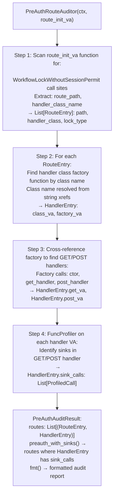

# Route Authentication Classification

Automate the 4-step pre-authentication route discovery process for flatui-based firmware web frameworks — scanning route init functions for `WorkflowLockWithoutSessionPermit`-only registrations, extracting handler class names, cross-referencing handler factories to find GET/POST handler VAs, and running `FuncProfiler` on each handler to surface dangerous sinks.

---

## Why this exists

1. **Pre-authentication route auditing is a 4-step manual process in flatui-based frameworks: find routes registered without session permission checks, map them to handler classes, find each class's GET/POST handler VA, and profile the handler for sinks.** `PreAuthRouteAuditor` automates all four steps in a single call, reducing 4–8 hours of manual web framework RE to under 5 minutes on a new firmware version.

2. **`WorkflowLockWithoutSessionPermit` is the specific registration pattern that marks a route as pre-authentication reachable** — routes using `WorkflowLockWithSession` are only reachable after login. `PreAuthRouteAuditor` scans for the former and explicitly excludes the latter, producing a list of routes that any attacker (unauthenticated) can reach directly.

3. **`PreAuthAuditResult.preauth_with_sinks()` returns only routes that have dangerous sinks** — this is the final triage filter that separates interesting routes (reachable pre-auth AND contain exec/file/network sinks) from uninteresting ones (reachable pre-auth but only render static content). The result is a direct input to vulnerability hypothesis generation.

---

## How it works



---

## Usage

```python
from ablation.analyzers.preauth_route_auditor import PreAuthRouteAuditor
from ablation.analyzers.binary_context import BinaryContext

ctx = BinaryContext.load_or_build('/path/to/httpsd')

# Find route init function VA (via SemanticSearcher or manual identification)
route_init_va = ctx.export_va('route_init') or 0x12340

auditor = PreAuthRouteAuditor(ctx, route_init_va)
result = auditor.audit()
print(result.fmt())

# Filter to only pre-auth routes with sinks
dangerous = result.preauth_with_sinks()
print(f"Pre-auth routes with sinks: {len(dangerous)}")
for route, handler in dangerous:
    print(f"  {route.path}  [{route.lock_type}]")
    for sink in handler.sink_calls:
        print(f"    sink: {sink.target_name} at {sink.site_va:#x}")
```

---

## Example output

The following illustrates the audit output format. Actual routes and handlers are binary-specific.

```
PreAuthRouteAuditor: httpsd

Pre-authentication routes (WorkflowLockWithoutSessionPermit):
  /api/v1/status         handler: StatusHandler     GET: <va>  POST: <va>
  /api/v1/license/upload handler: LicenseHandler    GET: <va>  POST: <va>  [SINK: system at <va>]
  /api/v1/config/import  handler: ConfigHandler     GET: <va>  POST: <va>  [SINK: popen at <va>]

preauth_with_sinks(): 2 routes (LicenseHandler, ConfigHandler)
```

---

## False positives

**Step 2 (handler class factory resolution) depends on string xref quality** — if `BinaryContext` lacks string xrefs for the binary (e.g., it was analyzed without `build_xref_index()`), handler class names will not be resolved and `HandlerEntry.factory_va` will be `None`. Run `ctx.build_xref_index(binary_path)` before running `PreAuthRouteAuditor` on a new binary.

**`WorkflowLockWithoutSessionPermit` detection is pattern-based** — a custom lock type that does not match the known string will be missed. If the audit returns zero pre-auth routes for a binary known to have them, inspect the route init function manually to find the lock type string used.

---

## Pipeline position

Run `PreAuthRouteAuditor` after `SemanticSearcher` has identified the web framework type and confirmed this is a flatui-based binary. The output feeds directly into `LLM Analyst Loop` hypothesis generation for the discovered pre-auth+sink routes.

---

## See also

- [Single Function Profiling](single-function-profiling.md) — `FuncProfiler` used in Step 4 to find sinks in handler functions
- [HTTP Method Enum Recovery](http-method-enum-recovery.md) — identifies HTTP method dispatch tables in the same binary
- [CMDB to Sink Mapping](cmdb-to-sink-mapping.md) — FortiOS-specific CMDB route-to-exec-sink analysis
