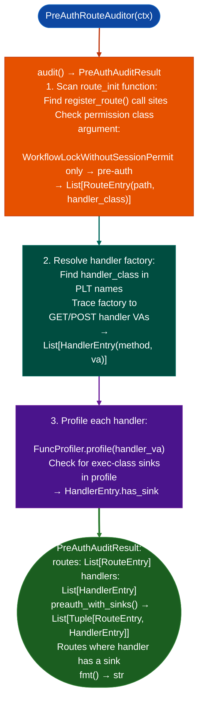

# Pre-Authentication Route Auditing

Automate the four-step process of identifying pre-authentication attack surface in firmware web frameworks: scanning the route initialization function for `WorkflowLockWithoutSessionPermit`-only routes, extracting handler class names, cross-referencing handler factories to resolve GET/POST handler VAs, and running `FuncProfiler` on each handler to surface exec-class sinks.

---

## Why this exists

1. **Pre-authentication routes are the highest-priority attack surface in firmware web interfaces**: they are reachable without any credential and represent the shortest path to unauthenticated RCE. The four-step manual process (route scan → handler class extraction → factory cross-reference → FuncProfiler) was performed by hand across multiple sessions before `PreAuthRouteAuditor` automated it.

2. **`WorkflowLockWithoutSessionPermit` is the specific route permission class used in flatui-based frameworks to mark routes that do not require an authenticated session.** Routes registered with only this permission class: without `WorkflowLock` or `RequireLogin`: are pre-auth. `PreAuthRouteAuditor.audit()` finds all such routes in the route initialization function and returns their handler VAs in one call.

3. **`PreAuthAuditResult.preauth_with_sinks()` returns only routes where the handler function contains a sink**: filtering out the majority of pre-auth routes that serve static resources, login pages, or health-check endpoints. This focuses the analyst's attention on the routes where a pre-auth finding is exploitable.

---

## How it works



---

## Usage

```python
from ablation.analyzers.preauth_route_auditor import PreAuthRouteAuditor
from ablation.analyzers.binary_context import BinaryContext

ctx = BinaryContext.load_or_build('/path/to/httpd')
auditor = PreAuthRouteAuditor(ctx)

result = auditor.audit()
print(result.fmt())

# High-priority: pre-auth routes with sinks
for route, handler in result.preauth_with_sinks():
    print(f"PRE-AUTH SINK: {route.path}  {handler.method} at {handler.va:#x}")
```

---

## Example output

The following illustrates pre-auth route audit output format. Actual routes and VAs are binary-specific.

```
PreAuthRouteAuditor: httpd

Pre-auth routes: <N>
  /api/v2/login    handler_class=LoginHandler
  /api/v2/status   handler_class=StatusHandler
  /api/v2/upload   handler_class=UploadHandler

Handlers with sinks: <M>
  /api/v2/upload  POST  handler_va=<va>
    sink: system() at <va>  (ARG_PROPAGATED)
```

---

## False positives

**`WorkflowLockWithoutSessionPermit` detection uses PLT name matching**: if the target uses a different permission class name or checks session validity via a different mechanism, pre-auth routes will not be detected. Verify the permission class name from the binary's string table before running the auditor.

**`FuncProfiler` sink detection in handler functions may produce `RODATA_CONST` verdict**: a route with a `system()` call where the argument is a string literal is reported as `has_sink=True` but the finding is not exploitable. `preauth_with_sinks()` includes all sink verdicts; filter to `ARG_PROPAGATED` and `UNKNOWN` for exploitable pre-auth candidates.

---

## Pipeline position

Run `PreAuthRouteAuditor` immediately after `BinaryContext.load_or_build()` for any firmware binary known to serve an HTTP interface httpd, lighttpd, nginx-based. This is the Phase 0.5 triage step before `TaintTracker` runs on identified handler VAs.

---

## Reading findings

`PreAuthRouteAuditor.audit()` returns a list of `RouteEntry` objects:

| Attribute | Content |
|:---|:---|
| `url` | URL path string for example `'/api/v2/upload'` |
| `handler` | Handler name string |
| `middleware` | Middleware name string empty if none |
| `method_ids` | `List[int]`: HTTP method ID list |
| `url_reg_va` | VA of the URL registration call |
| `handler_reg_va` | VA of the handler registration call |
| `middleware_va` | VA of the middleware registration |
| `is_preauth` | `True` if the route has no session/permission check |

---

## See also

- [Apache Module Analysis](http-method-enum-recovery.md): `ApacheModuleAnalyzer` for Apache module auth hook analysis
- [Single-Function Profiling](single-function-profiling.md): `FuncProfiler` that `PreAuthRouteAuditor` calls per handler
- [Named Taint Sources and Bounds](named-taint-sources-and-bounds.md): `TaintTracker` for confirmed pre-auth handler dataflow
