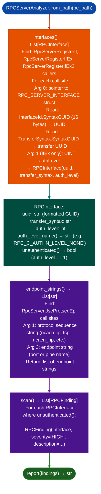

# Windows RPC Server Analysis

Enumerate Windows RPC server interfaces registered in a PE binary: extracting interface UUIDs, authentication levels, and transport endpoint strings, and report unauthenticated RPC interfaces (those registered with `RPC_C_AUTHN_LEVEL_NONE`) as HIGH findings.

---

## Why this exists

1. **Windows RPC interfaces registered with `RPC_C_AUTHN_LEVEL_NONE` (`authLevel=1`) accept calls from any unauthenticated network or local caller, regardless of Windows firewall or SMB authentication.** `RPCServerAnalyzer.scan()` identifies these interfaces by reading the `RPC_SERVER_INTERFACE` struct from the `RpcServerRegisterIf/IfEx/IfEx2` call site argument, enabling pre-auth attack surface enumeration without manual PE debugging.

2. **`RPCServerAnalyzer.interfaces()` returns all registered interfaces with their UUID and auth level, enabling differential analysis between service versions.** A patch that raises the auth level from `NONE` to `PKT_PRIVACY` closes a pre-auth RPC attack vector, this is verifiable statically across versions by comparing `RPCInterface.auth_level_name()` output.

3. `RPCServerAnalyzer.endpoint_strings()` extracts transport endpoint strings from `RpcServerUseProtseqEp` call sites: returning named pipe paths (`\\pipe\\svcname`), TCP port numbers, and ALPC endpoint names. Combined with interface UUID and auth level, this provides the complete pre-auth attack surface: which interface, over which transport, with which authentication requirement.

---

## How it works



---

## Usage

```python
from ablation.analyzers.rpc_server_analyzer import RPCServerAnalyzer

analyzer = RPCServerAnalyzer.from_path('/path/to/windows_service.dll')

# All registered interfaces
for iface in analyzer.interfaces():
    print(f"  {iface.uuid}  auth={iface.auth_level_name()}  unauthenticated={iface.unauthenticated()}")

# Endpoint strings
for ep in analyzer.endpoint_strings():
    print(f"  endpoint: {ep}")

# Unauthenticated interface findings
findings = analyzer.scan()
if findings:
    print(RPCServerAnalyzer.report(findings))
```

---

## Example output

The following illustrates the RPC analysis output format. Actual UUIDs and transport strings are binary-specific.

```
RPCServerAnalyzer: windows_service.dll

Interfaces:
  <uuid-1>   auth=RPC_C_AUTHN_LEVEL_NONE   unauthenticated=True
  <uuid-2>   auth=RPC_C_AUTHN_LEVEL_PKT    unauthenticated=False

Endpoints:
  ncacn_np:\\pipe\<service-pipe>
  ncacn_ip_tcp:<port>

Findings (1):
  [HIGH] Unauthenticated RPC interface
    Interface: <uuid-1>
    Auth level: RPC_C_AUTHN_LEVEL_NONE (1)
    Transport: ncacn_np:\\pipe\<service-pipe>
```

---

## False positives

**`RpcServerRegisterIf` (without `Ex`) does not take an auth level argument**: the auth level defaults to `RPC_C_AUTHN_LEVEL_DEFAULT` (0), which inherits from the process security descriptor, not `NONE`. `RPCInterface.unauthenticated()` returns `False` for these interfaces; only `RpcServerRegisterIfEx` with an explicit `authLevel=1` argument generates a HIGH finding.

**Arg reading uses static analysis**: if the auth level argument to `RpcServerRegisterIfEx` is passed through a register loaded at runtime for example from a config file, `RPCInterface.auth_level` may be `None` and `unauthenticated()` returns `False`. Treat `None` auth-level interfaces as requiring manual verification.

---

## Pipeline position

Run `RPCServerAnalyzer` on any Windows service DLL or EXE with `RpcServer*` imports as part of initial pre-auth surface enumeration. Unauthenticated interface findings (`severity='HIGH'`) qualify for taint analysis via `FuncProfiler` on the corresponding RPC method dispatch function VAs.

---

## Reading findings

`RPCServerAnalyzer.scan()` returns a list of finding dicts:

| Field | Content |
|:---|:---|
| `severity` | `HIGH` unauthenticated interface / `MEDIUM` exposed endpoint |
| `title` | Finding code such as `RPC_UNAUTHENTICATED_INTERFACE` and `RPC_NULL_SESSION_TRANSPORT` |
| `detail` | UUID, auth level, and transport endpoint |
| `uuid` | RPC interface UUID string |
| `auth_level` | `RPC_C_AUTHN_LEVEL_NONE` or higher auth level constant |
| `unauthenticated` | `True` if no authentication is required |

`RPCServerAnalyzer.interfaces()` returns `List[{uuid, auth_level, unauthenticated}]`.

---

## See also

- [BYOVD Capability Detection](byovd-capability-detection.md): dangerous kernel import detection for signed drivers
- [Control Flow Guard Review](control-flow-guard-review.md): CFG/XFG bypass analysis for Windows PE targets
- [Route Authentication Classification](route-authentication-classification.md): pre-auth route auditing for embedded web frameworks
