# RSA/ECDSA and Randomness Checks

Identify hash algorithm implementations in compiled ARM32/Thumb2 code from K-table constants, detect hand-rolled AES-CBC in embedded firmware, check for weak RNG seeding patterns (`srand(time(NULL))`) and `rand()` calls without seeding, test ECDSA/RSA key material for small subgroup, low-entropy, or repeated-nonce weaknesses, and detect birthday collision risk in hash function selection: via `ablation/analyzers/crypto_pattern_detector.py` and `modules/crypto_audit.py`.

---

## Why this exists

1. `HashAlgoDiscriminator` identifies hash implementations from K-table constants in ARM32 Thumb2 binary code: SHA-256's round constant `0x428a2f98`, MD5's `0xd76aa478`, and SHA-512's `0x428a2f98d728ae22` (64-bit) appear as 4-byte or 8-byte immediate loads in compiled code. `HashAlgoDiscriminator.scan()` builds a histogram of matching constants and returns the algorithm identity with a confidence score. This is the primary method for identifying which hash algorithm an unstripped or stripped embedded binary implements, before attempting to reverse-engineer the actual algorithm flow.

2. `CustomCBCDetector` identifies hand-rolled AES-128-CBC: in embedded firmware, developers frequently implement AES-CBC directly in ARM32/Thumb2 instead of using a library. The canonical pattern is: a BSS-tracked pointer to the current cipher block, XOR with the previous ciphertext block chaining step, and IV loaded from a `.rodata` address. `CustomCBCDetector.scan()` identifies this pattern and returns the IV address, the block pointer, and the chaining XOR instruction. Hand-rolled CBC implementations are prime candidates for padding oracle vulnerabilities, IV reuse, and missing authentication.

3. **`check_rng_weakness()` and `miller_rabin_primality()`** in `crypto_audit.py` detect mathematical weaknesses in key material: `check_rng_weakness()` scans binary data for `srand(time(NULL))` predictable seed and `rand()` without preceding `srand` unseeded, deterministic output. `miller_rabin_primality()` and `check_weak_prime()` test RSA prime factors for small prime values, GCD weakness ROCA-style, and Fermat primality failures that indicate a weak prime generation implementation.

---

## How it works

```mermaid
flowchart TD
    A(["HashAlgoDiscriminator(data: bytes, base_addr: int)\n  .scan() → List[HashAlgoMatch]\n  Scan for K-table constants:\n    SHA-256: 0x428a2f98, 0x71374491, 0xb5c0fbcf ...\n    MD5: 0xd76aa478, 0xe8c7b756, 0x242070db ...\n    SHA-1: 0x5a827999, 0x6ed9eba1, 0x8f1bbcdc ...\n    SHA-512: 64-bit K constants\n  Histogram confidence: N_found / N_total > 0.8\n  → [{algo, confidence, const_va, first_const_va}]"]):::input --> B["CustomCBCDetector(data, base_addr, cs_md: int)\n  .scan() → List[CBCPattern]\n  Pattern: BSS ptr load + VLDM/VLDMIA block load\n    XOR with prev CT (VEOR instruction)\n    VST1 store + ptr update\n    IV from .rodata (LDR immediate offset)\n  → [{iv_va, iv_value, block_ptr_va, chain_xor_va}]"]:::primary
    B:::primary --> C["check_rng_weakness(binary_data: bytes) → list\n  Regex scan on ASCII-decoded binary:\n    rand()/srand()/random() refs → WEAK_RNG_LIBC_RAND (HIGH)\n    srand(time(...)) or 10-digit Unix timestamp literal → TIME_SEEDED_RNG (CRITICAL)\n    /dev/random present but /dev/urandom absent → DEV_RANDOM_BLOCKING_RNG (MEDIUM)\n    Math.random in binary → MATH_RANDOM_WEAK_RNG (HIGH)\n    RC4 strings + rand() refs → RC4_WITH_WEAK_RNG (CRITICAL)\n  → [{severity, title, detail, host: 'localhost', port: 0}]\n\ncheck_weak_prime(n) → dict\n  miller_rabin_primality(n, rounds=5) → bool\n  Fermat test: a^(n-1) mod n != 1 → composite\n  GCD(n, common_small_primes_product) > 1 → small factor\n  → {prime: bool, fermat_fail: bool, small_factor: int|None}"]:::secondary
    C:::secondary --> D(["check_birthday_collision_risk(hash_bits, num_samples) → dict\n  Birthday bound: P(collision) ≈ 1 - e^(-n²/2m)\n    m = 2^hash_bits\n  Flag: P > 0.01 for MD5 (128-bit) with >18M samples\n  Flag: P > 0.01 for SHA-1 (160-bit) with >300M samples\n  → {hash_bits, num_samples, collision_prob, safe: bool}"]):::output
    classDef input     fill:#0d47a1,stroke:#1565c0,color:#fff
    classDef primary   fill:#e65100,stroke:#bf360c,color:#fff
    classDef secondary fill:#004d40,stroke:#00695c,color:#fff
    classDef tertiary  fill:#4a148c,stroke:#6a1b9a,color:#fff
    classDef neutral   fill:#37474f,stroke:#546e7a,color:#fff
    classDef output    fill:#1b5e20,stroke:#2e7d32,color:#fff
    linkStyle 0 stroke:#bf360c,stroke-width:2px
    linkStyle 1 stroke:#00695c,stroke-width:2px
    linkStyle 2 stroke:#2e7d32,stroke-width:3px
```



---

## Usage

```python
from ablation.analyzers.crypto_pattern_detector import (
    HashAlgoDiscriminator, CustomCBCDetector
)
from modules.crypto_audit import check_rng_weakness

# Hash algorithm identification in a specific function
# HashAlgoDiscriminator(binary, load_addr=0) — parameter is load_addr, not base_addr
data = open('firmware.bin', 'rb').read()
discriminator = HashAlgoDiscriminator(data, load_addr=0x08000000)
# scan_function(va, size) → HashAlgoMatch (algo, confidence, matched)
# Typically called from a BinaryContext sweep that provides candidate VAs
match = discriminator.scan_function(va=0x080a2000, size=0x200)
# HashAlgoMatch fields: algo (str), confidence (int 0-100), matched (List[ConstMatch])
print(f"  {match.algo}: confidence={match.confidence}  matches={[m.name for m in match.matched[:4]]}")

# CustomCBCDetector.scan_range(va, size) → List[CBCPattern]
cbc = CustomCBCDetector(data, load_addr=0x08000000)
for pattern in cbc.scan_range(va=0x080a2000, size=0x1000):
    print(f"  Custom CBC: loop_va={pattern.loop_va:#x}  confidence={pattern.confidence}")

# Binary RNG weakness scan — returns [{severity, title, detail, host, port}]
for w in check_rng_weakness(data):
    print(f"  [{w['severity']}] {w['title']}: {w['detail'][:80]}")
```

---

## Example output

The following illustrates RSA/ECDSA and randomness check output format.

```
HashAlgoDiscriminator: firmware.bin (base=0x08000000)

  SHA-256: confidence=0.94  first constant at 0x080a2400
  MD5: confidence=0.87  first constant at 0x080a3000

CustomCBCDetector:

  Custom AES-CBC: IV at 0x080b1000  block_ptr=0x200014e0  chain_XOR at 0x080a2680

check_rng_weakness:

  [CRITICAL] TIME_SEEDED_RNG: TIME_SEEDED_RNG — predictable seed: srand(time(...)) ...
```

---

## False positives

**`HashAlgoDiscriminator` constant collisions**: the round constants for CRC32 and some checksum algorithms partially overlap with SHA-256 K-table prefixes. A confidence score below 0.85 should be treated as ambiguous. Cross-reference with the function size and calling context to confirm the algorithm.

**`CustomCBCDetector` requires ARM32 Capstone handle**: the CBC pattern scanner uses Capstone for instruction-level analysis. On firmware with a different architecture MIPS32, ARM64, the pattern definitions do not apply and `scan()` returns an empty list. This is correct behavior, not a false negative.

---

## Pipeline position

Run hash algorithm and CBC detection during firmware static analysis after `scan_firmware_signatures()` establishes the binary layout. RNG weakness detection applies to any binary where key generation is suspected.

---

## Reading output

`HashAlgoDiscriminator.scan()` returns a list of `HashAlgoMatch` objects:

| Attribute | Content |
|:---|:---|
| `algo` | Algorithm name for example `'SHA256'`, `'MD5'`, `'CRC32'` |
| `confidence` | Integer 0–100: confidence score based on K-table constant coverage |
| `matched` | `List[ConstMatch]`: each matched constant with `.va` (address) and `.name` constant name |

`CustomCBCDetector.detect()` returns `{iv_va, block_ptr, chain_xor_va}` or `None`.

---

## See also

- [SAML and Key Material Review](saml-and-key-material-review.md): `KeyCryptoAnalyzer` for PEM-embedded key material extraction
- [JWT Analysis and Weak Secret Testing](jwt-analysis-and-weak-secret-testing.md): HS256 weak secret detection in token-based authentication
