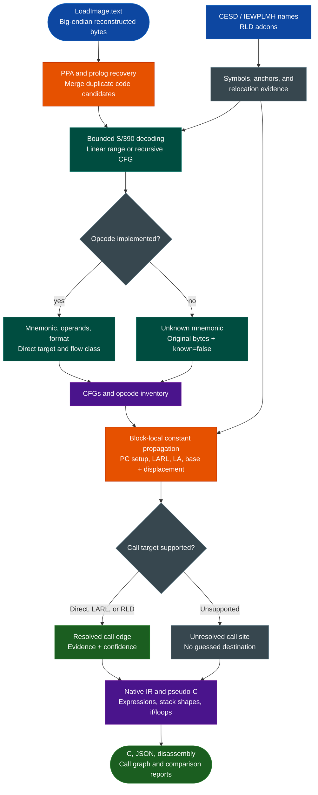

<a id="s390-disassembly-decompilation"></a>
# S/390 Disassembly, Decompilation & Variants

Decode big-endian S/390 and selected z/Architecture instructions from IBM z/OS load images, recover LE/C++ PPA and linkage-variant functions, resolve evidence-backed calls, build bounded control-flow graphs, and emit source-linked pseudo-C without an external disassembler, decompiler, or RE framework.

The native backend implements instruction decoding, PPA/prolog recovery, call graphs, opcode inventory, and a conservative decompiler. It does not depend on Capstone, Ghidra, Radare2, or an adapter.

---

## Why this exists

1. **Container extraction is only the first step.** After NETDATA and PDS/PDSE processing, an analyst needs native instruction decoding, function evidence, relocation-aware linkage, and control flow. These stages work directly on `LoadImage.text`; no ELF or PE wrapper is required.

2. **S/390 analysis needs more than an opcode table.** LE/C++ PPA records, non-XPLINK and XPLINK linkage, RLD adcons, and compiler base-register sequences provide independent evidence. Keeping those evidence classes separate prevents a guessed address from looking like a resolved call.

3. **Control-flow correctness determines analysis quality.** Conventional returns, `BALR 1,14`, program-counter-only `BALR/BASR` setup, and mask-zero branches must not be treated as ordinary calls or branches. Correcting these semantics prevents large amounts of inline data from being decoded as code.

4. **Unknowns must remain visible.** Unsupported opcodes retain their bytes and `known=false`. Unknown decompiler operations, unresolved calls, indirect branches, medium-confidence prologs, and incomplete CFGs are explicit rather than silently repaired.

5. **The implementation is self-contained.** Decoder, relocation, call-graph, decompiler, comparison, and inventory logic use only the Python standard library and can be inspected, tested, and maintained with Ablation.

---

## How it works



Reported addresses are RVAs into reconstructed `text.bin`, not raw member-file offsets. See [IBM z/OS Artifact Analysis](ibm-zos.md#address-and-mapping-model) for container reconstruction and chunk mappings.

---

## Supported variants and evidence layers

The README's concise “Variants” column combines instruction encoding with metadata and linkage conventions. LE/C++ PPA and XPLINK are not separate CPU architectures.

| Variant or layer | Current support | Confidence and boundary |
|---|---|---|
| Big-endian S/390 | Length-derived RR, RX, RS, SI, RI, RIL, RRE, RXY, RSE, and SS decoding | Selective opcode coverage; unknown instructions remain explicit |
| Selected z/Architecture | 64-bit register operations, extended immediates, PC-relative memory operations, `E3`/`EB` forms, and signed 20-bit RXY displacements | Not a complete z/Architecture implementation |
| LE PPA | `PPA_LE` trampoline recognition, signed PPA1 resolution, code RVA, names, and frame metadata | High-confidence function evidence, not complete-boundary proof |
| C++ PPA | `PPA_CPP` recognition with signed offsets and CP500 names | High-confidence function evidence; malformed records are skipped |
| Non-XPLINK linkage | Conventional save/store prolog candidates | Medium-confidence `SAVE_STORE_PROLOG`; requires corroboration |
| XPLINK linkage | Register-4 `st`, `stm`, `sty`, `stg`, and `stmg` save candidates | Medium-confidence `XPLINK_SAVE_STORE`; not every prolog shape is covered |
| CESD symbols | Section, program, and label symbols can name candidates and provide anchors | An entry field or label alone is not promoted to a function |
| IEWPLMH names | Printable and binary `IEWBXLF NAME` inventories with no inferred RVA | Name evidence only; no address is invented |
| RLD adcons | Full and repeated-pointer entries, A/V types, direction, target, resident, and resolved status | External/unresolved targets remain unresolved |
| Pseudo-C | Expressions, stack-shaped references, comparisons, calls, returns, guarded if/else regions, and multi-block loops | Prototypes and types are estimates; complex CFGs retain labels and gotos |
| Function-pointer sites | Register expressions, resolved targets where supported, and indirect-call metadata | Unresolved pointers remain unresolved; no destination is invented |

PPA evidence takes precedence at an entry collision, and a prolog at a PPA function's `code_rva` is merged rather than emitted as a duplicate function. `next_entry_rva` is only the next recovered PPA entry, not a proven function end.

---

## Instruction decoding

### Length and format model

The decoder derives length from the first two bits and then applies an opcode handler.

| First two bits | Instruction length |
|---|---:|
| `00` | 2 bytes |
| `01` or `10` | 4 bytes |
| `11` | 6 bytes |

| Internal format | Implemented examples | Operand model |
|---|---|---|
| RR | `lr`, `ar`, `clr`, `balr`, `bcr` | Two registers; return, call, and branch-mask semantics |
| RX | `l`, `st`, `la`, `a`, `c`, `bc`, `bal` | Register plus base/index/displacement |
| RS | `stm`, `lm`, shifts, `clm`, `icm` | Register, register/mask, and base/displacement; the third register is not an index |
| SI | `cli`, `mvi`, `tm`, `ni`, `oi`, `xi` | Immediate plus base/displacement |
| RI `A5` | `iihh`, `nilh`, `oill`, `llill` | Register plus unsigned 16-bit immediate |
| RI `A7` | `tmll`, `brc`, `bras`, `brct`, `lhi`, `aghi` | Register or mask plus immediate; supported relative targets |
| RIL `C0` | `larl`, `brcl`, `brasl`, `lgfi`, `iilf`, `xilf` | Register or mask plus signed/unsigned 32-bit immediate |
| RIL `C2` | `msgfi`, `msfi`, `agfi`, `alfi`, `cgfi`, `clgfi` | Extended arithmetic and comparison immediates |
| RIL `C4`/`C6` | `lgrl`, `stgrl`, `exrl`, `cgrl`, `clgrl` | PC-relative targets |
| RRE | `lgr`, `ltgr`, `mvst`, `clst`, `srst`, `alcr` | Extended opcode plus two registers |
| RXY `E3` | `lg`, `stg`, `ly`, `sty`, `lay`, `llgf`, `bic` | Base/index plus signed 20-bit displacement |
| RSE `EB` | `lmg`, `stmg`, `clmh`, `icmh` | Extended opcode, register/mask, and base/displacement |
| SS | `mvc`, `clc`, `tr`, `trt`, `pack`, `zap`, `ap` | Two storage operands plus encoded operand/length byte |

The format labels are internal decoder categories, not a claim to implement every instruction in those IBM families. Unsupported opcodes remain unknown rather than receiving invented mnemonics.

### Linkage and flow semantics

- `BCR 15,14` and `BALR` with second register 14 and a non-14 first register model conventional returns.
- `BALR/BASR` with second register zero is a program-counter/base setup, not automatically a call.
- Mask-zero `BCR`, `BC`, `BRC`, `BRCL`, and `BIC` paths do not branch.
- Direct conditional branches retain fall-through. Calls do not absorb the callee into the caller's CFG.
- Unknown instructions retain raw bytes and `known=false`; unsupported code and inline data are not assigned semantics.

Each structured instruction includes `address`, `hex`, `mnemonic`, `operands`, `format`, `known`, optional `target`, and flow class `next`, `call`, `conditional_jump`, `jump`, or `return`.

---

## Call graphs

```bash
python3 -m ablation.ibm_zos callgraph PROGRAM.bin CALLGRAPH_DIR --maximum 20000
python3 -m ablation.ibm_zos callgraph PROGRAM.bin CALLGRAPH_DIR --sid SIDE1.bin SIDE2.bin
```

The resolver uses only supported evidence:

| Evidence | Meaning |
|---|---|
| `direct:MNEMONIC` | Target is encoded directly in the call instruction |
| `larl` | A register is assigned a PC-relative target before an indirect call |
| `la_symbol` | A computed address matches a known symbol |
| `rld:0x...` | A base-plus-displacement load resolves through a resolved RLD adcon |
| `summary:0x...` | A callee returns a constant or target proven by straight-line code |
| `external_rld:0x...` | An unresolved external RLD reference; no target address is inferred |

Block-local constant propagation tracks program-counter setup, `LARL`, `LA/LAY`, register copies, and base/index values. State is discarded at joins and after calls when it cannot be propagated safely. Straight-line return summaries propagate only constants or targets proven within the callee. Other functions, branches, unknown instructions, and unresolved calls do not receive summaries.

`external_calls` preserves unresolved external RLD references separately from `unresolved_calls`. Optional `--sid` arguments add `binder_links` with DLL, side-deck, original and demangled names, and normalized-name matches. These links are name relationships, not address or DLL-ownership proof.

Outputs are `callgraph.json` and `callgraph.txt`. Nodes retain function evidence; edges retain site, target, target name, evidence, and confidence. A resolved edge does not prove complete call-graph coverage.

Pipeline `--deep --cfg` writes the same artifacts beside each executable's function reports.

---

## Native decompilation

```bash
python3 -m ablation.ibm_zos decompile PROGRAM.bin DECOMPILED_DIR
python3 -m ablation.ibm_zos decompile PROGRAM.bin DECOMPILED_DIR \
  --function 0x10d8 --maximum 20000
```

`--function` selects an exact entry or code RVA. Without it, every recovered function is written separately as `fn_ENTRY.c` and `fn_ENTRY.json`; `decompilation.json` summarizes the run.

The decompiler provides:

- Block-local register-expression recovery for loads, addresses, arithmetic, logical operations, immediates, shifts, and register copies.
- Stack-shaped variables for supported register-4 and register-13 memory references. These are not claimed to be complete or correctly typed local variables; declarations use observed 8/16/32/64-bit access widths.
- Comparison and branch-condition rendering, calls, return expressions, stores, save/load ranges, and explicit unsupported operations.
- Guarded `if`/`else` regions, `while`, `do ... while`, and multi-block `for (;;)` loops. Invalid joins, overlapping structures, and outside predecessors retain labels and gotos.
- Function-pointer call sites with register expressions, resolved targets where supported, and per-site metadata.
- Estimated prototypes and load-based return types. Original names, entry/code RVAs, evidence kind, and source instructions remain in comments.
- `UNKNOWN_0x...`, `UNSUPPORTED_mnemonic`, `indirect_call`, and `indirect_branch` markers instead of fabricated expressions.

Pseudo-C is a review aid, not original source recovery or proof of type, ABI, reachability, or complete function boundaries.

---

## Opcode inventory

```bash
python3 -m ablation.ibm_zos opcode-inventory PROGRAM.bin inventory.json --maximum 20000
```

The inventory counts functions, complete/incomplete CFGs, known and unknown instructions, mnemonics, formats, and unknown opcode signatures with example bytes. Use it to prioritize decoder work by observed corpus frequency rather than implementing opcodes blindly.

---

## Python API

```python
from ablation.ibm_zos.callgraph import build_call_graph
from ablation.ibm_zos.decompiler import S390Decompiler
from ablation.ibm_zos.functions import recover_functions
from ablation.ibm_zos.loadmodule import read_load_image
from ablation.ibm_zos.s390 import S390Decoder

image = read_load_image("PROGRAM.bin")
for instruction in S390Decoder().linear(image.text, 0, 0x100):
    print(instruction.text())

recovery = recover_functions(image, include_cfg=True, maximum_per_function=20000)
graph = build_call_graph(image, recovery)
decompiler = S390Decompiler(image, recovery, graph)
for function in recovery.functions:
    print(decompiler.decompile(function).pseudo_c)
```

---

## Example output

Decoding `07fe` produces the conventional return model:

```json
{
  "address": 0,
  "hex": "07fe",
  "mnemonic": "bcr",
  "operands": "%r15, %r14",
  "format": "RR",
  "known": true,
  "target": null,
  "flow": "return"
}
```

A supported loop can be rendered as:

```c
while (!((r1 == 0x0))) {
    r1 = (r1 + -0x1); /* source instruction retained */
}
```

Inspect `kind`, `confidence`, `complete`, `unknown_instruction_count`, call evidence, and decompiler warnings together. High-confidence PPA identity does not imply complete instruction or CFG coverage.

---

## Interpretation and limitations

- ISA coverage is selective. Full S/390, z/Architecture, floating-point, privileged, and every extended operand form are not claimed.
- Zero padding and inline constants can remain explicit unknowns; the decoder does not invent a return rule to suppress them.
- Medium-confidence prologs are candidates, not proof of function boundaries or complete program coverage.
- Indirect calls and branches remain unresolved without direct, symbol, or RLD evidence.
- Function-pointer call expressions are recovered and supported IBM C++ callback/member-function signatures are demangled; complete ABI-specific type inference and every IBM type encoding are not claimed.
- Pseudo-C prototypes, types, stack variables, and high-level structure are estimates. Complex CFGs and data flow are not fully structured.
- Load-time relocation is a separate operation; analysis does not silently mutate `LoadImage.text`.
- No dynamic z/OS execution or vulnerability verdict is implied.

Run focused tests with:

```bash
python3 -m pytest -q tests/test_ibm_zos.py
```

---

## Related workflows

- [IBM z/OS Artifact Analysis](ibm-zos.md) documents NETDATA extraction, PDS/PDSE and `IEWPLMH` loading, RLD relocation, side-decks, comparison, and the end-to-end pipeline.
- [IBM AIX Binary Analysis](aix-xcoff32-64-analysis.md) covers the separate PowerPC/XCOFF IBM artifact path.

### Source map

| Module | Responsibility |
|---|---|
| `ablation/ibm_zos/s390.py` | Instruction length, opcode, operand, target, and linkage-flow decoding |
| `ablation/ibm_zos/functions.py` | PPA/prolog recovery, deduplication, and bounded CFGs |
| `ablation/ibm_zos/callgraph.py` | Constant propagation and evidence-backed call graphs |
| `ablation/ibm_zos/decompiler.py` | Native IR, expressions, stack shapes, and pseudo-C |
| `ablation/ibm_zos/inventory.py` | Known/unknown opcode and CFG inventory |
| `ablation/ibm_zos/compare.py` | Normalized function and side-deck comparison |
| `ablation/ibm_zos/relocation.py` | RLD parsing and preferred-base relocation |
| `ablation/ibm_zos/loadmodule.py` | PDS load-module, IEWPLMH, RLD, and name reconstruction |
| `tests/test_ibm_zos.py` | Decoder, recovery, decompiler, negative, CLI, and corpus-golden coverage |
