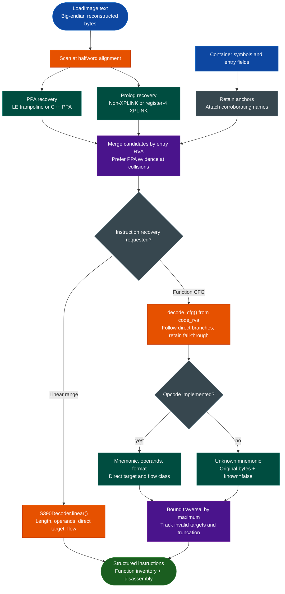

<a id="s390-disassembly-function-recovery"></a>
# S/390 Disassembly, Function Recovery & Variants

Decode big-endian S/390 instructions from IBM z/OS load images, recover LE and C++ functions from PPA metadata, generate non-XPLINK and XPLINK prolog candidates, and build bounded instruction-level control-flow graphs without an external disassembler or RE framework.

This is a **disassembler and static analyzer**, not a pseudo-C decompiler. It appears under “Decompilers, Disassemblers & Analyzers” because of the disassembly and analysis capabilities documented here.

---

## Why this exists

1. **Container extraction is only the first step.** After NETDATA and PDS/PDSE processing, an analyst still needs native instruction decoding, function evidence, and control flow. `S390Decoder` and `recover_functions` provide those layers without converting the artifact to another executable format.

2. **S/390 analysis needs more than an opcode table.** LE/C++ PPA records and linkage conventions provide independent function evidence. Keeping instruction decoding, PPA recovery, and prolog scanning separate makes the origin and confidence of every function candidate visible.

3. **Unknown instructions must remain visible.** An unsupported opcode is represented with its original bytes and `known=false`; it is not assigned an invented mnemonic. CFG completeness and unknown-instruction counts are reported independently.

4. **The implementation is self-contained.** The backend uses only the Python standard library. It does not depend on Capstone, Ghidra, Radare2, or an external adapter, so its decoding behavior can be inspected, tested, and maintained inside Ablation.

---

## How it works



The input is a `LoadImage`, normally produced by the IBM z/OS loaders. Reported addresses are RVAs into reconstructed `text.bin`, not raw member-file offsets. See [IBM z/OS Artifact Analysis](ibm-zos.md#address-and-mapping-model) for chunk mappings and container reconstruction.

---

## Supported variants and evidence layers

The README's concise “Variants” column combines instruction encoding with metadata and linkage conventions. LE/C++ PPA and XPLINK are not separate CPU architectures.

| Variant or layer | Current support | Confidence and boundary |
|---|---|---|
| Big-endian S/390 | Length-derived decoding for common RR, RX, RS, SI, RI, RIL, RRE, extended `E3`, RSE, and SS forms | Conservative, selective opcode coverage; unknown instructions remain explicit |
| Selected z/Architecture instructions | Includes supported `lgr`, `ltgr`, `lghi`, `brctg`, `larl`, `brasl`, `lmg`, `stmg`, and selected `E3`/`EB` opcodes | Not a complete z/Architecture implementation or a claim that every operand form is modeled |
| LE PPA | `PPA_LE` trampoline recognition, signed PPA1 resolution, code RVA, name, and frame metadata | High-confidence function evidence; not proof of complete boundaries or CFG coverage |
| C++ PPA | `PPA_CPP` recognition with signed PPA offsets and CP500 names | High-confidence function evidence; malformed or unsupported records are skipped |
| Non-XPLINK linkage | Conventional save/store prolog candidates using supported base-register and displacement patterns | Medium-confidence `SAVE_STORE_PROLOG` candidate; requires corroboration |
| XPLINK linkage | Register-4 save-sequence recognition | Medium-confidence `XPLINK_SAVE_STORE` candidate; not every XPLINK prolog shape is covered |
| Container symbols | Supported CESD section, program, and label kinds can name candidates and provide anchors | A container entry or label alone is not promoted to a function |

PPA candidates take precedence when a PPA and prolog candidate share an entry RVA. A symbol-backed name can raise a candidate's confidence, but `next_entry_rva` is only the next recovered PPA entry—not a proven end address.

---

## Instruction decoding

### Length and format model

The decoder derives instruction length from the first two bits before selecting an opcode handler.

| First two bits | Instruction length |
|---|---:|
| `00` | 2 bytes |
| `01` or `10` | 4 bytes |
| `11` | 6 bytes |

| Internal format | Implemented examples | Operand model |
|---|---|---|
| RR | `lr`, `ar`, `clr`, `balr`, `bcr` | Two register nibbles; branch-mask and return modeling where applicable |
| RX | `l`, `st`, `la`, `a`, `c`, `bc`, `bal` | Register plus base/index/displacement memory operand |
| RS | `stm`, `lm`, shifts, `bxh`, `bxle` | Two registers plus base/displacement |
| SI | `cli`, `mvi`, `tm`, `ni`, `oi`, `xi` | Immediate plus base/displacement |
| RI | `brc`, `bras`, `brct`, `lhi`, `ahi` | Register or mask plus signed 16-bit immediate; supported relative targets |
| RIL | `larl`, `brcl`, `brasl` | Register or mask plus signed 32-bit immediate; supported relative targets |
| RRE | `lgr`, `ltgr`, `lpgr`, `lngr`, `lcgr` | Extended opcode plus two registers |
| RXY `E3` | Selected `ly`, `sty`, `lay`, `cy`, and related opcodes | Six-byte extended opcode with base/index and signed 20-bit displacement |
| RSE `EB` | `lmg`, `stmg` | Extended opcode, two registers, base/displacement |
| SS | `mvc`, `mvz`, `clc`, `tr`, `trt`, `pack`, `zap`, `ap` | Two storage operands plus encoded length or related operand byte |

The format labels are the backend's internal decoding categories, not a claim to implement every instruction in those IBM format families. In particular, extended-form and 64-bit support is selective. Supported `E3` instructions combine the low 12 displacement bits with the high 8 bits and sign-extend the resulting 20-bit displacement.

### Structured instruction records

With `disasm --json` or CFG output, each instruction includes:

| Field | Meaning |
|---|---|
| `address` | RVA in reconstructed executable text |
| `hex` | Original instruction bytes |
| `mnemonic` | Implemented mnemonic or `unknown` |
| `operands` | Rendered register, memory, immediate, or target operands |
| `format` | Internal format classification or `unknown` |
| `known` | Whether the opcode is implemented |
| `target` | Direct branch/call target when recoverable; otherwise `null` |
| `flow` | `next`, `call`, `conditional_jump`, `jump`, or `return` |

A return currently recognizes the conventional `BCR 15,14` encoding. Direct conditional branches retain fall-through. Calls are recorded without automatically absorbing the callee into the caller's CFG. Invalid, odd, truncated, or out-of-image recursive targets make a CFG incomplete.

---

## Usage

Run from the Ablation repository root. Start with an extracted PDS load module or `IEWPLMH` program object, not a NETDATA envelope.

### Linear disassembly

```bash
python3 -m ablation.ibm_zos disasm PROGRAM.bin --start 0x0 --length 0x100
python3 -m ablation.ibm_zos disasm PROGRAM.bin --start 0x200 --length 0x80 --json
```

`--start` and `--length` accept decimal or `0x` values. Defaults are start 0, length 256, and at most 1000 instructions. The requested byte range must lie within reconstructed text.

### Function recovery and CFGs

```bash
python3 -m ablation.ibm_zos functions PROGRAM.bin FUNCTIONS_DIR
python3 -m ablation.ibm_zos functions PROGRAM.bin FUNCTIONS_DIR --cfg --maximum 20000
```

Without `--cfg`, the tool writes function candidates and anchors but does not recover instruction bodies. With `--cfg`, it recursively decodes from each candidate's `code_rva` and adds instructions, calls, branches, and completeness fields.

The output directory contains:

- `functions.json`: structured anchors and functions, including instruction arrays with `--cfg`.
- `functions.txt`: entry RVA, code RVA, evidence kind, confidence, and name.
- `disassembly.txt`: recovered instructions grouped by candidate.

`--maximum` bounds work per function. Reaching the limit sets `complete=false`; increasing it can improve coverage but increases runtime and output size.

### Python API

```python
from ablation.ibm_zos.functions import recover_functions
from ablation.ibm_zos.loadmodule import read_load_image
from ablation.ibm_zos.s390 import S390Decoder

image = read_load_image("PROGRAM.bin")
for instruction in S390Decoder().linear(image.text, 0, 0x100):
    print(instruction.text())

recovery = recover_functions(image, include_cfg=True, maximum_per_function=20000)
for function in recovery.functions:
    print(function.entry_rva, function.name, function.kind, function.complete)
```

---

## Example output

Decoding bytes `07fe` at RVA zero produces the conventional return model:

```json
{
  "address": 0,
  "hex": "07fe",
  "mnemonic": "bcr",
  "operands": "%r15, %r14",
  "format": "RR",
  "known": true,
  "target": null,
  "flow": "return"
}
```

For function records, inspect `kind`, `confidence`, `complete`, and `unknown_instruction_count` together. A high-confidence PPA function can still have an incomplete CFG. An unknown instruction can be retained during traversal without being assigned a fabricated operation.

---

## Interpretation and limitations

- This backend does **not** emit pseudo-C, recover high-level expressions, infer variable types, reconstruct general stack variables, or perform decompiler-style data-flow analysis.
- The opcode catalog is intentionally partial. Full S/390, z/Architecture, floating-point, privileged, and every extended operand form are not claimed.
- Medium-confidence prologs are candidates, not proof of function boundaries or complete program coverage.
- Container entry fields and symbols are anchors; they do not independently prove a function.
- Indirect calls and branches can have `target=null`. Binder linkage and load-time relocation are not resolved here.
- RLD information is retained by the loader but is not applied before decoding.
- `complete=false` can indicate truncation, an invalid target, or the instruction cap. Check `unknown_instruction_count` separately.
- No dynamic z/OS execution or vulnerability verdict is implied.

Run the focused tests with:

```bash
python3 -m pytest -q tests/test_ibm_zos.py
```

---

## Related workflows

- [IBM z/OS Artifact Analysis](ibm-zos.md) documents NETDATA extraction, PDS/PDSE and `IEWPLMH` loading, side-decks, and the end-to-end pipeline.
- [IBM AIX Binary Analysis](aix-xcoff32-64-analysis.md) covers the separate PowerPC/XCOFF IBM artifact path.

### Source map

| Module | Responsibility |
|---|---|
| `ablation/ibm_zos/s390.py` | Instruction length, opcode, operand, direct-target, and flow decoding |
| `ablation/ibm_zos/functions.py` | PPA/prolog candidates, symbols, and bounded CFG recovery |
| `ablation/ibm_zos/image.py` | Load-image, instruction-input, and RVA mapping model |
| `ablation/ibm_zos/loadmodule.py` | PDS load-module and `IEWPLMH` reconstruction |
| `tests/test_ibm_zos.py` | Decoder, PPA/prolog, CFG, negative, and corpus-golden coverage |
