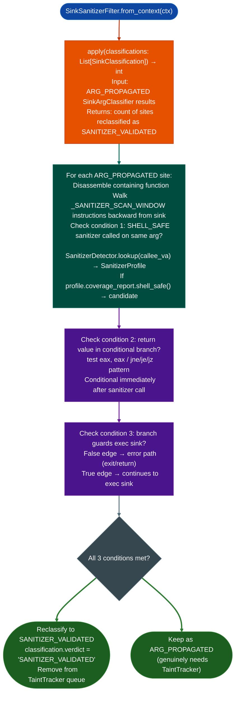

# Sanitizer-Gated Sink Filtering

Post-process `ARG_PROPAGATED` `SinkArgClassifier` results to detect sanitizer-validated exec sinks: automatically reclassifying sites where a shell-safe allowlist validator is called on the argument before the exec sink with a conditional branch on the return value, reducing the manual triage burden from 30–60 minutes per `ARG_PROPAGATED` site to a single automated pass.

---

## Why this exists

1. **Every `ARG_PROPAGATED` result from `SinkArgClassifier` requires manual disassembly to determine whether the argument passes through a shell-safe validator before reaching the exec sink: a 30–60 minute task per site on a stripped binary.** `SinkSanitizerFilter` automates this: it pairs `SanitizerDetector`'s behavioral signature matching with backward analysis of the exec sink's argument path, identifying whether a confirmed shell-safe function is called on the same argument and whether a conditional branch on its return value guards the exec sink.

2. **Three structural conditions must all be true for a site to be reclassified as `SANITIZER_VALIDATED`:** (1) A `SHELL_SAFE` function (detected by `SanitizerDetector`) is called on the same argument as the exec sink within `_SANITIZER_SCAN_WINDOW` instructions before the sink; (2) the sanitizer's return value is used in a conditional branch `test eax, eax / jz <error>`; and (3) the conditional branch's false edge leads to an error path, not to the exec sink. All three conditions together mean that the exec sink is unreachable without passing the shell-safe allowlist check.

3. `SinkSanitizerFilter.apply()` modifies the `SinkClassification` list in-place: `ARG_PROPAGATED` sites that pass all three conditions are upgraded to `SANITIZER_VALIDATED` and removed from the taint analysis queue. The remaining `ARG_PROPAGATED` sites are the ones that genuinely require `TaintTracker` analysis.

---

## How it works



---

## Usage

```python
from ablation.analyzers.sink_arg_classifier import SinkArgClassifier
from ablation.analyzers.sink_sanitizer_filter import SinkSanitizerFilter
from ablation.analyzers.binary_context import BinaryContext

ctx = BinaryContext.load_or_build('/path/to/target.elf')

# Step 1: classify all sink call sites
clf = SinkArgClassifier.from_context(ctx)
results = clf.classify_all()

print(f"Before filter: {sum(1 for r in results if r.verdict == 'ARG_PROPAGATED')} ARG_PROPAGATED")

# Step 2: filter out sanitizer-validated sites
filt = SinkSanitizerFilter.from_context(ctx)
n_reclassified = filt.apply(results)

print(f"Reclassified: {n_reclassified} as SANITIZER_VALIDATED")
print(f"After filter: {sum(1 for r in results if r.verdict == 'ARG_PROPAGATED')} ARG_PROPAGATED (need TaintTracker)")

# Print detailed report
print(filt.report(results))
```

---

## Example output

The following illustrates the filter output format. Actual counts and addresses are binary-specific.

```
SinkSanitizerFilter:
  Input:  <N> ARG_PROPAGATED sites
  Reclassified: <M> as SANITIZER_VALIDATED
    <va>: system  — sanitizer: validate_path() shell_safe=True, branch guards sink
    <va>: popen   — sanitizer: check_filename() shell_safe=True, branch guards sink
  Remaining: <K> ARG_PROPAGATED (feed to TaintTracker)
```

---

## False positives

**Condition 3 conditional branch guards exec sink requires that the false edge leads to an error path, not a partial sanitization.** A sanitizer that is called but whose result is not used to prevent the exec sink call specifically the sanitizer return value is ignored will not be detected and the site will remain `ARG_PROPAGATED`. Verify by checking that the branch is conditional on the sanitizer's return, not on an unrelated condition.

**`_SANITIZER_SCAN_WINDOW` is a fixed instruction count**: a sanitizer called more than `_SANITIZER_SCAN_WINDOW` instructions before the exec sink will not be detected. Increase the window for large functions with long sanitizer-to-sink paths.

---

## Pipeline position

Run `SinkSanitizerFilter.apply()` immediately after `SinkArgClassifier.classify_all()` and before `TaintTracker`. The filter reduces the `ARG_PROPAGATED` queue by removing structurally safe sites, making `TaintTracker` runs faster and the analyst's review queue shorter.

---

## Reading output

`SinkSanitizerFilter.applyclassifications` accepts `List[SinkClassification]` from `SinkArgClassifier` and returns a new `List[SinkClassification]`. `ARG_PROPAGATED` entries where all three sanitizer conditions are confirmed are upgraded to `SANITIZER_VALIDATED`; all other entries pass through unchanged.

Call `SinkSanitizerFilter.reportclassifications` after `apply()` to get a triage summary string showing how many sites were validated vs. remaining.

---

## See also

- [Sink Argument Classifier](sink-argument-classifier.md): produces the `ARG_PROPAGATED` list that this filter processes
- [Sanitizer Recognition](sanitizer-recognition.md): `SanitizerDetector` that identifies `SHELL_SAFE` validators
- [Taint Analysis](taint-analysis.md): processes the remaining `ARG_PROPAGATED` sites after filtering
