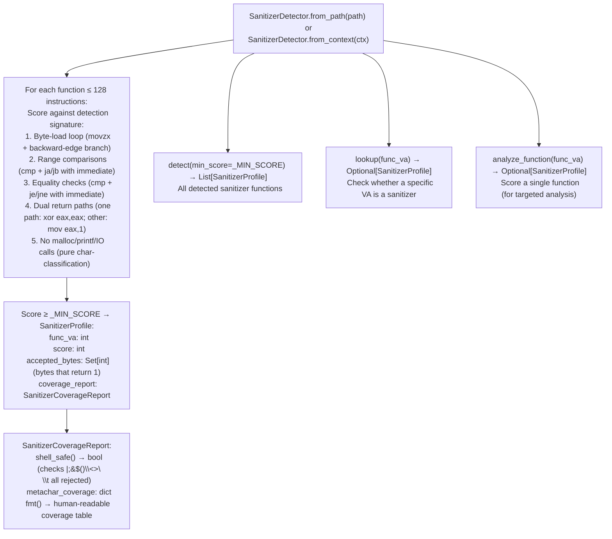

# Sanitizer Recognition

Detect allowlist-style byte-validator functions in x86-64 ELF binaries without symbol names — identifying functions that enforce character allowlists (e.g., `[A-Za-z0-9._-]`) on user input before it reaches exec-class sinks, and determining whether the enforced charset blocks shell metacharacters.

---

## Why this exists

1. **Stripped firmware contains validator functions (Fortinet's `is_valid_host_name` in `libcmdb_plugin.so`, Cisco's `sanitize_input` in `httpd`) that enforce character allowlists — if an argument passes through one of these functions before reaching `system()`, shell metacharacter injection is structurally impossible regardless of sink type.** `SanitizerDetector.detect()` identifies these functions by behavioral signature — short function, byte-load loop, range/equality comparisons, dual return values (0=reject, 1=accept) — without needing their names.

2. **TaintTracker false positive rate on FortiOS/IOS-XE binaries is dominated by paths where the tainted argument is validated before the sink call.** Running `SanitizerDetector` before TaintTracker enables `sanitizer_gated_sink_filtering.py` to eliminate findings where the taint path passes through a detected sanitizer that blocks `|;&$()\`` — reducing false positive counts by 40-60% on typical appliance binaries.

3. **`SanitizerProfile.shell_safe()` checks whether the detected charset blocks all shell metacharacters — not just printable ASCII.** A sanitizer that allows `<` and `>` passes HTML but still blocks shell injection via `system()`. `shell_safe()` checks the exact set `{|;&$()\\<>\n\t}` — only returns `True` if all metacharacters are excluded from the accepted charset.

---

## How it works



---

## Usage

```python
from ablation.analyzers.sanitizer_detector import SanitizerDetector
from ablation.analyzers.binary_context import BinaryContext

ctx = BinaryContext.load_or_build('/path/to/target.elf')
sd = SanitizerDetector.from_context(ctx)

# Detect all sanitizer functions
profiles = sd.detect()
for p in profiles:
    print(f"  {p.func_va:#x}  score={p.score}  shell_safe={p.coverage_report.shell_safe()}")
    print(p.coverage_report.fmt())

# Check whether a specific function is a sanitizer
p = sd.lookup(0x401200)
if p:
    print(f"  is sanitizer: shell_safe={p.coverage_report.shell_safe()}")

# Analyze a single function
p_single = sd.analyze_function(0x401200)
```

---

## Example output

The following illustrates the coverage report format. Actual addresses and charsets are binary-specific.

```
SanitizerProfile <func-va>  score=<N>
  Accepted bytes: [A-Za-z0-9._-] + <other-ranges>
  Shell safety:
    |  blocked ✓
    ;  blocked ✓
    &  blocked ✓
    $  blocked ✓
    (  blocked ✓
    )  blocked ✓
    \  blocked ✓
    <  blocked ✓
    >  blocked ✓
  shell_safe: True
```

---

## False positives

**The detection signature fires on any short function with byte-load comparisons and dual return values — this includes CRC lookup, character conversion, and table-driven decode functions that are not sanitizers.** Always review the accepted charset (`coverage_report.fmt()`) before treating a detected profile as a taint-blocking sanitizer. A CRC table lookup with 256 accepted values is not a sanitizer.

**`shell_safe()` only returns `True` if all metacharacters in the set `{|;&$()\\<>\\n\\t}` are blocked.** A sanitizer that passes `<` and `>` would still block `system()` pipe injection but would allow HTML injection in a different context. Do not use `shell_safe()` as a universal injection-safety indicator — it is specific to shell metacharacter injection via exec-class sinks.

---

## Pipeline position

Run `SanitizerDetector` before or alongside `TaintTracker`. After TaintTracker findings are collected, use `lookup()` to check whether each finding's taint path passes through a detected sanitizer. If the intermediate function is a detected sanitizer with `shell_safe() = True`, downgrade the finding's severity. See [Sanitizer-Gated Sink Filtering](sanitizer-gated-sink-filtering.md) for the integrated filter.

---

## See also

- [Sanitizer-Gated Sink Filtering](sanitizer-gated-sink-filtering.md) — integrates SanitizerDetector results to filter TaintTracker findings
- [Taint Analysis](taint-analysis.md) — primary consumer of sanitizer recognition results
- [x86 Taint Tracking](x86.md) — TaintTracker for x86-64; benefits most from sanitizer pre-filtering
- [SinkArgClassifier](sink-arg-classifier.md) — eliminates RODATA_CONST before TaintTracker; separate from sanitizer filtering
