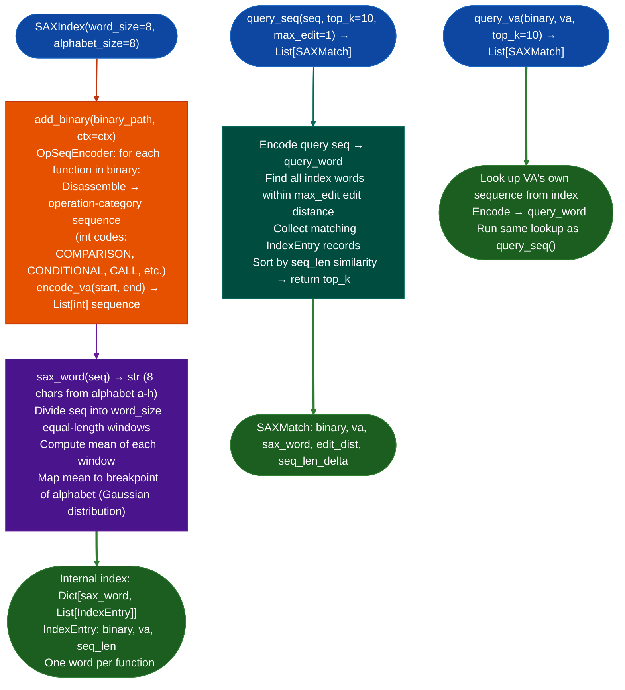

<a id="sax-approximate-indexing"></a>
# Approximate Function Matching

Fast approximate nearest-neighbor function lookup using SAX (Symbolic Aggregate approXimation) encoding of operation-category sequences: a pre-filter for `SemanticSearcher` that narrows candidates in microseconds without running embedding inference on every function.

---

## Why this exists <sup>[↑](#sax-approximate-indexing)</sup>

1. **`SemanticSearcher` runs BERT-class embedding inference: each query takes 50-200ms per function scored, which is acceptable for a shortlist of 10-50 candidates but prohibitive for full-corpus scanning of a 10,000-function binary.** `SAXIndex` encodes each function's operation-category sequence as a short symbolic word 8 characters from an 8-symbol alphabet, then uses edit-distance lookup to find approximate matches in microseconds. The SAX pre-filter narrows the 10,000-function corpus to a 10-100 function shortlist before `SemanticSearcher` runs.

2. **SAX encoding produces the same or nearby words for similar sequences: two functions that both do `[cmp, jmp, call, mov, ret]` with minor variations will produce identical or 1-edit-distance SAX words.** This property enables approximate matching: `query_seq()` returns all functions within a configurable edit distance of the query word. Unlike exact substring matching, SAX tolerates small insertions and deletions that appear when the same algorithm is compiled with different optimization levels.

3. `SAXIndex.add_binary()` indexes all functions in a binary in a single pass using `OpSeqEncoder`: the operation-category sequence for every function is computed once during indexing, not at query time. The index can be saved to disk (`save()`) and reloaded (`load()`) for reuse across sessions, avoiding re-computation on large firmware collections.

---

## How it works <sup>[↑](#sax-approximate-indexing)</sup>



---

## Usage <sup>[↑](#sax-approximate-indexing)</sup>

```python
from ablation.analyzers.sax_index import SAXIndex

idx = SAXIndex(word_size=8, alphabet_size=8)

# Index one or more binaries
idx.add_binary('/firmware/lib/libcmdb_plugin.so', ctx=ctx)
idx.add_binary('/firmware/lib/libdata.so')

# Save index for reuse across sessions
idx.save('/path/to/corpus.sax')

# Load existing index
idx2 = SAXIndex.load('/path/to/corpus.sax')

# Query by sequence
from ablation.analyzers.subsequence_searcher import SubsequenceSearcher
ss = SubsequenceSearcher.from_path('/path/to/binary', ctx=ctx)
seq = ss._encode_va(0x1000)   # get op-category sequence for a function

results = idx2.query_seq(seq, top_k=20, max_edit=1)
for r in results:
    print(f"  {r.binary}:{r.va:#x}  edit_dist={r.edit_dist}  seq_len_delta={r.seq_len_delta}")

# Query by known function VA (find all similar functions in the corpus)
results2 = idx2.query_va('/firmware/lib/libcmdb_plugin.so', 0x401200, top_k=10)
```

---

## Example output <sup>[↑](#sax-approximate-indexing)</sup>

The following illustrates the SAX query result format. Actual addresses and words are binary/function-specific.

```
SAXIndex query for <func-va> (sax_word='<word>'):
  <binary>:<va>  edit_dist=0  seq_len_delta=0   (exact word match)
  <binary>:<va>  edit_dist=1  seq_len_delta=12  (1 edit, slightly longer)
  <binary>:<va>  edit_dist=1  seq_len_delta=3   (1 edit, similar length)
  ...
```

---

## False positives <sup>[↑](#sax-approximate-indexing)</sup>

**SAX edit distance 1 includes both similar and incidentally similar functions: two functions that happen to map to the same SAX word may be structurally unrelated for example a hash function and a sort function that both have many comparison operations.** SAX results are candidates for embedding scoring, not confirmed matches. Always pass SAX results through `SemanticSearcher` before treating them as similar functions.

**`sax_word()` uses a fixed Gaussian distribution breakpoint table for the alphabet: on binaries with highly skewed operation-category distributions for example SIMD-heavy code with many arithmetic operations, the breakpoints may not distribute words evenly across the alphabet.** Adjust `alphabet_size` or `word_size` if query results are consistently clustered in a few alphabet letters.

---

## Pipeline position <sup>[↑](#sax-approximate-indexing)</sup>

Use `SAXIndex` as the first filter in a corpus-scale similarity search: index all binaries in the firmware collection, then use `query_va()` to find functions similar to a confirmed candidate across the entire corpus. The SAX shortlist (top_k=20-50) feeds `SemanticSearcher` for final embedding-based ranking. This reduces `SemanticSearcher` inference calls by 100-1000x on large firmware collections.

---

## Reading output <sup>[↑](#sax-approximate-indexing)</sup>

`SAXIndex.query_vactx, func_va` and `SAXIndex.query_seq(seq)` both return `List[SAXMatch]`:

| Attribute | Content |
|:---|:---|
| `binary` | Path to the matched binary |
| `func_va` | VA of the matched function |
| `sax_word` | The SAX word representation of the matched function |
| `seq_len` | Length of the function's instruction sequence |
| `mindist` | Minimum SAX distance score (lower = more similar) |
| `edit_dist` | SAX word edit distance (0 = exact word match) |

Results are ordered by ascending `mindist`. Use `str(match)` for a formatted one-line summary.

---

## See also <sup>[↑](#sax-approximate-indexing)</sup>

- [Semantic Search](semantic-search.md): embedding-based similarity; consumes SAX shortlist
- [Behavioral Subsequence Search](behavioral-subsequence-search.md): DTW-based structural matching; complementary to SAX pre-filter
- [Function Identity Database](function-identity-database.md): persistent storage for confirmed function identities; integrates with SAX corpus
