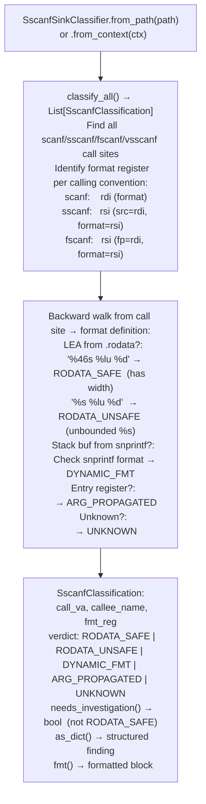

# scanf Family Overflow Candidates

Classify `sscanf`/`scanf`/`fscanf`/`vsscanf` call sites for destination buffer overflow risk via unbounded `%s` format specifiers — determining whether the format string is a `.rodata` constant with width bounds (`RODATA_SAFE`), an unsafe unbounded `%s` literal (`RODATA_UNSAFE`), a runtime-built format (`DYNAMIC_FMT`), a caller-propagated argument (`ARG_PROPAGATED`), or unresolvable (`UNKNOWN`).

---

## Why this exists

1. **`scanf("%s", buf)` with an unbounded `%s` is CWE-121 — the `%s` specifier reads until whitespace with no length limit, overflowing `buf` if the input is long enough.** `SscanfSinkClassifier` finds all `scanf`-family call sites and classifies them: `RODATA_SAFE` sites (format has explicit width specifier, e.g., `"%46s"`) require no further analysis; `RODATA_UNSAFE` sites (format has unbounded `%s`) are confirmed overflow candidates; other verdicts require deeper investigation.

2. **The `DYNAMIC_FMT` verdict handles the `libwmshared.so` pattern: `snprintf(buf, 32, "%%%zus %%lu %%d", 46)` → `"%46s %lu %d"`.** This pattern dynamically builds a width-bounded format string at runtime, making it appear dangerous (the format is not a `.rodata` constant) when it is actually safe. `SscanfSinkClassifier` detects this pattern and emits `DYNAMIC_FMT` instead of `UNKNOWN`, reducing the manual trace burden to: confirm the `snprintf` format template is a `.rodata` constant.

3. **`SscanfSinkClassifier` fills the gap left by `SinkArgClassifier`** — `SinkArgClassifier` handles exec-class sinks (`system`/`popen`/`execve`) while `SscanfSinkClassifier` handles input-parsing sinks. Using both gives complete coverage of the two highest-value vulnerability classes in protocol parser firmware (command injection and buffer overflow via `scanf`).

---

## How it works



---

## Verdict table

| Verdict | Meaning | Action |
|---|---|---|
| `RODATA_SAFE` | `.rodata` format, explicit width specifier | Stop. No overflow possible via format. |
| `RODATA_UNSAFE` | `.rodata` format, has unbounded `%s` | HIGH risk. Confirm buffer size vs. max input. |
| `DYNAMIC_FMT` | Format built at runtime via `snprintf` | Check that the `snprintf` template is `.rodata` constant. |
| `ARG_PROPAGATED` | Format came from caller argument | `TaintTracker` to confirm network → format path. |
| `UNKNOWN` | Provenance unresolved | Manual inspection required. |

---

## Usage

```python
from ablation.analyzers.sscanf_sink_classifier import SscanfSinkClassifier
from ablation.analyzers.binary_context import BinaryContext

ctx = BinaryContext.load_or_build('/path/to/target.elf')
clf = SscanfSinkClassifier.from_context(ctx)

# Classify all scanf-family call sites
results = clf.classify_all()

# Focus on investigation-required sites
for r in results:
    if r.needs_investigation():
        print(r.fmt())

# Count by verdict
from collections import Counter
counts = Counter(r.verdict for r in results)
print(counts)
```

---

## Example output

The following illustrates the classification output format. Actual addresses and formats are binary-specific.

```
[RODATA_UNSAFE] sscanf at <va>
  fmt_reg: rsi ← LEA .rodata+<off>: "%s %lu %d"
  Unbounded %s — destination buffer may overflow if input > buffer size

[DYNAMIC_FMT] sscanf at <va>
  fmt_reg: rsi ← stack buffer filled by snprintf
  snprintf template: .rodata: "%%%zus %%lu %%d"
  Likely safe if snprintf width argument is bounded
```

---

## False positives

**`RODATA_UNSAFE` fires when the format string contains any unbounded `%s`** — this includes formats like `"%s:"` where the `%s` is the first of a two-part format and the destination is a temp buffer with intentional bounds enforcement via `strncat`. Confirm the buffer size and whether there is a subsequent length check on the destination.

---

## Pipeline position

Run `SscanfSinkClassifier.classify_all()` alongside `SinkArgClassifier.classify_all()` as part of the initial sink classification sweep. The two classifiers together cover exec-class sinks and input-parsing sinks — the two highest-value vulnerability classes. `RODATA_UNSAFE` findings are the highest priority since the buffer overflow is often directly confirmable from the format string alone.

---

## Reading findings

`ScanfOverflowScanner.scan()` returns a list of finding dicts:

| Field | Content |
|:---|:---|
| `severity` | `HIGH` (`RODATA_UNSAFE`: static format with `%s`) / `MEDIUM` (`DYNAMIC_FMT`: format from snprintf) |
| `title` | Finding code: `SCANF_UNBOUNDED_S` or `SCANF_DYNAMIC_FMT` |
| `detail` | Format string, destination register, and overflow condition |
| `fmt_reg` | Register holding the format string argument |
| `call_va` | VA of the `sscanf`/`fscanf` call |
| `fmt_string` | Resolved format string value (if RODATA) |

---

## See also

- [Sink Argument Classifier](sink-argument-classifier.md) — exec-class sink classification (complementary)
- [Deprecated Unsafe Function Scanning](deprecated-unsafe-function-scanning.md) — `gets()` detection (another unbounded input function)
- [Taint Analysis](taint-analysis.md) — confirm `ARG_PROPAGATED` formats are user-controlled
