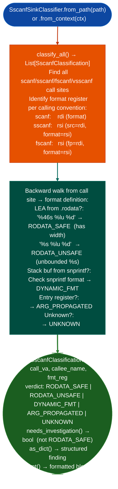

# SscanfSinkClassifier / DeprecatedFuncScanner

  - [What is scanf overflow and deprecated-function analysis?](#what-is-scanf-overflow-and-deprecated-function-analysis)
  - [Why this exists](#why-this-exists)
  - [How it works](#how-it-works)
  - [Verdict table](#verdict-table)
  - [Usage](#usage)
  - [Example output](#example-output)
  - [DeprecatedFuncScanner](#deprecatedfuncscanner)
    - [Usage](#usage-1)
    - [DeprecatedHit fields](#deprecatedhit-fields)
  - [False positives](#false-positives)
  - [Pipeline position](#pipeline-position)
  - [Reading findings](#reading-findings)
  - [See also](#see-also)

**Files:** `ablation/analyzers/sscanf_sink_classifier.py` · `ablation/analyzers/deprecated_func_scanner.py`

---

## What is scanf overflow and deprecated-function analysis? <sup>[↑](#sscanfsinkclassifier--deprecatedfuncscanner)</sup>

`scanf("%s", buf)` reads until whitespace with no length limit. When `buf` is a fixed-size stack or heap allocation, any input longer than the allocation overflows the buffer. The C standard itself deprecated `gets()` for this reason: there is no safe way to call it. `mktemp()`, `tmpnam()`, and `getwd()` are deprecated because they introduce TOCTOU race conditions and predictable temporary file names, not buffer overflows, but are exploitable in comparable ways.

The CWE taxonomy classifies these patterns separately: CWE-120 (buffer copy without checking input size), CWE-121 (stack-based buffer overflow), CWE-242 (use of inherently dangerous function). All three are frequently found in embedded firmware that predates modern secure coding guides. A binary compiled from legacy C code may import `gets`, `mktemp`, or `scanf` with unbounded `%s` without any other sign of a security issue, and the import list alone does not distinguish safe `scanf("%d", &n)` from unsafe `scanf("%s", buf)`.

`SscanfSinkClassifier` fills the gap between `SinkArgClassifier` (exec-class sinks: `system`/`popen`/`execve`) and format-string scanning by classifying the format specifier in each `scanf`-family call. `DeprecatedFuncScanner` finds calls to `gets()`, `mktemp()`, `tmpnam()`, and `getwd()`, and for `gets()` also estimates the stack frame layout to compute the overflow offset to saved `rip`. Together they cover the buffer-overflow and unsafe-import surface of the binary in a single pre-taint pass.

## Why this exists <sup>[↑](#sscanfsinkclassifier--deprecatedfuncscanner)</sup>

1. **`scanf"%s", buf` with an unbounded `%s` is CWE-121: the `%s` specifier reads until whitespace with no length limit, overflowing `buf` if the input is long enough.** `SscanfSinkClassifier` finds all `scanf`-family call sites and classifies them: `RODATA_SAFE` sites format has explicit width specifier, e.g., `"%46s"` require no further analysis; `RODATA_UNSAFE` sites (format has unbounded `%s`) are confirmed overflow candidates; other verdicts require deeper investigation.

2. **The `DYNAMIC_FMT` verdict handles the `libwmshared.so` pattern: `snprintfbuf, 32, "%%%zus %%lu %%d", 46` → `"%46s %lu %d"`.** This pattern dynamically builds a width-bounded format string at runtime, making it appear dangerous (the format is not a `.rodata` constant) when it is actually safe. `SscanfSinkClassifier` detects this pattern and emits `DYNAMIC_FMT` instead of `UNKNOWN`, reducing the manual trace burden to: confirm the `snprintf` format template is a `.rodata` constant.

3. `SscanfSinkClassifier` fills the gap left by `SinkArgClassifier`: `SinkArgClassifier` handles exec-class sinks (`system`/`popen`/`execve`) while `SscanfSinkClassifier` handles input-parsing sinks. Using both gives complete coverage of the two highest-value vulnerability classes in protocol parser firmware (command injection and buffer overflow via `scanf`).

---

## How it works <sup>[↑](#sscanfsinkclassifier--deprecatedfuncscanner)</sup>



---

## Verdict table <sup>[↑](#sscanfsinkclassifier--deprecatedfuncscanner)</sup>

| Verdict | Meaning | Action |
|---|---|---|
| `RODATA_SAFE` | `.rodata` format, explicit width specifier | Stop. No overflow possible via format. |
| `RODATA_UNSAFE` | `.rodata` format, has unbounded `%s` | HIGH risk. Confirm buffer size vs. max input. |
| `DYNAMIC_FMT` | Format built at runtime via `snprintf` | Check that the `snprintf` template is `.rodata` constant. |
| `ARG_PROPAGATED` | Format came from caller argument | `TaintTracker` to confirm network → format path. |
| `UNKNOWN` | Provenance unresolved | Manual inspection required. |

---

## Usage <sup>[↑](#sscanfsinkclassifier--deprecatedfuncscanner)</sup>

```python
from ablation.analyzers.sscanf_sink_classifier import SscanfSinkClassifier
from ablation.analyzers.binary_context import BinaryContext

ctx = BinaryContext.load_or_build('/path/to/target.elf')
clf = SscanfSinkClassifier.from_context(ctx)

# Classify all scanf-family call sites
results = clf.classify_all()

# Focus on investigation-required sites
for r in results:
    if r.needs_investigation():
        print(r.fmt())

# Count by verdict
from collections import Counter
counts = Counter(r.verdict for r in results)
print(counts)
```

---

## Example output <sup>[↑](#sscanfsinkclassifier--deprecatedfuncscanner)</sup>

The following illustrates the classification output format. Actual addresses and formats are binary-specific.

```
[RODATA_UNSAFE] sscanf at <va>
  fmt_reg: rsi ← LEA .rodata+<off>: "%s %lu %d"
  Unbounded %s — destination buffer may overflow if input > buffer size

[DYNAMIC_FMT] sscanf at <va>
  fmt_reg: rsi ← stack buffer filled by snprintf
  snprintf template: .rodata: "%%%zus %%lu %%d"
  Likely safe if snprintf width argument is bounded
```

---

## False positives <sup>[↑](#sscanfsinkclassifier--deprecatedfuncscanner)</sup>

**`RODATA_UNSAFE` fires when the format string contains any unbounded `%s`**, this includes formats like `"%s:"` where the `%s` is the first of a two-part format and the destination is a temp buffer with intentional bounds enforcement via `strncat`. Confirm the buffer size and whether there is a subsequent length check on the destination.

---

## Pipeline position <sup>[↑](#sscanfsinkclassifier--deprecatedfuncscanner)</sup>

Run `SscanfSinkClassifier.classify_all()` alongside `SinkArgClassifier.classify_all()` as part of the initial sink classification sweep. The two classifiers together cover exec-class sinks and input-parsing sinks: the two highest-value vulnerability classes. `RODATA_UNSAFE` findings are the highest priority since the buffer overflow is often directly confirmable from the format string alone.

---

## Reading findings <sup>[↑](#sscanfsinkclassifier--deprecatedfuncscanner)</sup>

`SscanfSinkClassifier.from_context(ctx).classify_all()` returns `List[SscanfClassification]`. See [sscanf-sink-classifier](sscanf_sink_classifier.md) for the full field reference.

| Attribute | Content |
|:---|:---|
| `sink_name` | Sink function name for example `'sscanf'`, `'fscanf'` |
| `fmt_arg_pos` | Argument position of the format string |
| `func_va` | VA of the function containing the sink call |
| `call_va` | VA of the `sscanf`/`fscanf` call |
| `verdict` | `'RODATA_UNSAFE'` / `'RODATA_SAFE'` / `'DYNAMIC_FMT'` / `'ARG_PROPAGATED'` / `'UNKNOWN'` |
| `format_str` | Resolved format string (if `RODATA_SAFE` or `RODATA_UNSAFE`) |
| `detail` | Human-readable classification explanation |
| `severity` | `'HIGH'` for `RODATA_UNSAFE`; `'MEDIUM'` for `DYNAMIC_FMT`; `'LOW'` for safe |

---

## DeprecatedFuncScanner <sup>[↑](#sscanfsinkclassifier--deprecatedfuncscanner)</sup>

`DeprecatedFuncScanner` finds every call to `gets()`, `mktemp()`, `tmpnam()`, and `getwd()` in an x86-64 ELF binary. For `gets()` and `getwd()` it also inspects the stack frame to estimate the buffer size and the overflow offset to the saved `rip` value.

```python
from ablation.analyzers.deprecated_func_scanner import DeprecatedFuncScanner
from ablation.analyzers.binary_context import BinaryContext

ctx = BinaryContext.load_or_build('/path/to/target.elf')
scanner = DeprecatedFuncScanner.from_context(ctx)

hits = scanner.scan()
for h in hits:
    print(h.fmt())
```

### Usage <sup>[↑](#sscanfsinkclassifier--deprecatedfuncscanner)</sup>

```python
# Standalone (builds BinaryContext internally)
scanner = DeprecatedFuncScanner.from_path('/path/to/target.elf')
hits = scanner.scan()

# From an existing BinaryContext
scanner = DeprecatedFuncScanner.from_context(ctx)
hits = scanner.scan()

print(DeprecatedFuncScanner.report(hits))
```

### DeprecatedHit fields <sup>[↑](#sscanfsinkclassifier--deprecatedfuncscanner)</sup>

| Field | Type | Description |
|:------|:-----|:------------|
| `va` | `int` | VA of the `CALL` instruction to the deprecated function |
| `func_va` | `int` | VA of the containing function |
| `func_name` | `str` | Name of the containing function (from `BinaryContext`) |
| `plt_name` | `str` | Dangerous function name: `gets`, `mktemp`, `tmpnam`, `getwd` |
| `cwe` | `str` | CWE class: `CWE-242/CWE-121` for `gets`/`getwd`; `CWE-242/CWE-377` for `mktemp`/`tmpnam` |
| `reason` | `str` | One-line description of the risk |
| `buf_size` | `int` | Estimated buffer size in bytes; `-1` if not resolved |
| `frame_size` | `int` | Total stack frame size; `-1` if not resolved |
| `overflow_offset` | `int` | Bytes from buffer start to saved `rip`; `-1` if not resolved |
| `callers` | `List[str]` | Names of functions that call the containing function |

---

## See also <sup>[↑](#sscanfsinkclassifier--deprecatedfuncscanner)</sup>

- [Sink Argument Classifier](sink-arg-classifier.md): exec-class sink classification; run alongside SscanfSinkClassifier
- [Format String Scanner](format-string-scanner.md): complements sscanf classification for printf-family format bugs
- [Taint Analysis](taint-analysis.md): confirm `ARG_PROPAGATED` formats are user-controlled
