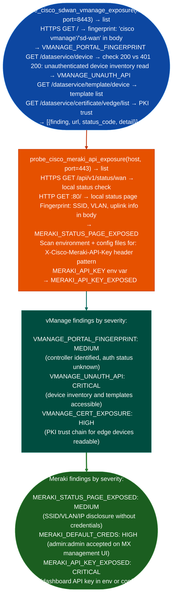

# SD-WAN/Meraki Management Probes

Probe Cisco SD-WAN vManage controller for unauthenticated REST API access and portal fingerprint, test Meraki local status page for SSID/VLAN disclosure without authentication, and detect Meraki dashboard API key exposure in device configuration: providing SD-WAN and cloud-managed network attack surface assessment: via `modules/network_analyze.py`.

---

## Why this exists

1. **`probe_cisco_sdwan_vmanage_exposure()` detects unauthenticated vManage REST API access**: vManage is the SD-WAN policy controller that exposes a REST API on TCP/8443. The `/dataservice/device` endpoint returns full device inventory; `/dataservice/template/device` returns device templates that contain device credentials; `/dataservice/certificate/vedge/list` returns the PKI trust chain for all SD-WAN edge devices. CVE-2021-1479 (unauthenticated heap overflow via `/dataservice/disasterrecovery`) and CVE-2023-20214 session establishment without authentication are the canonical exploitation paths. `probe_cisco_sdwan_vmanage_exposure()` fingerprints the portal and attempts `/dataservice/device` to confirm whether authentication is enforced.

2. **`probe_cisco_meraki_api_exposure()` tests the Meraki local status page**: each Meraki MX/MS/MR device exposes a local web status page (port 80) that returns SSID names, VLAN configurations, uplink IP addresses, and connected client counts without authentication. This page is intended for local physical access troubleshooting but is accessible to any host on the management network. Additionally, the probe scans environment variables and configuration files for `X-Cisco-Meraki-API-Key` patterns: the single API key that provides full read/write access to all networks under a Meraki organization.

3. **Blast radius of vManage credential exposure**: the vManage device templates store the administrative credentials for all SD-WAN edge routers in the fabric. A single unauthenticated read of `/dataservice/template/device/config/attached/<template-id>` returns the configuration including AAA credentials for every attached router. This represents complete compromise of the SD-WAN fabric from a single HTTP request.

---

## How it works



---

## Usage

```python
from modules.network_analyze import (
    probe_cisco_sdwan_vmanage_exposure,
    probe_cisco_meraki_api_exposure
)

for host in discovered_hosts:
    sdwan = probe_cisco_sdwan_vmanage_exposure(host, port=8443)
    meraki = probe_cisco_meraki_api_exposure(host, port=443)

    for f in sdwan + meraki:
        print(f"  [{f['severity']}] {f['title']}: {f['detail'][:80]}")
```

---

## Example output

The following is a schematic example showing output structure and field names. Values are illustrative.

```
probe_cisco_sdwan_vmanage_exposure: <target-ip>:8443

  [MEDIUM]   VMANAGE_PORTAL_FINGERPRINT
               detail: Cisco vManage web portal fingerprinted at https://<target-ip>:8443/

  [CRITICAL] VMANAGE_UNAUTH_API
               detail: /dataservice/device returned HTTP 200 without authentication;
                       device inventory accessible including template credentials

probe_cisco_meraki_api_exposure: <target-ip>:443

  [MEDIUM] MERAKI_STATUS_PAGE_EXPOSED
             detail: Organization status page accessible; SSID=<name> VLAN=<id>
```

---

## False positives

**`VMANAGE_PORTAL_FINGERPRINT` without API access**: a vManage instance that serves the portal page but requires authentication for all `/dataservice/*` endpoints is correctly configured. The fingerprint finding is informational; only `VMANAGE_UNAUTH_API` indicates an actionable vulnerability. Do not treat fingerprinting as equivalent to unauthenticated access.

**`MERAKI_STATUS_PAGE_EXPOSED`**: the local status page on port 80 is documented by Cisco as an intentional feature for on-site troubleshooting. Its accessibility on internal management networks is expected behavior, not a misconfiguration. Report it as a finding when the management network is accessible from untrusted zones.

---

## Pipeline position

Run SD-WAN/Meraki probes when network discovery identifies TCP/8443 (vManage) or Meraki-branded management interfaces. vManage credentials from device templates provide direct access to all SD-WAN edge routers; Meraki API key access provides full cloud-managed network control.

---

## Reading findings

SD-WAN/Meraki probe functions return `List[{severity, title, detail, host, port}]`:

| Field | Content |
|:---|:---|
| `severity` | `CRITICAL` unauthenticated API / `MEDIUM` portal fingerprint |
| `title` | Finding code for example `VMANAGE_UNAUTH_API`, `VMANAGE_PORTAL_FINGERPRINT`, `MERAKI_DEFAULT_CRED` |
| `detail` | Endpoint, HTTP response code, or data accessible without authentication |
| `host` | Target IP |
| `port` | Service port for example `8443` for vManage |

---

## See also

- [NX-OS/ACI/APIC Fabric Enumeration](nx-os-aci-apic-fabric-enumeration.md): complementary Cisco management plane enumeration
- [Nexus Dashboard](nexus-dashboard.md): Nexus Dashboard SSO and management plane exposure
