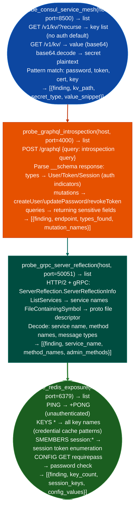

# Secrets/Access Infrastructure

Probe Consul KV store for unsealed secret material, enumerate GraphQL API schema via introspection to map authentication and data access endpoints, test gRPC server reflection for service definitions, and probe Redis for cached credentials and session tokens: identifying secrets infrastructure exposure in a target environment: via `modules/network_analyze.py`.

---

## Why this exists

1. `probe_consul_service_mesh()` with KV store access reveals secrets stored in Consul: many teams store database passwords, API keys, and TLS certificates in Consul's KV store as a lightweight secrets backend. `probe_consul_service_mesh()` recursively lists all keys at `/v1/kv/?recurse` without authentication in misconfigured deployments, and individual values are retrieved via `/v1/kv/<key>` as base64-encoded data. Consul KV secrets are typically stored in plaintext: no encryption at rest unless Vault transit is configured.

2. `probe_graphql_introspection()` maps the entire API surface via a single unauthenticated query: GraphQL's introspection feature returns the complete schema: every type, query, mutation, field name, argument name, and return type. This is equivalent to reading the API specification without needing documentation access. `probe_graphql_introspection()` sends `{"query": "{__schema{types{name fields{name type{name}}}}"}` and parses the response to identify authentication-related types `User`, `Token`, `Session`, mutation entry points for credential modification, and fields that return sensitive data types.

3. `probe_grpc_server_reflection()` enumerates gRPC service method definitions: gRPC Server Reflection port 50051 exposes a `ServerReflectionInfo` streaming RPC that returns protobuf file descriptors for all registered services. `probe_grpc_server_reflection()` reconstructs the service/method tree from the descriptor, identifying privileged operations admin RPC methods, credential management calls that may be callable without authentication from the internal network.

---

## How it works



---

## Usage

```python
from modules.network_analyze import (
    probe_consul_service_mesh,
    probe_graphql_introspection,
    probe_grpc_server_reflection,
    probe_redis_exposure
)

# Consul KV secrets
consul_findings = probe_consul_service_mesh(target_host, port=8500)
for f in consul_findings:
    if 'kv' in f.get('finding', '').lower():
        print(f"  KV key: {f.get('kv_path')} → {f.get('secret_type')}")

# GraphQL schema map
graphql_findings = probe_graphql_introspection(target_host, port=4000)
for f in graphql_findings:
    print(f"  GraphQL mutations: {f.get('mutation_names', [])[:5]}")
```

---

## Example output

The following is a schematic example showing output structure and field names. Values are illustrative.

```
probe_consul_service_mesh: <target-ip>:8500 (KV store)

  [CRITICAL] CONSUL_KV_OPEN:
    detail: /v1/kv/?recurse accessible without authentication; KV store contains
            service credentials, API keys, and configuration secrets in plaintext

probe_graphql_introspection: <target-ip>:4000

  [HIGH] GRAPHQL_INTROSPECTION_OPEN:
    Types: User, Token, AdminSession
    Mutations: createUser, resetPassword, revokeToken

probe_grpc_server_reflection: <target-ip>:50051

  [HIGH] GRPC_REFLECTION_OPEN:
    Services: auth.AuthService, admin.UserManagement
    Admin methods: DeleteUser, ResetCredentials, ListTokens
```

---

## False positives

**`probe_consul_service_mesh()` KV pattern matching**: keys with names matching `password`, `token`, or `cert` may contain non-sensitive placeholder values for example `password: changeme_in_prod`. Evaluate the actual decoded value rather than reporting based on key name alone.

**`probe_graphql_introspection()` mutation enumeration**: the presence of mutations like `resetPassword` is an inherent GraphQL feature, not a vulnerability in isolation. The finding is that introspection is unauthenticated, which reveals the schema to attackers. Confirm whether the mutations themselves require authentication before assessing impact.

---

## Pipeline position

Run secrets infrastructure probing after Consul and Redis ports are discovered via host/service discovery. Consul KV and Redis credential cache access provide the most direct credential material for lateral movement.

---

## Reading findings

Secrets infrastructure probe functions return `List[{severity, title, detail, host, port}]`:

| Field | Content |
|:---|:---|
| `severity` | `CRITICAL` unauthenticated KV/secrets / `HIGH` schema/mutation exposure |
| `title` | Finding code for example `CONSUL_KV_OPEN`, `GRAPHQL_INTROSPECTION_OPEN`, `VAULT_UNAUTHENTICATED` |
| `detail` | KV paths, exposed types/mutations, or plaintext secret excerpt |
| `host` | Target IP |
| `port` | Service port for example `8500` for Consul, `4000` for GraphQL |

---

## See also

- [Orchestration/Management Exposure](orchestration-management-exposure.md): Consul service catalog and Kong admin API
- [Observability Exposure](observability-exposure.md): Redis as observability backend; OTel pipeline data injection
