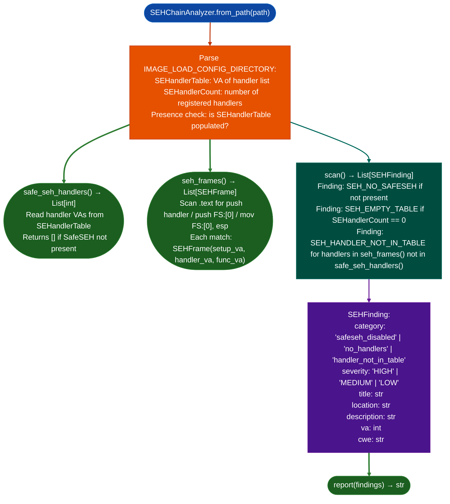

# SEH and SafeSEH Review

Analyze x86 (32-bit) Windows PE binaries for Structured Exception Handler (SEH) chain vulnerabilities: detecting whether SafeSEH is absent every SEH overwrite redirects execution, enumerating SafeSEH handler tables, and finding SEH frame setup patterns in the binary's code.

---

## Why this exists

1. **x86 Windows uses a stack-linked list of SEH frames: an attacker who overwrites a stack SEH frame can redirect execution to an arbitrary address when an exception fires.** `SEHChainAnalyzer.scan()` checks whether `SafeSEH` (`IMAGE_LOAD_CONFIG.SEHandlerTable`) is present in the binary, how many handlers are registered, and whether the registered handlers are appropriate subset of all exports: a SafeSEH table with zero entries is as bad as no SafeSEH at all.

2. **SafeSEH only protects against SEH-based overwrites when the binary is loaded in a process where all loaded DLLs have SafeSEH tables.** If any DLL lacks a SafeSEH table, the entire protection collapses: `SEHChainAnalyzer` identifies which specific DLL is the weak link. `SEHFinding.severity = 'CRITICAL'` for SafeSEH absent, `'HIGH'` for partial table present but small.

3. **`SEHChainAnalyzer.seh_frames()` finds SEH frame setup code patterns**: `push handler; push FS:[0]; mov FS:[0], esp`: identifying which functions install SEH handlers and which handler VAs they register. This is the starting point for identifying whether a specific overflowable SEH frame is in a security-sensitive function.

---

## How it works



---

## Usage

```python
from ablation.analyzers.seh_chain_analyzer import SEHChainAnalyzer

analyzer = SEHChainAnalyzer.from_path('target32.dll')
findings = analyzer.scan()
print(SEHChainAnalyzer.report(findings))

# Check SafeSEH table
handlers = analyzer.safe_seh_handlers()
print(f"SafeSEH handlers: {len(handlers)}")

# Find SEH frame setup patterns
frames = analyzer.seh_frames()
for frame in frames:
    print(f"  Setup: {frame.setup_va:#x}  Handler: {frame.handler_va:#x}")
```

---

## Example output

The following illustrates the SEH analysis output format. Actual findings are binary-specific.

```
SEHChainAnalyzer: target32.dll  (x86 PE)

SafeSEH table: Present  (<N> handlers)
SEH frames found in .text: <M>

Findings:

[HIGH] SEH_HANDLER_NOT_IN_TABLE
  handler_va: <va>  (not in SafeSEH table)
  setup_va:   <va>  (inside func: <name>)
  Handler is reachable by stack overwrite but not protected by SafeSEH
```

---

## False positives

**`SEH_HANDLER_NOT_IN_TABLE` fires when a handler VA found in `seh_frames()` does not appear in `safe_seh_handlers()`**, this can occur when the frame was set up by injected code or by a DLL that was not compiled with `/safeseh`. Confirm by checking which module the `handler_va` belongs to before treating it as a finding.

---

## Pipeline position

Run `SEHChainAnalyzer` on x86 (32-bit) Windows PE binaries identified as security-sensitive. It is x86-only: x86_64 Windows uses a different exception handling mechanism table-based unwinding that is not vulnerable to classic SEH overwrites. Use `CFGBypassDetector` for x86_64 Windows bypass analysis.

---

## Reading findings

`SEHChainAnalyzer.from_path(path).scan()` returns `List[SEHFinding]`. See [seh-chain-analyzer](seh-chain-analyzer.md) for the full field reference.

| Attribute | Content |
|:---|:---|
| `severity` | `'HIGH'` / `'MEDIUM'` / `'LOW'` / `'INFO'` |
| `category` | `'safeseh_disabled'` / `'no_handlers'` / `'handler_not_in_table'` / `'seh_frame_count'` / `'dynamic_handler_count'` |
| `title` | Short finding title |
| `location` | PE path or section name |
| `description` | Explanation of the SafeSEH bypass condition |
| `va` | VA of the relevant `push handler_va` instruction 0 if not applicable |
| `cwe` | CWE identifier |

---

## See also

- [Control Flow Guard Review](control-flow-guard-review.md): x86_64 Windows CFG bypass analysis
- [Crash Offset and ROP Helpers](crash-offset-and-rop-helpers.md): ROP chain construction using SEH handler target
- [Windows Artifact Discovery](windows-artifact-discovery.md): broader Windows binary analysis context
