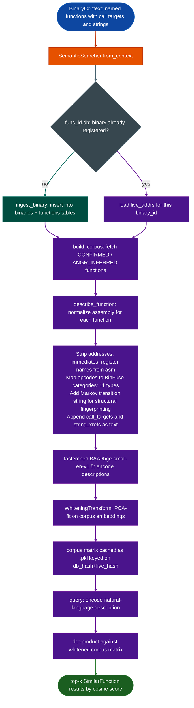

<a id="semanticsearcher"></a>
# Semantic Code Search

  - [What is semantic code search?](#what-is-semantic-code-search)
  - [Why this exists](#why-this-exists)
  - [How it works](#how-it-works)
  - [SemanticSearcher](#semanticsearcher)
  - [Usage](#usage)
  - [Example output](#example-output)
  - [False positives](#false-positives)
  - [Pipeline position](#pipeline-position)
  - [Reading results](#reading-results)
  - [See also](#see-also)

**File:** `ablation/analyzers/semantic_search.py`

---

## What is semantic code search? <sup>[↑](#semanticsearcher)</sup>

Semantic code search finds functions in a stripped binary by matching a natural-language description of behavior to function embeddings computed from disassembly. Instead of searching by symbol name (unavailable in stripped binaries) or by byte patterns (only matches known functions), it searches by meaning: "HTTP request parser," "AES key schedule," or "command injection sink that calls system()."

`SemanticSearcher` builds text descriptions from normalized opcode categories, call targets, strings, names, and roles, then encodes those descriptions and the natural-language query with the same general-purpose text-embedding model. Dot-product similarity ranks the candidates. This is behavioral text retrieval, not a model trained specifically on disassembly/query pairs and not proof of functional equivalence across compilers or architectures.

The implementation uses `BAAI/bge-small-en-v1.5` at 384 dimensions through `fastembed`, with PCA whitening fitted to the corpus. Corpus embeddings are cached so later queries can reuse them; first-build and query latency depend on corpus size, model initialization, and hardware.

## Why this exists <sup>[↑](#semanticsearcher)</sup>

1. **Stripped firmware has no symbol names.** The first step in any firmware RE engagement is identifying what functions exist and what they do. Without symbols, the only practical options are recognizing known patterns pattern matching or semantic similarity to function descriptions. When a pattern library has no coverage: a new target, a modified function, a custom cipher: the analyst needs a way to search by what the function *does* rather than what it is called. Semantic Code Search provides that capability.

2. **Direct binary similarity tools fail across architectures and compiler versions.** Tools that compare raw byte sequences or control flow graph structure produce false negatives when a function is recompiled with different optimization levels or ported across ISAs. A FortiGate x86 function and its FortiSwitch ARM64 counterpart implement the same algorithm but share almost no structural similarity at the byte or CFG level. Encoding both as behavioral embeddings opcode category sequences allows cross-architecture matching that structural tools cannot achieve.

3. **BERT embedding anisotropy must be corrected for threshold-based filtering to work.** Off-the-shelf BERT models produce embeddings that cluster in a narrow cone of the embedding space. Without correction, cosine similarity between unrelated function descriptions scores 0.6–0.9, making it impossible to set a threshold that separates true matches from noise. This searcher applies PCA whitening Su et al. 2021 so that unrelated pairs score 0.4–0.6 and true matches stay above 0.8: providing a calibrated, actionable similarity score.

---

## How it works <sup>[↑](#semanticsearcher)</sup>

The searcher operates in three stages: **assembly normalization**, **embedding**, and **whitened cosine retrieval**.



### Assembly normalization <sup>[↑](#semanticsearcher)</sup>

Raw disassembly contains build-specific tokens addresses, register names, large immediates that differ between compiler versions and must be stripped before encoding. After stripping, each opcode is mapped to one of 11 BinFuse semantic categories:

| Category | Representative opcodes |
|---|---|
| `ARITHMETIC_OP` | `add`, `sub`, `imul`, `div`, `inc`, `dec`, `neg` |
| `DATA_TRANSFER_OP` | `mov`, `lea`, `push`, `pop`, `ldr`, `str`, `ldp` |
| `COMPARISON_OP` | `cmp`, `test`, `cmn`, `tst`, `fcmp` |
| `LOGIC_OP` | `and`, `or`, `xor`, `not`, `eor`, `bic` |
| `BIT_SHIFT_OP` | `shl`, `shr`, `sar`, `rol`, `ror`, `lsl` |
| `UNCONDITIONAL_OP` | `jmp`, `call`, `ret`, `b`, `bl`, `br` |
| `CONDITIONAL_OP` | `je`, `jne`, `jl`, `jg`, `beq`, `bne`, `cbnz` |
| `MEMORY_MGMT_OP` | `rep`, `movs`, `stos`, `prefetch`, `nop` |
| `PROCESSOR_STATE_OP` | `pushf`, `cpuid`, `rdtsc`, `mrs`, `msr`, `svc` |
| `SYNCHRONIZATION_OP` | `lock`, `cmpxchg`, `dmb`, `dsb`, `ldar`, `stlr` |
| `VECTOR_MGMT_OP` | `vmovdqu`, `vpaddd`, `pcmpeqb`, `ld1`, `fld` |

Cross-architecture invariance: `mov rax, rbx` (x86-64), `ldr x0, [x1]` (AArch64), and `ldm r0, {r1,r2}` (ARM32) all produce `DATA_TRANSFER_OP`. The encoding measures *what a function does*, not *which ISA it uses*.

**Markov transitions** over the opcode category sequence capture structural fingerprints: the characteristic transition patterns of sorting algorithms, cipher rounds, protocol parsers. The top-5 most frequent adjacent-category transitions are appended to the description text.

**Operand type patterns** from BinDeep Tian et al., 2020: keeping `MEM[REG+IMM]` patterns alongside opcode categories adds approximately 1.2% F1 over opcode-only encoding.

### Embedding and whitening <sup>[↑](#semanticsearcher)</sup>

The normalized description text is encoded with `BAAI/bge-small-en-v1.5` via `fastembed`. The resulting 384-dimensional embeddings are post-processed with PCA whitening Su et al., 2021:

1. Compute mean `μ` and covariance `C` of the corpus embedding matrix.
2. Eigendecompose `C` → eigenvectors `V`, eigenvalues `λ`.
3. Whitening matrix `W = V × diag(1/√λ)`.
4. Apply: `e_whitened = (e - μ) × W`, then L2-normalize.

Without whitening, cosine similarity between unrelated BERT embeddings scores 0.6–0.9 unusably high. After whitening, unrelated pairs drop to 0.4–0.6 and true matches stay above 0.8, making the similarity score actionable.

### Caching <sup>[↑](#semanticsearcher)</sup>

The corpus is expensive to build ~549 seconds for 11,000 functions on CPU, ~4 hours for the full 296k function corpus. The searcher caches the whitened embedding matrix as a `.pkl` file at `~/.ablation/func_semantic_cache_BAAI_bge_small_en_v1_5_<live_hash>.pkl`. Cache validity is keyed on `sha256func_id.db`: any new function insertion invalidates the cache. A `live_addrs` hash is included so caches for different binaries do not collide.

Scoping the corpus to a single binary (via `from_context()`) encodes approximately 11k functions instead of all 296k: a 26x speedup on first build 9 minutes vs 4 hours, with a 0.1s hot-path cost on cache hits.

---

## SemanticSearcher <sup>[↑](#semanticsearcher)</sup>

```python
from ablation.analyzers.semantic_search import SemanticSearcher
from ablation.analyzers.binary_context import BinaryContext

# Always use from_context — scopes corpus to the binary
ctx = BinaryContext.load_or_build('/fw/fortigate/httpsd')
searcher = SemanticSearcher.from_context(ctx)

# Natural-language query
results = searcher.query("HTTP request header parser", top_k=5)
for r in results:
    print(f"  0x{r.va:x}  {r.name}  ({r.confidence})  score={r.score:.3f}")
```

### `query()` return type <sup>[↑](#semanticsearcher)</sup>

```python
@dataclass
class SimilarFunction:
    name: str          # function name from names registry or export table
    role: str          # analyst-assigned role (or '' if unknown)
    confidence: str    # 'CONFIRMED' | 'ANGR_INFERRED'
    va: int            # virtual address in the binary
    score: float       # whitened cosine similarity (0.0–1.0)
```

---

## Usage <sup>[↑](#semanticsearcher)</sup>

```python
from ablation.analyzers.semantic_search import SemanticSearcher
from ablation.analyzers.binary_context import BinaryContext

ctx = BinaryContext.load_or_build('/fw/cisco/lina')
searcher = SemanticSearcher.from_context(ctx)

# Query by vulnerability pattern
vuln_candidates = searcher.query("buffer allocation with user-controlled size argument")
for r in vuln_candidates:
    if r.score >= 0.78:
        print(f"CANDIDATE: 0x{r.va:x} {r.name}  score={r.score:.3f}")

# Query by function role
parsers = searcher.query("TLS record layer framing and decryption")
crypto = searcher.query("AES-CBC decrypt with IV buffer copy")

# Query using existing function description for cross-binary matching
from ablation.analyzers.semantic_search import describe_function
# Build description for a known function in one binary
desc = describe_function(
    name="ssl_process_client_hello",
    role="TLS handshake",
    call_targets=["malloc", "memcpy", "strlen"],
    strings=["ClientHello", "ssl_version"],
    asm_lines=["push rbp", "mov rbp, rsp", "sub rsp, 0x80"],
)
matches = searcher.query(desc)

# Force corpus rebuild after adding new named functions
searcher.invalidate_cache()
```

---

## Example output <sup>[↑](#semanticsearcher)</sup>

```
[semantic_search] query="AES key schedule" top_k=5

  0x40a200  sub_40a200   (CONFIRMED)     score=0.893
  0x40b100  aes_expand_key (CONFIRMED)   score=0.881
  0x40c500  sub_40c500   (ANGR_INFERRED) score=0.744
  0x411200  sub_411200   (ANGR_INFERRED) score=0.701
  0x419800  sub_419800   (CONFIRMED)     score=0.693

[semantic_search] query="unauthenticated buffer allocation from network input" top_k=3

  0x22ccc0  recv_handler   (CONFIRMED)   score=0.912
  0x22d400  process_packet (CONFIRMED)   score=0.847
  0x234000  sub_234000     (CONFIRMED)   score=0.789
```

---

## False positives <sup>[↑](#semanticsearcher)</sup>

**Protobuf and template stubs with zero callers.** Generated serialization stubs are structurally repetitive (many `DATA_TRANSFER_OP` + `COMPARISON_OP` sequences) and embed well on queries for data handling functions. The `live_addrs` filter in `from_context()` excludes functions not confirmed in this binary's analysis, eliminating most template stubs that were registered from other binaries. If false positives persist, tighten the score threshold from 0.78 to 0.85.

**Score saturation on short functions.** Short stubs and forwarding functions contain little behavioral text, so their scores can be unstable or surprisingly high. Review their instruction count and call targets and deprioritize trivial wrappers before deeper analysis.

**Cache staleness.** If new function names have been added to the names registry (`ctx.set_name()`) since the last corpus build, queries will not find the newly named functions until the cache is invalidated. Call `searcher.invalidate_cache()` then re-run the query.

**Cross-architecture false negatives.** The `from_context()` path scopes the corpus to CONFIRMED/ANGR_INFERRED functions in `func_id.db` for this specific binary. If a cross-binary match is needed for example finding the same algorithm in an ARM64 binary after identifying it in x86-64, the second binary must also be ingested into `func_id.db` and searched separately.

---

## Pipeline position <sup>[↑](#semanticsearcher)</sup>

**Before this module:** `BinaryContext.load_or_build()` to populate the names registry. The more named functions in the registry, the higher the quality of the corpus. `CorpusBuilder.build()` is typically run first to populate the registry from export tables, debug symbols, and cross-reference analysis.

**After this module:** Use query results as candidate function VAs for `FuncProfiler.profile()` deep behavioral analysis, `TaintTracker.trace_function()` taint trace from identified entry points, or `HeapVulnScanner.from_context()` heap corruption analysis. Semantic search surfaces candidates quickly; subsequent tools confirm them.

---

## Reading results <sup>[↑](#semanticsearcher)</sup>

| Field | Content |
|:---|:---|
| `va` | Virtual address of the matching function in the binary |
| `name` | Function name from the names registry (may be `sub_<hex>` if unnamed) |
| `role` | Analyst-assigned role string, if set |
| `confidence` | `CONFIRMED` manually named or from symbols / `ANGR_INFERRED` derived by analysis |
| `score` | Whitened cosine similarity: >0.85 = strong match, 0.75–0.85 = plausible, <0.75 = weak |

---

## See also <sup>[↑](#semanticsearcher)</sup>

- [Binary Context](binary-context.md): corpus ingest source; run `from_context()` first
- [Function Profiler](function-profiler.md): deep behavioral analysis for candidates found by semantic search
- [Pattern Library](pattern-library.md): replay confirmed patterns instead of text queries when patterns exist
- [AI-Guided Analysis](llm-analyst-loop.md): retrieves prior database records to add context to targeted LLM analysis
- [Binary Diffing & Patch Tracking](../workflows/cross-version.md): uses semantic similarity for cross-version function matching
