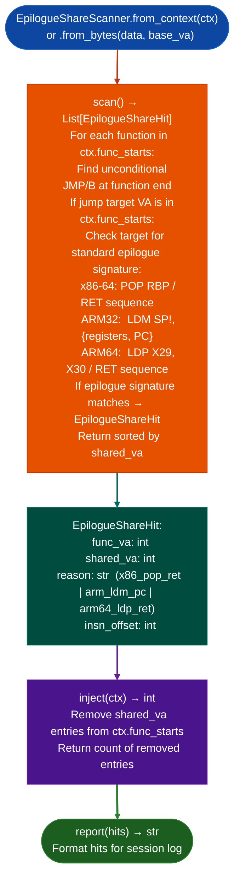

# Shared Epilogue Detection

Detect functions that share a tail block epilogue via unconditional jump: marking the shared block's address so the interprocedural taint loop skips it as a phantom function entry point, eliminating false-positive taint paths in corpus-wide analysis.

---

## Why this exists

1. **Some compilers merge the epilogue of multiple functions into a single shared block** reached via unconditional `JMP` or `B`: a size optimization common in MSVC for x86 PE targets, GCC for ARM thumb, and NXP VLE for ECU firmware. When `run_interprocedural()` encounters the shared block's address in `ctx.func_starts`, it treats it as an independent function entry and follows the taint path from there, producing a phantom result with no real source.

2. **The phantom taint path is not a false positive that TaintTracker can filter internally**: from TaintTracker's perspective, it is analyzing a real function entry with valid instructions. The only fix is to prevent the shared block from appearing in `func_starts` before the interprocedural loop starts. `EpilogueShareScanner.inject(ctx)` removes shared-epilogue entries from `ctx.func_starts` in place, upstream of TaintTracker.

3. **`EpilogueShareHit` records the function that jumps to the shared block, the shared block VA, and the reason the unconditional jump was classified as an epilogue share**: distinguishing tail calls different callee signature from epilogue shares (same frame teardown sequence: `POP RBP / RET` or `LDM SP!,{...,PC}`). This distinction is needed for accurate `report()` output and for manual review of ambiguous cases.

---

## How it works



---

## Usage

```python
from ablation.analyzers.epilogue_share_scanner import EpilogueShareScanner
from ablation.analyzers.binary_context import BinaryContext

ctx = BinaryContext.load_or_build('/path/to/target.so')

scanner = EpilogueShareScanner.from_context(ctx)
hits = scanner.scan()

# Remove phantom entries before interprocedural analysis
removed = scanner.inject(ctx)
print(f"Removed {removed} shared-epilogue phantom entries from func_starts")

if hits:
    print(EpilogueShareScanner.report(hits))
```

Run `EpilogueShareScanner.inject(ctx)` immediately after `BinaryContext.load_or_build()` and before any call to `TaintTracker` or `run_interprocedural()`.

---

## Example output

The following illustrates shared epilogue detection output format. Actual addresses are binary-specific.

```
EpilogueShareScanner: target.so

Hits: <N>

  func_va=<va_a>  →  shared_va=<va_b>  (x86_pop_ret)
  func_va=<va_c>  →  shared_va=<va_b>  (x86_pop_ret)
  func_va=<va_d>  →  shared_va=<va_e>  (arm64_ldp_ret)

inject(): <N> phantom entries removed from ctx.func_starts
```

---

## False positives

**Unconditional jumps to a non-epilogue code block may be misclassified as epilogue shares**: if the target block happens to start with `POP RBP` for other reasons, `EpilogueShareScanner` will mark it as a shared epilogue. Verify that the target is genuinely a frame teardown sequence and not a block that opens with a stack restoration for other reasons before accepting `inject()` removals.

**ARM32 `LDM SP!, {r4-r7, PC}` pattern may not match all calling conventions**: the epilogue signature check requires the register list to include PC. Non-standard calling conventions that use PC restore via `MOV PC, LR` are not detected and will not be marked as shared epilogues.

---

## Pipeline position

Run `EpilogueShareScanner` once per binary immediately after `BinaryContext.load_or_build()` and before `TaintTracker.run_interprocedural()`. It is a one-time preprocessing step, no findings to triage, only `inject()` to call.

---

## Reading output

`EpilogueShareScanner.scan()` returns a list of `EpilogueShareHit` objects:

| Attribute | Content |
|:---|:---|
| `from_func_va` | VA of the function that contains the unconditional jump |
| `jump_va` | VA of the jump instruction itself |
| `target_va` | VA where the jump lands the shared epilogue entry |
| `host_func_va` | VA of the function whose body the target lands inside |

`EpilogueShareScanner.inject(ctx)` adds all `target_va` values to `ctx.shared_epilogues` and returns `int`: the count of entries added.

---

## See also

- [Named Taint Sources and Bounds](named-taint-sources-and-bounds.md): `TaintTracker` that consumes the cleaned `ctx.func_starts`
- [Persistent Analysis Context](persistent-analysis-context.md): `BinaryContext` whose `func_starts` is modified by `inject()`
