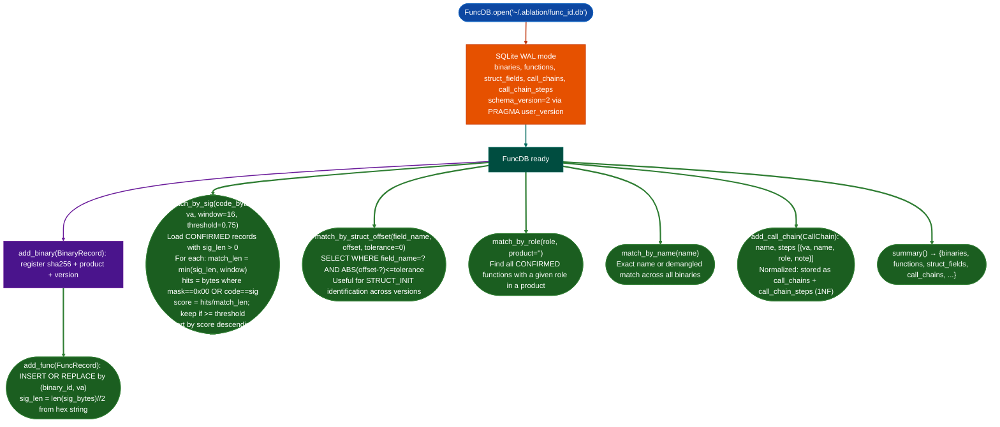
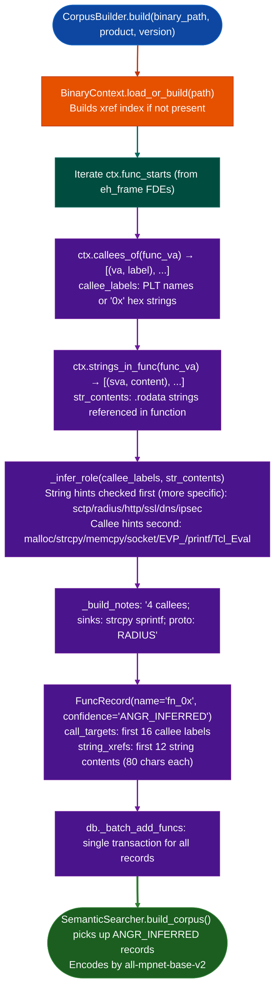

# Signature-Based Auto-Naming

Identify unknown functions in stripped binaries by matching their byte patterns, call graph neighborhoods, struct field access offsets, and referenced strings against a database of confirmed function identities accumulated across prior RE engagements, so repeated encounters with the same function across firmware versions require only one human identification.

---

## Why this exists

1. **Stripped firmware contains the same function in every build, unnamed every time.** FortiOS ships dozens of builds per year. The `fadcsystem` command dispatch function appears in every one of them, at a different virtual address, with a different prologue shape. Without a cross-version identity database, each build starts from zero: semantic search, profiler triage, manual disassembly: all to re-confirm a function the analyst confirmed six months ago. `FuncDB` stores confirmed function records keyed by binary SHA256, and `match_by_sig()` finds the same function in the new build in under a second.

2. **Byte-pattern matching needs wildcard masking to survive recompilation.** A naive byte-for-byte comparison fails across compiler version changes or optimization level changes: even when the function logic is identical. The `CALL rel32` instruction encoding changes every build because the callee address changes. The wildcard mask marks those bytes as `0x00` (skip) and the surrounding bytes as `0xff` must match. The pattern matches even when relative call targets differ between builds.

3. **Struct field offsets anchor function identity when byte patterns differ.** An ASLR-compiled `STRUCT_INIT` function has no reliable byte-level fingerprint: the code changes substantially when the struct layout shifts by one field. But the struct itself persists: `gp_name` at offset `0x2b0` is present across every FortiOS major version. `match_by_struct_offset()` finds all functions that access that field, letting the analyst identify the init function by what data structure it initializes rather than by what opcodes it uses.

4. **`CorpusBuilder` creates coverage for libraries with no prior RE work.** When an engagement introduces a new shared library (`libparse.so`) that has never been analyzed, `SemanticSearcher.build_corpus()` requires function records in `func_id.db` before it can produce embeddings. `CorpusBuilder.build()` runs in one call, indexes every function discovered via `eh_frame` FDE entries, infers roles from callee PLT names and referenced strings, and populates the database. The resulting `ANGR_INFERRED` records give semantic search a starting point without any manual analysis.

---

## How it works

### FuncDB: identity store



### CorpusBuilder: initial indexing pass



### Function confidence levels

| Confidence | Source | Used by |
|---|---|---|
| `CONFIRMED` | Analyst-confirmed via taint trace or CVE | `match_by_sig()`, all match methods |
| `ANGR_INFERRED` | `CorpusBuilder.build()`: heuristic role inference | `SemanticSearcher.build_corpus()` |
| `CANDIDATE` | Preliminary classification, not yet confirmed | Not used by matchers |

### Role taxonomy (partial)

```
AAA_DISPATCH  RADIUS_PARSER  RADIUS_ATTR_HANDLER  RADIUS_DISPATCH
TACACS_PARSER  CRYPTO_HPKE  CRYPTO_OPENSSL  CRYPTO_IPC
FILE_IO  TIMER  STRUCT_INIT  STRUCT_ACCESSOR
SAML_HANDLER  CSTP_HANDLER  DTLS_HANDLER  PLT_LIBC
HEAP_ALLOC  BUFFER_COPY  MEMORY_OP  FORMAT_STRING
NETWORK_IO  SYNCHRONIZATION  CRYPTO  LOGGING  TCL_INTERP
SCTP_HANDLER  DIAMETER_HANDLER  RADIUS_HANDLER  HTTP_HANDLER
TLS_HANDLER  IPSEC_HANDLER  DNS_HANDLER  IPS_DECODER  AV_SCANNER
```

---

## Usage

```python
from ablation.analyzers.func_id_db import FuncDB, BinaryRecord, FuncRecord, StructField, CallChain
from ablation.analyzers.binary_context import BinaryContext

ctx = BinaryContext.load_or_build('/fw/fortigate/httpsd')

with FuncDB.open() as db:
    # Register binary
    db.add_binary(BinaryRecord(
        sha256=ctx.sha256,
        path_hint='/fw/fortigate/httpsd',
        product='httpsd',
        arch='x86-64',
        version='7.4.1',
    ))

    # Register confirmed function after taint trace confirmation
    db.add_func(FuncRecord(
        binary_sha256=ctx.sha256,
        va=0x22ccc0,
        name='recv_handler',
        role='HTTP_HANDLER',
        confidence='CONFIRMED',
        sig_bytes='55 48 89 e5 41 57 41 56 00 00 00 00 00 48 83 ec 30',
        sig_mask ='ff ff ff ff ff ff ff ff 00 00 00 00 00 ff ff ff ff',
        call_targets=['SSL_get_peer_certificate', 'fadcsystem', 'malloc'],
        string_xrefs=['recv_handler: bad client cert', '/admin/login'],
        notes='CRITICAL: ssl cert CN → fadcsystem arg1',
    ))

    # Register struct field for cross-version identity
    db.add_struct_field(StructField(
        struct_name='gp_session',
        field_name='client_cert_cn',
        offset=0x2b0,
        binary_sha256=ctx.sha256,
        width=8,
        version_str='7.4.1',
    ))

    # Match in new binary
    new_ctx = BinaryContext.load_or_build('/fw/fortigate_761/httpsd')
    code = open('/fw/fortigate_761/httpsd', 'rb').read()
    for func_va in new_ctx.func_starts:
        offset = func_va - new_ctx.base_va
        matches = db.match_by_sig(code[offset:offset+32], func_va)
        for m in matches:
            if m['match_score'] >= 0.90:
                print(f"  MATCH 0x{func_va:x} ← {m['name']} [{m['product']}:{m['version']}] score={m['match_score']}")

    # Match by role across all Fortinet binaries
    radius_parsers = db.match_by_role('RADIUS_PARSER', product='lina')

    # Print summary
    print(db.summary())
```

---

## CorpusBuilder

```python
from ablation.analyzers.corpus_builder import CorpusBuilder
from ablation.analyzers.semantic_search import SemanticSearcher

# Build corpus for a new library
cb = CorpusBuilder()  # uses ~/.ablation/func_id.db
count = cb.build(
    '/fw/fortios7/libparse.so',
    product='libparse',
    version='7.4.1',
)
print(f'Indexed {count} functions')

# SemanticSearcher now has embeddings for all ANGR_INFERRED functions
searcher = SemanticSearcher()
n = searcher.build_corpus()  # encodes CONFIRMED + ANGR_INFERRED records
results = searcher.query(
    'RADIUS attribute parsed into stack buffer without length validation',
    top_k=10
)
for r in results:
    print(f"  0x{r.va:x}  {r.score:.3f}  {r.name}  [{r.role}]")
```

---

## Example output

```
[corpus_builder] loading BinaryContext for libparse.so...
[corpus_builder] 2741 functions, 12804 strings, 31203 xref pairs
[corpus_builder] inserted 2741 ANGR_INFERRED records  (3.1 sec)

FuncDB summary:
  binaries:         18
  functions:      6 203
  struct_fields:    412
  call_chains:       47
  call_chain_steps: 189
  schema_version:     2

MATCH 0x22ccc0 ← recv_handler [httpsd:7.4.1] score=0.941
MATCH 0x40b100 ← http_param_execute [httpsd:7.4.1] score=0.907
```

---

## False positives

**High score for a different function with similar prologue.** Two unrelated functions that happen to begin with the same push/pop sequence can match at a score above 0.75 when the window is short. Verify byte-pattern matches against the callee set: if the matched `FuncRecord.call_targets` list does not approximately match the actual callees of the candidate function, the match is a false positive. Use `window=32` for narrower hits at the cost of lower recall on functions shorter than 32 bytes.

**`ANGR_INFERRED` role wrong on multi-purpose functions.** The `_infer_role` heuristic assigns the first matching role. A function that calls both `socket()` and `SSL_connect()` receives `NETWORK_IO`, not `TLS_HANDLER`, because `NETWORK_IO` appears first in `_ROLE_HINTS`. These inferences affect the semantic search corpus quality but do not produce false positives in the matching path: `match_by_sig()` only queries `CONFIRMED` records.

**Struct offset tolerance misidentification.** `match_by_struct_offset'gp_name', 0x2b0, tolerance=8` returns every struct field named `gp_name` within ±8 bytes of offset `0x2b0`. When two different structs both have a `gp_name` field near that offset, the match is ambiguous. Qualify by `version_str` to narrow to the correct firmware version.

---

## Pipeline position

**Before this module:** First, run `CorpusBuilder.build()` on every new binary before calling `SemanticSearcher.build_corpus()`. Then run semantic search to identify candidates. After confirming with `TaintTracker`, populate `FuncDB` with `CONFIRMED` records for the newly identified function.

**After this module:** `match_by_sig()` results supply function names to `ctx.set_names_bulk()`. `match_by_role()` results supply the complete role inventory for the binary, used in call graph construction and attack chain documentation.

---

## Reading results

| Field | Content |
|:---|:---|
| `FuncRecord.sig_bytes` | Hex-encoded byte sequence 2 chars per byte, e.g., `"55 48 89 e5"` |
| `FuncRecord.sig_mask` | Wildcard mask: `ff` = must match, `00` = skip matches any byte |
| `FuncRecord.role` | Role tag from the taxonomy above |
| `FuncRecord.confidence` | `CONFIRMED` / `ANGR_INFERRED` / `CANDIDATE` |
| `match_score` | Proportion of non-wildcard bytes that matched, range 0.0–1.0 |
| `CallChain.chain` | `[{va, name, role, note}, ...]` ordered list of steps |

---

## See also

- [Semantic Code Search](semantic-code-search.md): consumes `ANGR_INFERRED` records produced by `CorpusBuilder`
- [Analyst Naming Registry](analyst-naming-registry.md): session-scoped name overlay; `FuncDB` provides the cross-session identity store
- [Binary Context](binary-context.md): supplies `func_starts`, `callees_of()`, and `strings_in_func()` to `CorpusBuilder`
- [Function Profiler](function-profiler.md): uses `match_by_role()` results to focus profile runs on known-dangerous roles
