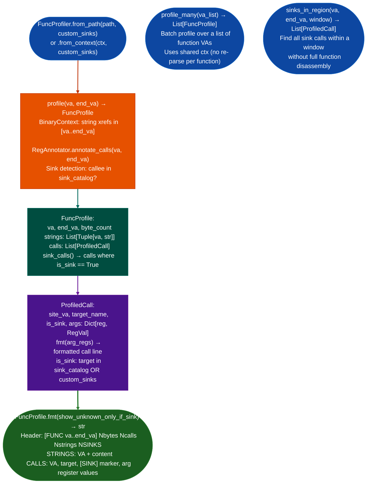

# Single Function Profiling

Produce a complete analysis report for one function in a single call: combining string cross-references, callee annotation, sink detection, and register argument values from `BinaryContext`, `RegAnnotator`, and the sink catalog: replacing the four-call manual sequence `callees_of()` + `dump_text()` + `annotate_calls()` + string lookup.

---

## Why this exists

1. **Manual triage of a candidate function requires four separate tool calls: enumerate callees, dump disassembly, annotate call arguments, and look up string cross-references.** `FuncProfiler.profile()` collapses these into a single call that returns a `FuncProfile` with all four outputs in one structured block, formatted for immediate reading. On a function with 10 calls and 4 string references, this saves roughly 15 minutes of manual assembly.

2. **`FuncProfiler` integrates sink awareness directly into the profile output: each call site is annotated as `[SINK]` if the callee name appears in the sink catalog default or custom.** Without sink tagging, an analyst reading raw call output must mentally cross-reference against a sink list. With sink tagging, the first line of the profile shows `2 SINKS` and the sink call sites are marked inline.

3. **`FuncProfiler` accepts custom sinks via `custom_sinks={'exec_handler': [2]}`: the dict maps function names to argument positions.** This allows vendor-specific wrapper functions `fadcsystem`, `vendor_exec` to be treated as sinks in the profile without modifying the global sink catalog.

---

## How it works



---

## Usage

```python
from ablation.analyzers.func_profiler import FuncProfiler
from ablation.analyzers.binary_context import BinaryContext

ctx = BinaryContext.load_or_build('/path/to/target.elf')

# Basic single-function profile
fp = FuncProfiler.from_context(ctx)
profile = fp.profile(va=0x1000, end_va=0x1200)
print(profile.fmt())

# With custom sinks
fp2 = FuncProfiler.from_path(
    '/path/to/target.elf',
    custom_sinks={'exec_handler': [2], 'fad_csystem': [0]}
)
profile2 = fp2.profile(va=0x1000, end_va=0x1200)

# Check if function has a specific sink
if profile2.has_sink('exec_handler'):
    for call in profile2.sink_calls():
        print(call.fmt())

# Batch profile
profiles = fp.profile_many([0x1000, 0x2000, 0x3000])
for p in profiles:
    print(p.fmt())

# Quick sink scan over a large region
sinks = fp.sinks_in_region(va=0x401000, end_va=0x420000, window=4096)
```

---

## Example output

```
[FUNC 0x1000..0x1200]  357B  11 calls  4 strings  2 SINKS

STRINGS:
  0x8000  '/bin/target-binary'
  0x1a5f10  '--output-path'
  0x1a5f28  '/var/private/test-path'
  0x1a5e00  'help'

CALLS:
  0x100c  strncpy         rdi=Arg(0)  rsi=0x8004  rdx=Const(256)
  0x1020  recv            rdi=Arg(1)  rsi=[rbp-0x100]  rdx=Const(0x400)
  0x1034  system  [SINK]  rdi=Ret(recv)
```

---

## False positives

**`is_sink` classification uses callee name matching: a callee named `exec_result_handler` matches the `exec` prefix in some catalog configurations.** Review `profile.fmt()` output to confirm that `[SINK]`-tagged calls are genuine exec sinks and not name-collision matches. Extend the catalog with full function names rather than prefixes for vendor-specific wrappers.

---

## Pipeline position

Step 6 in the RE workflow CLAUDE.md: `FuncProfiler.profile()` on top candidates from `SemanticSearcher`. This is the standard triage step before `SinkArgClassifier`: the profile gives the human analyst enough context strings, call pattern, sink presence to decide whether to proceed to taint analysis or discard the candidate.

---

## Reading output

`FuncProfiler.profile(va)` returns a `FuncProfile` object:

| Attribute | Content |
|:---|:---|
| `va` | Entry VA of the profiled function |
| `end_va` | End VA last instruction |
| `size` | Function size in bytes |
| `strings` | `List[va, string]`: string references within the function |
| `calls` | `List[ProfiledCall]`: all call sites with argument register annotations |
| `sink_calls` | `List[ProfiledCall]`: only the sink-classified calls property |

`FuncProfile.has_sink(name)` returns `True` if any sink call's `target_name` matches `name`.

---

## See also

- [Call Argument Annotation](call-argument-annotation.md): `RegAnnotator` underlying the CALLS section
- [Sink Argument Classifier](sink-argument-classifier.md): next step after profiling confirms a sink
- [Control-Flow Graph Construction](control-flow-graph-construction.md): `CFGBuilder` used within `BinaryContext` for disassembly
