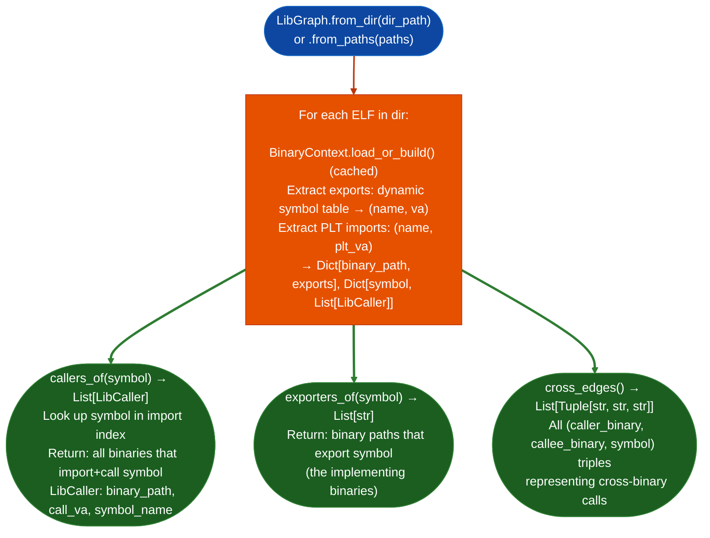

# Cross-Binary Import/Export Graph

Build a unified import/export graph for all ELF binaries in a firmware directory: providing `callers_of(symbol)` lookups that identify every binary and function VA that imports and calls a named symbol, enabling cross-library attack surface analysis without loading each binary individually.

---

## Why this exists

1. **`TaintTracker` and `CrossBinaryTaintTracker` need to know which binaries import a given symbol to perform cross-binary taint analysis.** Without `LibGraph`, identifying all callers of `ssl_read()` across 80 firmware libraries requires running `BinaryContext.load_or_build()` on each library separately. `LibGraph.from_dir()` builds the full import/export matrix for all libraries in one call: subsequent `callers_of()` queries are O(1) lookups.

2. **`LibGraph.from_dir()` caches `BinaryContext` hits at ~110ms per binary**: enabling fast re-use across sessions without rebuilding the full context for each library. The cache hit rate for a stable firmware image is ~100%, making the second and subsequent `LibGraph.from_dir()` calls near-instant.

3. **`LibGraph` is the resolution layer used by `CrossBinaryTaintTracker`**: when a taint path exits one binary via a PLT stub, `CrossBinaryTaintTracker` calls `lib_graph.callers_of()` to find the implementing binary and VA, then continues taint propagation there. `LibGraph` is not optional for cross-binary taint analysis; it is the mandatory dependency.

---

## How it works



---

## Usage

```python
from ablation.analyzers.lib_graph import LibGraph

lg = LibGraph.from_dir('/path/to/firmware/rootfs/usr/lib/')

# All callers of system()
for caller in lg.callers_of('system'):
    print(f"  {caller.binary_path}:{caller.call_va:#x}")

# Who implements SSL_read?
for path in lg.exporters_of('SSL_read'):
    print(f"  Exported by: {path}")

# All cross-library edges
for src, dst, sym in lg.cross_edges():
    print(f"  {src} → {dst} via {sym}")
```

---

## Example output

The following illustrates LibGraph output format. Actual names and addresses are firmware-specific.

```
LibGraph: /path/to/firmware/rootfs/usr/lib/  (<N> binaries)

callers_of('system'):
  libhttpd.so        call_va=<va>
  libmgmt.so         call_va=<va>
  libcli_handler.so  call_va=<va>

exporters_of('SSL_read'):
  libssl.so.1.1

cross_edges(): <E> edges
```

---

## False positives

**PLT import detection is by name**: two binaries that both import `system` appear as separate callers in `callers_of('system')`. If one binary wraps `system` and the other calls the wrapper (not `system` directly), the wrapper call chain is not captured in `LibGraph`. Use `CrossBinaryTaintTracker` for verified path analysis.

**`from_dir()` includes all `.so` files**: test libraries, debug libraries, or stale libraries in the same directory will be indexed. Filter by known library set using `from_paths()` when the directory contains non-production files.

---

## Pipeline position

Build `LibGraph` once per firmware image at session start, before any `CrossBinaryTaintTracker` run. Store it as a session variable, it is reused by all subsequent cross-library analysis steps. Do not rebuild per-target; one `LibGraph` covers the entire firmware image.

---

## Reading output

`LibGraph.buildrootfs_path` returns a `LibGraph` object:

| Method | Return |
|:---|:---|
| `callers_offunc_name` | `List[{library, call_va}]`: all call sites of `func_name` across the corpus |
| `exporters_offunc_name` | `List[str]`: libraries that export `func_name` |
| `binaries` | `List[str]`: all library paths in the corpus |
| `binary_count` | Integer: number of binaries loaded |

---

## See also

- [Configurable Taint Reporting](configurable-taint-reporting.md): `CrossBinaryTaintTracker` that uses `LibGraph` for import resolution
- [Native Library Inventory](native-library-inventory.md): `LibraryInventory` for per-library triage before `LibGraph` construction
