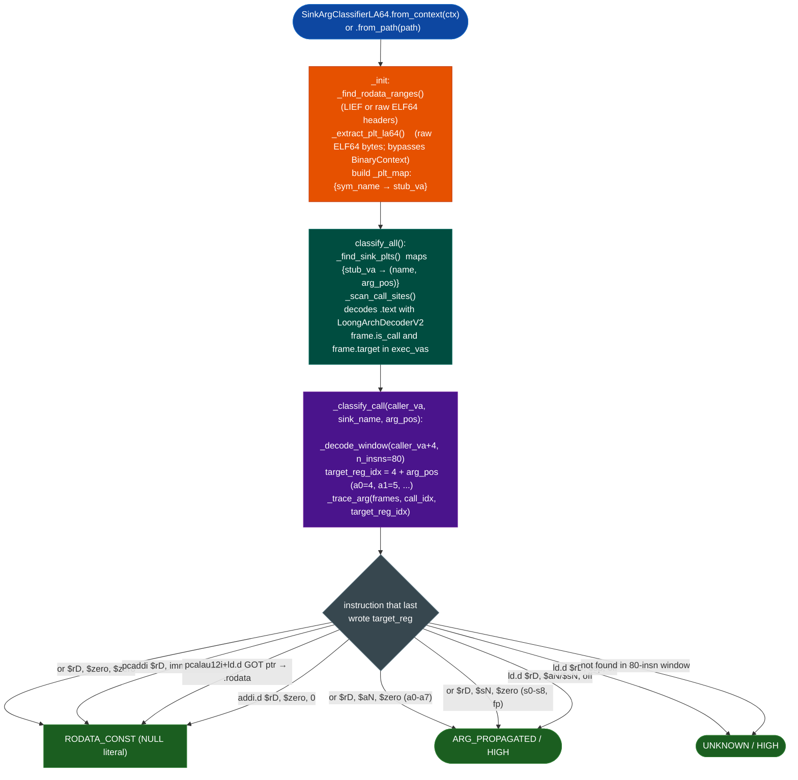

# SinkArgClassifierLA64

Classify exec-class sink call-site argument provenance on stripped LoongArch64 ELF binaries.
Runs before `TaintTracker` to eliminate hardcoded-literal sinks from the triage queue
and to identify call sites where user-controlled data reaches an exec-class function.

---

## Why this exists

1. `sac_for_context()` dispatched all `loongarch64` binaries to the x86-64 `SinkArgClassifier` before this module.  That classifier uses Capstone for call-site discovery.  Capstone 5.x has no LoongArch support, so every LA64 binary returned 0 results.  This module is the LA64 SAC gap closure.

2. BinaryContext returns 0 PLT entries for LA64 binaries when the GOT base offset is large.  Confirmed on Alpine execline 2.9.9.1 where the GOT is at 0x2faa0.  This module decodes PLT stubs from raw ELF bytes, bypassing BinaryContext entirely, so PLT resolution works regardless of GOT offset.

3. The `bl` instruction on LA64 uses a 26-bit split-field offset where the low 16 bits and high 10 bits are stored in non-contiguous positions.  The naive formula `insn & 0x3FFFFFF` produces the wrong target.  Delegating call-site discovery to `LoongArchDecoderV2` keeps the split-field formula in one place and prevents the bug from reappearing in new scanners.

4. Alpine musl-libc binaries (execline, s6, s6-networking) do not call `execv` directly.  They route all process spawning through skarnet wrapper functions such as `cspawn`, `xexec_ae`, and `xmexec_afn`.  `add_sink()` registers these vendor wrappers without modifying the module.

---

## How it works



---

## Usage

```python
from ablation.analyzers.binary_context import BinaryContext
from ablation.analyzers.sink_arg_classifier_loongarch64 import SinkArgClassifierLA64

ctx = BinaryContext.load_or_build('/path/to/la64_binary')
clf = SinkArgClassifierLA64.from_context(ctx)

# Default sinks: execv, execve, execvp, execvpe, execl, execlp, popen, system
results = clf.classify_all()
print(clf.report(results))

# Register vendor-specific wrappers
clf2 = SinkArgClassifierLA64.from_context(ctx)
clf2.add_sink('cspawn',            arg_pos=0)  # skarnet process spawn
clf2.add_sink('xexec_ae',          arg_pos=0)  # execline primary exec path
clf2.add_sink('xmexec_afn',        arg_pos=0)
clf2.add_sink('el_modif_and_exec', arg_pos=0)
results = clf2.classify_all()
print(clf2.report(results))
```

`add_sink()` registers one argument position per call.
To classify multiple arguments of the same function, construct two classifiers with separate `add_sink()` calls and run `classify_all()` on each.
`_sinks` is keyed by name, so a second `add_sink('cspawn', 1)` on the same instance overwrites the first.

---

## PLT resolution

The module decodes PLT stubs from raw ELF bytes without using BinaryContext.  Each 16-byte LA64 PLT stub has the pattern:

```
pcaddu12i $t3, N      ; GOT page: stub_VA + N*0x1000
ld.d      $t3, $t3, M ; GOT slot: page + M
jirl      $zero, $t3, 0
andi      $zero, $zero, 0x0  ; pad
```

The module reads `.rela.plt` to build a GOT-address-to-symbol-name map, then walks each stub and computes `got_addr = stub_va + N*0x1000 + M`.  This handles binaries where `BinaryContext.plt` is empty due to large GOT offsets.

---

## Argument trace patterns

| Pattern | Verdict |
|---|---|
| `or $rD, $zero, $zero` | RODATA_CONST (NULL literal) |
| `pcaddi $rD, imm` and target in .rodata | RODATA_CONST |
| `pcalau12i $rD, imm20` + `ld.d $rD, $rD, disp` and GOT pointer in .rodata | RODATA_CONST |
| `addi.w/addi.d $rD, $zero, 0` | RODATA_CONST (NULL) |
| `or $rD, $aN, $zero` ($a0-$a7) | ARG_PROPAGATED (entry argument) |
| `or $rD, $sN/$fp, $zero` | ARG_PROPAGATED (callee-saved; SAC-LA64-CALLEE-001) |
| `ld.d/ldptr.d $rD, $aN/$sN, off` | ARG_PROPAGATED (struct field from arg/callee base) |
| `ld.d/ldptr.d $rD, $sp, off` | UNKNOWN (stack slot; origin not traced) |
| Not found in 80-insn lookback | UNKNOWN |

Trace depth is bounded at 1 recursive level.
Deeper copy chains (register copied through two or more intermediary registers before the call) return UNKNOWN rather than a false RODATA_CONST.
Conservative toward ARG_PROPAGATED: callee-saved registers are classified ARG_PROPAGATED because on all confirmed LA64 binaries they hold values derived from parsed external data, not from `.rodata`.
A forward scan from function entry would confirm the source; the SAC does not do that.

---

## Ground truth

| Binary | Sink | arg_pos | Verdict | Detail |
|---|---|---|---|---|
| mqtt-exec 0.7.1 (Alpine LA64) | execv | 0 | RODATA_CONST | pcalau12i+ld.d GOT ptr in .rodata (hardcoded program path) |
| mqtt-exec 0.7.1 (Alpine LA64) | execv | 1 | ARG_PROPAGATED | argv slots filled from MQTT topic+payload via alsl.d+st.d |
| s6-tcpserverd 2.8.0.0 (Alpine LA64) | cspawn | 0 | ARG_PROPAGATED | ldptr.d $a0, $a1 (CLI argv passed through) |
| s6-tcpserverd 2.8.0.0 (Alpine LA64) | cspawn | 1 | ARG_PROPAGATED | ld.d $a1, $fp, -808 (callee-saved frame slot; SAC-LA64-CALLEE-001) |

s6-tcpserverd manual taint review (session 14): cspawn argv originates from `subgetopt_r` CLI argument parsing, not from network data.  Verdict is SAFE by design — the program path and argument vector are operator-configured at daemon startup.

---

## Limitations

- Stack-spilled arguments return UNKNOWN.  A register spilled to `$sp+N` and reloaded loses the chain.
- Indirect calls (target=0) are not classified.  `frame.is_call=True, frame.target=0` means the callee address is in a register at runtime; the stub VA cannot be matched.
- SNPRINTF_RODATA classification (format-string intermediary pattern) is not implemented.  The x86-64 SAC handles this; LA64 does not yet have the equivalent.
- Coverage requires the sink symbol to appear in `.rela.plt`.  Statically-linked or inlined exec wrappers are not found.

---

## Module gap history

| Session | Gap |
|---|---|
| 14 | LA64 SAC gap confirmed: sac_for_context() returned 0 on mqtt-exec 0.7.1 |
| 14 | BinaryContext PLT bug confirmed: 0 entries on execline 2.9.9.1 (GOT@0x2faa0) |
| 14 | bl split-field encoding bug found in raw scanner; fixed by delegating to decoder |
| 14 | Module created; sac_for_context() wired for loongarch64 |
| 15 | _trace_arg refactored from op_str string parsing to frame.operands indices |

---

## See also

- [LoongArch64 Analysis Stack](loongarch64.md): decoder, CFG, TaintTracker, structured operands
- [SinkArgClassifier](sink-arg-classifier.md): x86-64 SAC (the original; LA64 follows its interface)
- [SinkArgClassifier PPC64 ELFv2](sink-arg-classifier-ppc64-elfv2.md): architecture-specific SAC pattern this module follows
