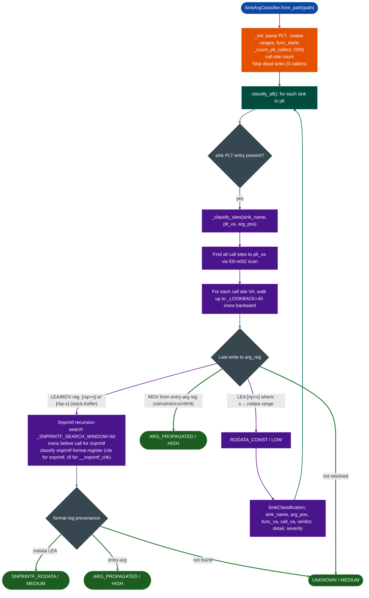

<a id="sinkargclassifier"></a>
# Dangerous Call Classification

  - [What is sink argument classification?](#what-is-sink-argument-classification)
  - [Why this exists](#why-this-exists)
  - [How it works](#how-it-works)
  - [Usage](#usage)
  - [Integration in the RE workflow](#integration-in-the-re-workflow)
  - [Example output](#example-output)
  - [False positives](#false-positives)
  - [Pipeline position](#pipeline-position)
  - [Reading findings](#reading-findings)
  - [See also](#see-also)

**File:** `ablation/analyzers/sink_arg_classifier.py`

---

## What is sink argument classification? <sup>[↑](#sinkargclassifier)</sup>

An exec-class sink is any function that causes the OS to execute a command: `system()`, `popen()`, `execve()`, `execl()`, and vendor-specific wrappers around them. Every call to such a function in a firmware binary is a candidate for command injection. A 100,000-instruction binary may have hundreds of such call sites. Running `TaintTracker` on all of them, starting from every network entry point, wastes significant time on calls that can never be exploited because their command string is a compile-time constant.

`SinkArgClassifier` solves this with a targeted pre-pass. For each exec-class sink call site, it walks backward through the calling function's instruction stream to classify the command-string argument's provenance into one of four categories. `RODATA_CONST` means the string comes from a fixed address in `.rodata` and the attacker cannot influence it. `SNPRINTF_RODATA` means the string was built by an `snprintf` call whose format string is a `.rodata` constant. `ARG_PROPAGATED` means the string came from an argument to the enclosing function and could be attacker-controlled if the enclosing function is reachable from network input. `UNKNOWN` means the analysis could not resolve the origin within a bounded lookback window.

Only `ARG_PROPAGATED` and `UNKNOWN` sites need to go to `TaintTracker`. `RODATA_CONST` and parameterless `SNPRINTF_RODATA` sites are safe by construction. In practice, `SinkArgClassifier` eliminates roughly 80% of exec-class call sites before taint tracking begins, reducing the analysis surface to the small fraction that is actually exploitable.

## Why this exists <sup>[↑](#sinkargclassifier)</sup>

1. **TaintTracker wastes effort on sinks that cannot be exploited.** A `system("/bin/ls")` call is a sink in name only: the argument originates from `.rodata`, not from user input. Passing every exec-class call site to `TaintTracker` means tracing dozens of unreachable sinks for every real one. `SinkArgClassifier` runs first and stamps `RODATA_CONST` on every hardcoded-literal sink, removing them from the taint queue entirely.

2. **Most firmware shell invocations go through a snprintf buffer.** The dominant pattern in Fortinet, Aruba, and Cisco firmware builds a shell command with `snprintfcmd, sizeof(cmd, '/bin/tool %s', user_param)` and passes `cmd` to a vendor exec function. A pure backward trace from the exec site sees a stack-buffer argument and returns `UNKNOWN`: the format string is never examined. This tool follows the stack buffer one level up to the `snprintf` call and classifies the `snprintf` format register: if that register also holds a `.rodata` literal, the verdict changes from `UNKNOWN` to `SNPRINTF_RODATA`, which carries only MEDIUM risk (format is fixed; injection requires controlling a `%s` argument).

3. **Vendor exec functions differ from the POSIX `system` API in argument position.** Fortinet's `fadcsystem` passes the command string in `rsi` (arg 1), not `rdi` (arg 0). Fortinet's `fadcsystem_envp` uses `rdi`. Cisco's `sys_vdom_exec` uses `rsi`. Without configurable argument position, a classifier built around `system(rdi)` misclassifies every vendor-specific sink. `add_sinkname, arg_pos` registers these variants without modifying the module.

---

## How it works <sup>[↑](#sinkargclassifier)</sup>



### The four verdicts <sup>[↑](#sinkargclassifier)</sup>

| Verdict | Severity | Meaning | Action |
|---|---|---|---|
| `RODATA_CONST` | LOW | Argument LEA'd from `.rodata`: hardcoded literal | Skip: no injection path |
| `SNPRINTF_RODATA` | MEDIUM | Buffer built by `snprintf` with `.rodata` format | Verify: injection requires `%s` argument control |
| `ARG_PROPAGATED` | HIGH | Argument came from a caller-supplied entry register | Taint-trace: confirm caller-control depth |
| `UNKNOWN` | MEDIUM | Backward trace exhausted lookback without resolving | Manual trace required |

### Snprintf format positions by variant <sup>[↑](#sinkargclassifier)</sup>

| Function | Arg position | Register |
|---|---|---|
| `snprintf` | 2 | `rdx` |
| `vsnprintf` | 2 | `rdx` |
| `__snprintf_chk` | 4 | `r8` |
| `sprintf` | 1 | `rsi` |
| `vsprintf` | 1 | `rsi` |
| `asprintf` | 1 | `rsi` |

---

## Usage <sup>[↑](#sinkargclassifier)</sup>

```python
from ablation.analyzers.sink_arg_classifier import SinkArgClassifier

# From path (standalone, no pre-built context required)
clf = SinkArgClassifier.from_path('/fw/fortigate/httpsd')

# Add vendor-specific sinks before calling classify_all
clf.add_sink('fadcsystem',      arg_pos=1)   # rsi = command
clf.add_sink('fadcsystem_envp', arg_pos=0)   # rdi = command
clf.add_sink('sys_vdom_exec',   arg_pos=1)   # rsi = command
clf.add_sink('exec_by_pipe',    arg_pos=0)

# Classify all registered sinks
results = clf.classify_all()

# Triage: eliminate RODATA_CONST before further analysis
actionable = [r for r in results if r.verdict != 'RODATA_CONST']
for r in actionable:
    print(r.fmt())

print(f"Total: {len(results)}  "
      f"RODATA_CONST: {sum(1 for r in results if r.verdict == 'RODATA_CONST')}  "
      f"ARG_PROPAGATED: {sum(1 for r in results if r.verdict == 'ARG_PROPAGATED')}  "
      f"SNPRINTF_RODATA: {sum(1 for r in results if r.verdict == 'SNPRINTF_RODATA')}  "
      f"UNKNOWN: {sum(1 for r in results if r.verdict == 'UNKNOWN')}")

# From context: share the BinaryContext PLT and func_starts
from ablation.analyzers.binary_context import BinaryContext
ctx = BinaryContext.load_or_build('/fw/fortigate/httpsd')
clf = SinkArgClassifier.from_context(ctx)
clf.add_sink('fadcsystem', arg_pos=1)
results = clf.classify_all()
```

---

## Integration in the RE workflow <sup>[↑](#sinkargclassifier)</sup>

```python
# Recommended sequence: SinkArgClassifier before TaintTracker
from ablation.analyzers.sink_arg_classifier import SinkArgClassifier, ARG_PROPAGATED, UNKNOWN
from ablation.analyzers.taint_tracker import TaintTracker
from ablation.analyzers.binary_context import BinaryContext

ctx = BinaryContext.load_or_build('/fw/cisco/lina')
clf = SinkArgClassifier.from_context(ctx)
clf.add_sink('fadcsystem', arg_pos=1)
clf.add_sink('sys_vdom_exec', arg_pos=1)

results = clf.classify_all()

# TaintTracker runs only on HIGH/uncertain sites
tt = TaintTracker('/fw/cisco/lina')
for r in results:
    if r.verdict in (ARG_PROPAGATED, UNKNOWN):
        sinks = tt.trace_function(r.func_va, tainted_args=['rdi', 'rsi', 'rdx'])
        if sinks:
            print(f"CONFIRMED: 0x{r.func_va:x} {r.sink_name} — taint path confirmed")
            for s in sinks:
                print(f"  {s.sink_type} at 0x{s.address:x}: {s.instruction}")
```

---

## Example output <sup>[↑](#sinkargclassifier)</sup>

```
  HIGH    ARG_PROPAGATED       0x22ccc0  call@0x22d090  fadcsystem(arg1)  rsi <- rsi@entry (direct propagation)
  MEDIUM  UNKNOWN              0x22d200  call@0x22d3a0  fadcsystem(arg1)  rsi <- [rbp-0x50]: snprintf not found in window
  MEDIUM  SNPRINTF_RODATA      0x22d400  call@0x22d540  system(arg0)      rdi <- [rbp-0x40]: snprintf@0x22d4c0 fmt=rdx='/bin/sslctl %s'
  LOW     RODATA_CONST         0x22d600  call@0x22d6c0  system(arg0)      rdi <- LEA .rodata:'/bin/ls -la'

Total: 47  RODATA_CONST: 31  ARG_PROPAGATED: 8  SNPRINTF_RODATA: 5  UNKNOWN: 3
```

---

## False positives <sup>[↑](#sinkargclassifier)</sup>

**`RODATA_CONST` on pointer-chasing code.** When the argument register receives a `.rodata` address that is then further processed for example the value is incremented past a prefix, then the incremented pointer reaches the sink, the classifier still returns `RODATA_CONST` because it saw a `.rodata` LEA in the backward trace. Verify by checking whether any arithmetic modifies the register between the LEA and the call.

**`SNPRINTF_RODATA` with controllable `%s` arguments.** `SNPRINTF_RODATA` means the format string itself is a `.rodata` literal, but a `%s` slot in that format string can still receive attacker input. `snprintf(cmd, sz, '/bin/tool %s', user_param)` classifies as `SNPRINTF_RODATA` correctly, but injection still works through `user_param`. Treat `SNPRINTF_RODATA` as medium risk, not safe.

**`ARG_PROPAGATED` on already-validated entry arguments.** An entry argument can be attacker-controlled or can be an internal pointer validated before the function was called. `ARG_PROPAGATED` is a necessary but not sufficient condition for exploitability. Confirm with `TaintTracker` and `PathSolver`.

---

## Architecture variants <sup>[↑](#sinkargclassifier)</sup>

Use the implementation matching the target rather than forcing every binary through the x86-64 classifier:

```python
from ablation.analyzers.sink_arg_classifier_arm32 import SinkArgClassifierARM32
from ablation.analyzers.sink_arg_classifier_loongarch64 import SinkArgClassifierLA64

arm32 = SinkArgClassifierARM32.from_context(ctx)
arm32_results = arm32.classify_all()
print(arm32.report(arm32_results))

la64 = SinkArgClassifierLA64.from_path('/path/to/loongarch64-binary')
la64_results = la64.classify_all()
print(la64.report(la64_results))
```

The variants share verdict concepts but use architecture-specific instruction decoding, calling conventions, and function-boundary recovery. Their coverage is not interchangeable; review `UNKNOWN` results with the corresponding architecture's disassembly.

---

## Pipeline position <sup>[↑](#sinkargclassifier)</sup>

**Before this module:** `BinaryContext.load_or_build()`: PLT and func_starts accelerate classification. Register vendor sinks with `add_sink()` before calling `classify_all()`.

**After this module:** Discard `RODATA_CONST` results. For networked binaries (any `recv`/`accept`/`read` in PLT), pass results to `NetworkSinkFinder.from_context(ctx).find()` first — it filters to network-reachable sinks and is the primary triage step before TaintTracker. For local-only binaries, pass `ARG_PROPAGATED` and `UNKNOWN` directly to `TaintTracker.trace_function()`. `SNPRINTF_RODATA` sites warrant manual inspection of `%s` argument sources before taint tracing.

---

## Reading findings <sup>[↑](#sinkargclassifier)</sup>

| Field | Content |
|:---|:---|
| `sink_name` | Name of the called sink function for example `fadcsystem`, `system` |
| `arg_pos` | 0-indexed argument position of the command string 0 = `rdi`, 1 = `rsi`, etc. |
| `func_va` | VA of the function containing the sink call |
| `call_va` | VA of the `CALL` instruction |
| `verdict` | `RODATA_CONST` / `SNPRINTF_RODATA` / `ARG_PROPAGATED` / `UNKNOWN` |
| `detail` | Human-readable trace: register provenance chain |
| `severity` | `LOW` / `MEDIUM` / `HIGH` derived automatically from verdict |

---

## See also <sup>[↑](#sinkargclassifier)</sup>

- [NetworkSinkFinder](network-sink-finder.md): filters SAC results to network-reachable sinks — run this before TaintTracker on any networked binary
- [Taint Analysis](taint-analysis.md): run on `ARG_PROPAGATED` and `UNKNOWN` results
- [Function Profiler](function-profiler.md): integrates sink detection with argument annotation
- [Binary Context](binary-context.md): share PLT via `from_context()` to skip re-parsing
- [Format String Scanner](format-string-scanner.md): parallel scanner for printf-class sinks
