# Sink Argument Classifier

Classify the provenance of command-string arguments at arbitrary exec-class sink call sites in x86-64 ELF binaries: determining whether a shell-invoking sink receives a hardcoded literal, a stack-formatted string from a fixed template, a caller-propagated argument, or an unresolved source: to eliminate RODATA_CONST sinks from taint analysis before they waste analyst time.

---

## Why this exists

1. **The overwhelming majority of `system()` / `popen()` / `execve()` call sites in firmware binaries receive a `.rodata` string literal: analyzing these with `TaintTracker` would be pure noise.** `SinkArgClassifier.classify_all()` must run before `TaintTracker` on every binary; it classifies all shell sink call sites into four verdicts and eliminates `RODATA_CONST` and parameterless `SNPRINTF_RODATA` sites from the taint queue. Only `ARG_PROPAGATED` and `UNKNOWN` sites are worth the full taint analysis pass.

2. **`SinkArgClassifier` handles the `__snprintf_chk` calling convention** where the format argument is in `r8` (not `rdx` as in plain `snprintf`), and performs one level of `snprintf` recursion: if the command argument is a stack buffer filled by a preceding `snprintf`, `SinkArgClassifier` classifies *that* `snprintf`'s format argument instead of the buffer pointer. Without this recursion, every `system(buf)` where `buf` was built by `snprintfbuf, n, fmt, ...` would appear as `UNKNOWN` when the format is actually a `.rodata` constant.

3. **`SinkClassification.as_dict()` produces structured output that feeds `FindingRegistry` and the pipeline report.** Each verdict has a defined interpretation: `RODATA_CONST` terminates analysis, `SNPRINTF_RODATA` requires manual inspection of the format's `%s` arguments, `ARG_PROPAGATED` feeds `TaintTracker`, and `UNKNOWN` feeds `TaintTracker` at lower priority.

---

## How it works

```mermaid
flowchart TD
    A(["SinkArgClassifier.from_path(path)\n  or .from_context(ctx)"]):::input --> B["classify_all() → List[SinkClassification]\n  Find all call sites for registered sink names\n  Default sinks: system, popen, execve, execl, execvp\n  add_sink(name, arg_pos) to extend"]:::primary
    B:::primary --> C["For each call site:\n  Identify fmt register for sink's command argument\n  (rdi for system; first arg per calling convention)"]:::secondary
    C:::secondary --> D["Backward walk from call site:\n  Case 1: LEA from .rodata?\n    → RODATA_CONST ('hardcoded literal. No injection.')\n  Case 2: stack buffer filled by preceding snprintf?\n    → recurse: classify snprintf's format arg\n    If snprintf fmt is .rodata → SNPRINTF_RODATA\n  Case 3: register from function entry?\n    → ARG_PROPAGATED ('caller controls this')\n  Case 4: provenance unresolved within look-back window?\n    → UNKNOWN"]:::tertiary
    D:::tertiary --> E["SinkClassification:\n  sink_name, call_va, arg_pos\n  verdict: RODATA_CONST | SNPRINTF_RODATA | ARG_PROPAGATED | UNKNOWN\n  evidence: annotated instruction trace\n  as_dict() → structured finding\n  fmt() → formatted block"]:::tertiary
    E:::tertiary --> F(["report(results) → str\n  Summary by verdict count + per-site details"]):::output
    classDef input     fill:#0d47a1,stroke:#1565c0,color:#fff
    classDef primary   fill:#e65100,stroke:#bf360c,color:#fff
    classDef secondary fill:#004d40,stroke:#00695c,color:#fff
    classDef tertiary  fill:#4a148c,stroke:#6a1b9a,color:#fff
    classDef neutral   fill:#37474f,stroke:#546e7a,color:#fff
    classDef output    fill:#1b5e20,stroke:#2e7d32,color:#fff
    linkStyle 0 stroke:#bf360c,stroke-width:2px
    linkStyle 1 stroke:#00695c,stroke-width:2px
    linkStyle 2 stroke:#6a1b9a,stroke-width:2px
    linkStyle 3 stroke:#6a1b9a,stroke-width:2px
    linkStyle 4 stroke:#2e7d32,stroke-width:3px
```



---

## Verdict table

| Verdict | Meaning | Next action |
|---|---|---|
| `RODATA_CONST` | Command is a `.rodata` string literal | Stop. No injection possible. |
| `SNPRINTF_RODATA` | Command built from fixed format string via `snprintf` | Inspect `%s` arguments manually |
| `ARG_PROPAGATED` | Command came from a function argument register | Feed to `TaintTracker` |
| `UNKNOWN` | Provenance unresolved within look-back window | Feed to `TaintTracker` lower priority |

---

## Usage

```python
from ablation.analyzers.sink_arg_classifier import SinkArgClassifier
from ablation.analyzers.binary_context import BinaryContext

ctx = BinaryContext.load_or_build('/path/to/target.elf')
classifier = SinkArgClassifier.from_context(ctx)

# Add custom sink (e.g., vendor-specific exec wrapper)
classifier.add_sink('fad_csystem', arg_pos=0)

# Classify all shell sinks
results = classifier.classify_all()
print(classifier.report(results))

# Filter for TaintTracker queue (exclude hardcoded literals)
taint_queue = [r for r in results if r.verdict in ('ARG_PROPAGATED', 'UNKNOWN')]
print(f"TaintTracker queue: {len(taint_queue)} sites")

# Single-sink targeting
results_system = classifier.classify_sink('system')
for r in results_system:
    print(r.fmt())
```

---

## Example output

The following illustrates the classification output format. Actual addresses and verdicts are binary-specific.

```
Sink Argument Classification
  system:          <N> sites  (RODATA_CONST: <A>, SNPRINTF_RODATA: <B>, ARG_PROPAGATED: <C>, UNKNOWN: <D>)
  popen:           <N> sites  (...)
  execve:          <N> sites  (...)

[ARG_PROPAGATED] system at <va>
  rdi ← rdi (function argument; caller controls command string)

[RODATA_CONST] system at <va>
  rdi ← LEA .rodata+<off>: '/usr/bin/logger -t httpd'
  (hardcoded literal — no injection possible)
```

---

## False positives

**`UNKNOWN` fires when provenance cannot be resolved within the look-back window.** Increase the look-back window if a known-safe site is classified `UNKNOWN` due to a long instruction sequence between the buffer initialization and the sink call. `UNKNOWN` is not a confirmed vulnerability, it is a prompt for `TaintTracker` analysis.

**`SNPRINTF_RODATA` requires manual inspection of the format's `%s` arguments**: if a `%s` argument at the `snprintf` call site is itself user-controlled, the verdict should be escalated to `ARG_PROPAGATED` after inspection. `SinkArgClassifier` does not recurse into `snprintf`'s own arguments beyond one level.

---

## Pipeline position

Step 6.5 in the RE workflow: run `SinkArgClassifier.classify_all()` after `FuncProfiler.profile()` and before `TaintTracker`. See `CLAUDE.md`: "classify ALL shell sink call sites as RODATA_CONST / SNPRINTF_RODATA / ARG_PROPAGATED / UNKNOWN: eliminate RODATA_CONST and parameterless SNPRINTF_RODATA before TaintTracker runs."

---

## Reading output

`SinkArgClassifier.classify_all()` returns a list of `SinkClassification` objects:

| Attribute | Content |
|:---|:---|
| `sink_name` | Sink function name such as `'system'`, `'popen'`, and `'execve'` |
| `arg_pos` | 0-indexed argument position being classified such as `0` for the first arg |
| `func_va` | VA of the calling function containing this call site |
| `call_va` | VA of the call instruction |
| `verdict` | `'RODATA_CONST'`, `'SNPRINTF_RODATA'`, `'ARG_PROPAGATED'`, or `'UNKNOWN'` |
| `detail` | Human-readable trace description of how the argument was derived |
| `severity` | `'HIGH'` ARG_PROPAGATED, `'MEDIUM'` SNPRINTF_RODATA / UNKNOWN, or `'LOW'` RODATA_CONST |

Only `ARG_PROPAGATED` and `UNKNOWN` sinks are passed to `TaintTracker`.

---

## See also

- [Taint Analysis](taint-analysis.md): downstream consumer of `ARG_PROPAGATED` and `UNKNOWN` sinks
- [Format String Scanning](format-string-scanning.md): complementary: finds user-controlled format arguments rather than command arguments
- [Deprecated Unsafe Function Scanning](deprecated-unsafe-function-scanning.md): finds gets/mktemp/tmpnam independently of argument classification
