<a id="sip-service-and-extension-discovery"></a>
# VoIP Security Assessment

Fingerprint SIP servers, enumerate valid extensions, probe unauthenticated registration surfaces, and detect weak media-security posture: using the `SIPEnumerator` class and its companion standalone probe functions.

---

## Why this exists

1. **SIP deployments expose version, capability, and extension information in response to unauthenticated RFC-required method messages: OPTIONS, REGISTER, and SUBSCRIBE are mandatory SIP methods that every compliant server must handle, making them ideal fingerprinting vectors.** Without a dedicated enumeration pass, subsequent attack-surface probes have no target extension range, no server identity, and no baseline response codes. `probe_sip_server()` resolves server identity from the `User-Agent`, `Server`, and `Allow` response headers in a single OPTIONS request. `probe_sip_enumeration()` then sweeps extension samples 100, 200, and 1000, then detects code-differential enumeration surfaces: if the server returns 200 for valid extensions and 403 for invalid ones, the full range is walkable without authentication.

2. **REGISTER without authentication is a direct call-hijacking primitive: an endpoint that returns 200 OK to a REGISTER without first issuing a 401/407 challenge accepts arbitrary binding updates from any source, routing all inbound calls to attacker-controlled Contact URIs.** `check_unauthenticated_register()` and `probe_sip_registration_hijacking()` cover three distinct surfaces: accepting any REGISTER without challenge (CRITICAL `SIP_UNAUTH_REGISTER`), accepting a REGISTER with Contact pointing to a TEST-NET-3 attacker IP without challenge (CRITICAL `SIP_REGISTRATION_HIJACK`), and accepting a wildcard Expires:0 de-registration without challenge (CRITICAL `SIP_UNAUTH_DEREGISTER`). These three primitives together constitute a complete call-hijacking chain requiring zero credentials.

3. **SIP deployments frequently omit SRTP enforcement: an endpoint that processes INVITE offers with RTP/AVP profile and no crypto= lines without issuing 488 Not Acceptable Here will negotiate unencrypted media for every call, making on-path RTP capture trivial.** `check_srtp_required()` and `probe_sip_media_interception()` jointly assess media-path encryption posture: INVITE with RTP/AVP only no SAVP, no crypto= lines, offer-less INVITE late-media model enabling RTP endpoint substitution, unauthenticated dialog event subscription RFC 4235: real-time active call enumeration, and OPTIONS Allow header SAVP absence confirms no path to encrypted media for any session.

---

## How it works

```mermaid
flowchart TD
    A(["SIPEnumerator(host, port=5060)"]):::input --> B["enumerate_all():\nOrchestrates all class methods\nReturns dict keyed by probe name"]:::primary
    B:::primary --> C(["probe_sip_server():\nOPTIONS sip:host SIP/2.0\nParse: User-Agent, Server, Allow\nSIP_SERVER_IDENTIFIED (LOW)\nSIP_METHODS_DISCLOSED (LOW)\nSIP_PROXY_DETECTED (LOW)"]):::output
    B:::primary --> D(["check_unauthenticated_register():\nREGISTER sip:1000@host, no auth\n200 → SIP_UNAUTH_REGISTER (CRITICAL)\n401/407 → auth required (expected)"]):::output
    B:::primary --> E(["enumerate_extensions(start=100, end=110):\nREGISTER each extension\nBaseline: fakesipuser99999\n401 = extension exists\n403 = extension absent (FreePBX/Trixbox)\n200 → SIP_AUTH_BYPASS (CRITICAL)\nSIP_EXTENSION_FOUND (MEDIUM) per valid ext"]):::output
    B:::primary --> F(["check_ami_interface():\nTCP 5038 banner grab\nadmin:admin / amp111 / password\nAMI_EXPOSED (HIGH) on banner\nAMI_AUTH_SUCCESS (CRITICAL) on login"]):::output
    B:::primary --> G(["check_srtp_required():\nINVITE with RTP/AVP SDP (no SRTP)\n200 → SRTP_NOT_REQUIRED (MEDIUM)\n488 → SRTP_REQUIRED (LOW)\n401 → SIP_AUTH_REQUIRED (LOW)"]):::output

    H(["probe_sip_enumeration(host, port=5060)"]):::input --> I(["OPTIONS sip:100@host, sip:200@host, sip:1000@host\n200 per ext → SIP_EXTENSION_VALID (HIGH)\nVia header RFC1918 IP → SIP_INTERNAL_IP_LEAK (HIGH)\nCode differential (200+403 mix) → SIP_EXTENSION_ENUM (HIGH)"]):::output
    H:::input --> J(["SUBSCRIBE Event:presence ext 100/200/1000\n200 → SIP_PRESENCE_UNAUTH (MEDIUM)\n(real-time extension occupancy without auth)"]):::output

    K(["probe_sip_registration_hijacking(host, port=5060)"]):::input --> L(["REGISTER Expires:0 ext 1000, no auth\n200 → SIP_UNAUTH_DEREGISTER (CRITICAL)"]):::output
    K:::input --> M(["REGISTER Contact:sip:1000@203.0.113.99:5060 (RFC5737 TEST-NET-3)\n200 → SIP_REGISTRATION_HIJACK (CRITICAL)"]):::output
    K:::input --> N(["REGISTER Contact:* Expires:0\n200 + Contact header → SIP_CONTACT_DISCLOSURE (HIGH)"]):::output

    O(["probe_sip_media_interception(host, port=5060)"]):::input --> P(["INVITE SDP RTP/AVP PCMU/8000, no crypto=\n100/180/183/200 → SIP_NO_SRTP_OFFERED (HIGH)\n(sends BYE to clean up dialog)"]):::output
    O:::input --> Q(["INVITE with no SDP body (late-media RFC3261§13.2.1)\n100/180/183/200 → SIP_LATE_MEDIA_ACCEPT (MEDIUM)"]):::output
    O:::input --> R(["SUBSCRIBE Event:dialog (RFC4235)\n200 → SIP_DIALOG_MONITOR (HIGH/CRITICAL)\nCRITICAL if NOTIFY body contains active dialog state"]):::output
    O:::input --> S(["OPTIONS → Allow+Supported header inspection\nNo SAVP/SRTP/SDES token → SIP_SAVP_NOT_ADVERTISED (MEDIUM)"]):::output

    T(["probe_sip_options_extended(host, port=5060)"]):::input --> U(["OPTIONS → parse Allow header\nINVITE → MEDIUM\nSUBSCRIBE → MEDIUM\nREFER → HIGH (call-transfer hijack surface)\nNOTIFY → LOW"]):::output

    V(["check_rtp_port_range(host, start=10000, end=10010)"]):::input --> W(["12-byte RTP probe per UDP port\n3+ responsive ports → MEDIA_PORT_RANGE_OPEN (HIGH)"]):::output
    classDef input     fill:#0d47a1,stroke:#1565c0,color:#fff
    classDef primary   fill:#e65100,stroke:#bf360c,color:#fff
    classDef secondary fill:#004d40,stroke:#00695c,color:#fff
    classDef tertiary  fill:#4a148c,stroke:#6a1b9a,color:#fff
    classDef neutral   fill:#37474f,stroke:#546e7a,color:#fff
    classDef output    fill:#1b5e20,stroke:#2e7d32,color:#fff
    linkStyle 0 stroke:#bf360c,stroke-width:2px
    linkStyle 1 stroke:#2e7d32,stroke-width:3px
    linkStyle 2 stroke:#2e7d32,stroke-width:3px
    linkStyle 3 stroke:#2e7d32,stroke-width:3px
    linkStyle 4 stroke:#2e7d32,stroke-width:3px
    linkStyle 5 stroke:#2e7d32,stroke-width:3px
    linkStyle 6 stroke:#2e7d32,stroke-width:3px
    linkStyle 7 stroke:#2e7d32,stroke-width:3px
    linkStyle 8 stroke:#2e7d32,stroke-width:3px
    linkStyle 9 stroke:#2e7d32,stroke-width:3px
    linkStyle 10 stroke:#2e7d32,stroke-width:3px
    linkStyle 11 stroke:#2e7d32,stroke-width:3px
    linkStyle 12 stroke:#2e7d32,stroke-width:3px
    linkStyle 13 stroke:#2e7d32,stroke-width:3px
    linkStyle 14 stroke:#2e7d32,stroke-width:3px
    linkStyle 15 stroke:#2e7d32,stroke-width:3px
    linkStyle 16 stroke:#2e7d32,stroke-width:3px
```



### Finding reference: SIPEnumerator class

| Finding code | Severity | Trigger condition |
|:---|:---|:---|
| `SIP_SERVER_IDENTIFIED` | LOW | OPTIONS response: User-Agent or Server header present |
| `SIP_METHODS_DISCLOSED` | LOW | Allow header returned in OPTIONS response |
| `SIP_PROXY_DETECTED` | LOW | Via/Record-Route header reveals SIP proxy in path |
| `SIP_UNAUTH_REGISTER` | CRITICAL | REGISTER with no credentials → 200 OK |
| `SIP_EXTENSION_FOUND` | MEDIUM | REGISTER differential: 401 for this extension, 403 for baseline |
| `SIP_AUTH_BYPASS` | CRITICAL | REGISTER for known extension → 200 OK without challenge |
| `AMI_EXPOSED` | HIGH | TCP/5038 banner returned: Asterisk Manager Interface reachable |
| `AMI_AUTH_SUCCESS` | CRITICAL | AMI login succeeded with default credential admin:admin, amp111, password |
| `SRTP_NOT_REQUIRED` | MEDIUM | INVITE RTP/AVP → 200 OK unencrypted media accepted |
| `SRTP_REQUIRED` | LOW | INVITE RTP/AVP → 488 Not Acceptable SRTP enforced: expected |

### Finding reference: standalone probes

| Finding code | Severity | Function | Trigger condition |
|:---|:---|:---|:---|
| `SIP_EXTENSION_VALID` | HIGH | `probe_sip_enumeration` | OPTIONS for extension → 200 OK |
| `SIP_INTERNAL_IP_LEAK` | HIGH | `probe_sip_enumeration` | Via header contains RFC1918 address |
| `SIP_EXTENSION_ENUM` | HIGH | `probe_sip_enumeration` | Different codes for different extensions code differential |
| `SIP_PRESENCE_UNAUTH` | MEDIUM | `probe_sip_enumeration` | SUBSCRIBE Event:presence → 200 OK without auth |
| `SIP_UNAUTH_DEREGISTER` | CRITICAL | `probe_sip_registration_hijacking` | REGISTER Expires:0 → 200 OK without auth challenge |
| `SIP_REGISTRATION_HIJACK` | CRITICAL | `probe_sip_registration_hijacking` | REGISTER with foreign Contact IP → 200 OK without auth |
| `SIP_CONTACT_DISCLOSURE` | HIGH | `probe_sip_registration_hijacking` | 200 OK contains Contact header with registered UA bindings |
| `SIP_NO_SRTP_OFFERED` | HIGH | `probe_sip_media_interception` | INVITE RTP/AVP only → 100/180/183/200 no SRTP rejection |
| `SIP_LATE_MEDIA_ACCEPT` | MEDIUM | `probe_sip_media_interception` | Offer-less INVITE → 100/180/183/200 late-media accepted |
| `SIP_DIALOG_MONITOR` | HIGH/CRITICAL | `probe_sip_media_interception` | SUBSCRIBE Event:dialog → 200 OK without auth |
| `SIP_SAVP_NOT_ADVERTISED` | MEDIUM | `probe_sip_media_interception` | OPTIONS Allow+Supported: no SAVP/SRTP/SDES token |
| `SIP_ALLOW_REFER` | HIGH | `probe_sip_options_extended` | Allow: REFER in OPTIONS response |
| `SIP_ALLOW_SUBSCRIBE` | MEDIUM | `probe_sip_options_extended` | Allow: SUBSCRIBE in OPTIONS response |
| `MEDIA_PORT_RANGE_OPEN` | HIGH | `check_rtp_port_range` | 3+ UDP ports in range respond to RTP probe |

---

## Authorized testing

SIP enumeration, registration probes, RTP injection checks, and extension scans generate live traffic and can disrupt calls or trigger rate limits. Use an isolated PBX with test extensions and explicit permission. Never use these probes against production or third-party VoIP services.

## Usage

```python
from modules.sip_enum import (
    SIPEnumerator,
    probe_sip_enumeration,
    probe_sip_registration_hijacking,
    probe_sip_media_interception,
    probe_sip_options_extended,
    check_rtp_port_range,
    parse_sdp_media,
)

# Full class-based enumeration (orchestrates all class methods)
enumerator = SIPEnumerator(host='<target>', port=5060)
results = enumerator.enumerate_all()
for probe_name, findings in results.items():
    for f in findings:
        print(f"[{f['severity']}] {f['title']}: {f['detail'][:80]}")

# Class methods individually
server_findings = enumerator.probe_sip_server()
register_findings = enumerator.check_unauthenticated_register()
ext_findings = enumerator.enumerate_extensions(start=100, end=200)
ami_findings = enumerator.check_ami_interface()
srtp_findings = enumerator.check_srtp_required()

# Standalone extension enumeration (OPTIONS + SUBSCRIBE + Via leak)
for f in probe_sip_enumeration('<target>', port=5060):
    print(f"[{f['severity']}] {f['title']}: {f['detail'][:100]}")

# Registration hijack surface
for f in probe_sip_registration_hijacking('<target>', port=5060):
    print(f"[{f['severity']}] {f['title']}")

# Media interception surface (SRTP, late-media, dialog monitor)
for f in probe_sip_media_interception('<target>', port=5060, timeout=10.0):
    print(f"[{f['severity']}] {f['title']}: {f['detail'][:80]}")

# Extended OPTIONS method surface
for f in probe_sip_options_extended('<target>', port=5060):
    print(f"[{f['severity']}] {f['title']}")

# RTP media port range probe
for f in check_rtp_port_range('<target>', start_port=10000, end_port=10020):
    print(f"[{f['severity']}] {f['title']}")

# Parse SDP body from a SIP response string
sdp = parse_sdp_media(sip_response_str)
print(f"Media: {sdp['media_ip']}:{sdp['media_port']} codec={sdp['codec']} profile={sdp['profile']}")
```

---

## Example output

The following illustrates the output format for representative findings. Actual values: extension numbers, server banners, RTP port ranges, IP addresses: will reflect the specific target.

```
[CRITICAL] SIP_UNAUTH_REGISTER: <target>:<port> returned 200 OK to REGISTER sip:<ext>@<target>
  with no Authorization header. RFC 3261 §10.3 requires authentication before binding update.
  Attacker can register arbitrary Contact URIs for extension <ext> without credentials.

[CRITICAL] SIP_REGISTRATION_HIJACK: <target>:<port> accepted REGISTER for extension <ext>
  with Contact: sip:<ext>@<attacker-ip>:5060 without 401/407 challenge.
  All inbound calls for extension <ext> now route to <attacker-ip>.

[HIGH] SIP_EXTENSION_VALID: <target>:<port> returned 200 OK to OPTIONS sip:<ext>@<target>.
  Extension <ext> confirmed active. No authentication required to confirm extension validity.

[HIGH] SIP_INTERNAL_IP_LEAK: <target>:<port> Via header for extension <ext> OPTIONS response
  contains RFC1918 address <private-ip>. Internal voice VLAN topology disclosed.

[HIGH] SIP_EXTENSION_ENUM: <target>:<port> OPTIONS code differential across extension range:
  ext100=<code>, ext200=<code>, ext1000=<code>. Valid vs invalid extension boundary walkable.

[CRITICAL] AMI_AUTH_SUCCESS: TCP <target>:5038 Asterisk Manager Interface accepted
  credential <username>:<password>. Full PBX administration access without service account.

[HIGH] SIP_NO_SRTP_OFFERED: <target>:<port> returned <code> to INVITE offering RTP/AVP PCMU/8000
  with no crypto= lines. Server did not issue 488. All calls carry unencrypted media.

[HIGH/CRITICAL] SIP_DIALOG_MONITOR: <target>:<port> returned 200 OK to unauthenticated
  SUBSCRIBE Event:dialog. Active call participants and dialog state disclosed in NOTIFY body.
```

---

## False positives

**`enumerate_extensions()` REGISTER differential misidentifies extensions on deployments where 401 vs 403 are not used for the valid/invalid distinction.** The differential interpretation: 401 = extension exists, 403 = extension absent: is documented in Hacking Exposed UC&VoIP ch04 for FreePBX and Trixbox. Cisco Unified Communications Manager (CUCM) returns 403 for both valid and invalid extensions from untrusted source IPs. Asterisk in default configuration returns 401 for all REGISTER attempts regardless of extension validity. Always confirm `SIP_EXTENSION_FOUND` findings by cross-referencing with `probe_sip_enumeration()` OPTIONS responses for the same extension range: a 200 OPTIONS response is a stronger confirmation than the REGISTER differential alone.

**`SIP_DIALOG_MONITOR` fires as HIGH even when no NOTIFY body is received within the timeout.** The function escalates to CRITICAL only when the received NOTIFY body contains `dialog` or `confirmed` keywords. When the server accepts the SUBSCRIBE (200 OK) but does not send a NOTIFY within `timeout` seconds default 10s, the finding is recorded at HIGH. On deployments where call activity is low, this produces a HIGH finding backed only by the 200 OK response. Verify by extending timeout or running during known active-call periods.

**`SIP_REGISTRATION_HIJACK` uses TEST-NET-3 203.0.113.99 as the forged Contact IP.** RFC 5737 designates 203.0.113.0/24 as documentation-only addresses. A server that accepts this Contact update has the vulnerability, but the probe itself routes inbound calls to a non-existent address. Confirm findings manually before escalating: on some SIP proxies, the acceptance of the Contact update does not guarantee that calls are actually redirected the proxy may re-validate the Contact on routing.

---

## Pipeline position

**Before this module:** Confirm that UDP/5060 or configured SIP port is reachable with a packet capture tool or `netcat -u`. Identify whether the deployment uses SIP/UDP or SIP/TCP: `_send_udp_sip()` is UDP-only; TCP-based SIP deployments common on enterprise CUCM require direct socket sends. Confirm that the AMI port TCP/5038 is network-accessible before running `check_ami_interface()`.

**After this module:** For `SIP_UNAUTH_REGISTER` and `SIP_REGISTRATION_HIJACK` findings: proceed to `sip-attack-surface-detection.md` probes `detect_sip_interception_indicators`, `probe_sip_authentication_bypass` to confirm the full call-hijacking chain. For `AMI_AUTH_SUCCESS`: enumerate AMI commands `action: command`, `command: sip show peers` for the full extension registry. For `SIP_NO_SRTP_OFFERED`: proceed to RTP injection surface assessment `probe_rtp_injection_surface`, `probe_rtp_covert_channel` in `voip-protocol-and-covert-channels.md`. Write confirmed findings to `~/VDT/VULNERABILITIES-<ip>.md`.

---

## Reading findings

| Field | Content |
|:---|:---|
| `f['severity']` | `CRITICAL`, `HIGH`, `MEDIUM`, or `LOW` |
| `f['title']` | Finding code string for example `SIP_UNAUTH_REGISTER`, `AMI_AUTH_SUCCESS` |
| `f['detail']` | Full finding narrative including host:port, observed behavior, protocol reference, and attack impact |
| `f['host']` | Target host IP or FQDN |
| `f['port']` | Target port for the specific probe that produced this finding |

---

## See also

- [SIP Attack Surface Detection](sip-attack-surface-detection.md): TDoS/flood detection, eavesdropping surfaces, call interception, authentication bypass, header injection, RTP injection
- [VoIP Protocol Inspection and Covert Channels](voip-protocol-and-covert-channels.md): DTMF extraction, covert channel detection, H.323/SCCP/MGCP legacy protocol probes, ASA SIP fixup bypass, WebRTC infrastructure
