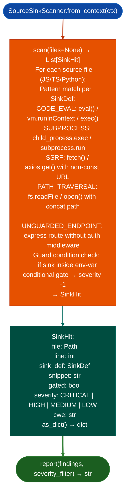

# Source Dangerous Sink Detection

Find dangerous code patterns across a source repository: detecting `eval`/`vm.runInContext` code execution, `subprocess`/`exec` command injection, SSRF-prone `fetch`/`axios` calls, path traversal in `fs.readFile`, and unguarded internal endpoints: with guard-condition detection that narrows findings to unguarded sinks and maps each to a CWE and severity.

---

## Why this exists <sup>[↑](#source-dangerous-sink-detection)</sup>

1. **Source RE requires the same sink-to-taint discipline as binary RE, but at the AST level.** `SourceSinkScanner` is the source-code equivalent of `SinkArgClassifier` + `FormatStringScanner`, it identifies every dangerous sink in a repository and classifies each by severity and CWE, providing the starting point for `SourceTaintTracker` dataflow analysis.

2. Guard-condition detection reduces `HIGH` findings to `MEDIUM` for gated sinks: `vm.runInContext` gated by `LANGFUSE_CODE_EVAL_DISPATCHER=insecure-local` is a `MEDIUM` requires explicit misconfiguration, not a `HIGH` always reachable. This was the LFG-CODEEVAL-1 pattern: the sink was present, dangerous in the abstract, but not exploitable without the env-var gate. `SourceSinkScanner` detects the gate and adjusts severity.

3. `SinkHit.as_dict()` provides structured output for `AgentLoop` integration: findings include file path, line number, sink function, CWE, severity, and the snippet. `AgentLoop` can consume these as pre-analyzed candidates for generating vulnerability hypothesis reports, referencing the exact file and line without re-running the scanner.

---

## How it works <sup>[↑](#source-dangerous-sink-detection)</sup>



---

## Usage <sup>[↑](#source-dangerous-sink-detection)</sup>

```python
from ablation.analyzers.source_sink_scanner import SourceSinkScanner
from ablation.analyzers.source_ingestion import SourceContext

ctx = SourceContext.from_path('/path/to/repo')
scanner = SourceSinkScanner.from_context(ctx)

findings = scanner.scan()
print(SourceSinkScanner.report(findings, severity_filter='HIGH'))

# Critical unguarded sinks
critical = [f for f in findings if f.severity == 'CRITICAL' and not f.gated]
for f in critical:
    print(f"  {f.file}:{f.line}  {f.sink_def.name}  CWE-{f.cwe}")
```

---

## Example output <sup>[↑](#source-dangerous-sink-detection)</sup>

The following illustrates source sink scanner output format. Actual paths and sinks are codebase-specific.

```
SourceSinkScanner: /path/to/repo

Files scanned: <N>  Findings: <M>

  [CRITICAL] CODE_EVAL  src/eval.ts:<line>  CWE-95
    vm.runInContext(code, sandbox)
    gated=False

  [MEDIUM] CODE_EVAL  src/local_eval.ts:<line>  CWE-95
    vm.runInContext(code, sandbox)
    gated=True  (LANGFUSE_CODE_EVAL_DISPATCHER=insecure-local gate)
```

---

## False positives <sup>[↑](#source-dangerous-sink-detection)</sup>

**Pattern matching without AST analysis may fire on string literals**: a `eval("safe_constant")` call where the argument is a string literal will be flagged as `CODE_EVAL`. Verify the `snippet` to confirm the sink argument is not a compile-time constant before escalating.

**Guard-condition detection uses regex on the surrounding code block**: a conditional gate that checks the env-var on a different line than the sink invocation may not be detected. Findings with complex or multi-file guard logic should be reviewed manually even if `gated=False`.

---

## Pipeline position <sup>[↑](#source-dangerous-sink-detection)</sup>

Run `SourceSinkScanner` immediately after `SourceContext.from_path()` as the first scan on any source repository. This is the source-RE equivalent of Phase 0.5 triage. Feed `CRITICAL` and `HIGH` unguarded findings to `SourceTaintTracker` for full dataflow analysis.

---

## Reading findings <sup>[↑](#source-dangerous-sink-detection)</sup>

`SourceSinkScanner.from_context(ctx).scan()` returns `List[SinkHit]`:

| Attribute | Content |
|:---|:---|
| `rel_path` | Source file path relative to the repository root |
| `line` | Line number |
| `category` | Sink category for example `code-evaluation`, `subprocess`, `path-traversal`, `ssrf` |
| `cwe` | CWE identifier for example `CWE-95`, `CWE-78`, `CWE-22` |
| `severity` | `CRITICAL` / `HIGH` / `MEDIUM` after guard reduction |
| `base_severity` | Severity before guard reduction |
| `guarded` | `True` if an env-var or conditional gate was detected near the sink |
| `description` | Human-readable description of the sink pattern |
| `line_text` | Exact source line containing the sink |

`SinkHit.as_dict()` returns a JSON-serializable dict for export.

---

## See also <sup>[↑](#source-dangerous-sink-detection)</sup>

- [Source Code Analysis Pipeline](bare-integration.md): `SourceContext` that `SourceSinkScanner` consumes
- [Tenant Isolation Checking](container-isolation-escape-surface.md): `SourceIsolationChecker` for IDOR complement scan
- [Source Taint Tracking](bare-integration.md): `SourceTaintTracker` for full dataflow from identified sinks
