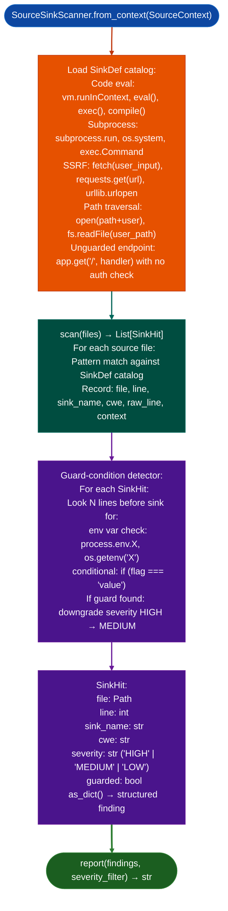

# Source/Dangerous Sink Detection

Scan source code repositories for dangerous sink patterns: code evaluation, subprocess execution, SSRF, path traversal, and unguarded internal endpoints: with guard-condition detection that narrows findings from HIGH to MEDIUM when a sink is gated behind an environment variable or conditional check.

---

## Why this exists

1. **Binary RE tools find sinks in compiled code; `SourceSinkScanner` finds the same sink classes in source-available targets Node.js, Python, Go, Ruby web applications where the attack surface is in interpreted or compiled-from-source code rather than firmware.** `SourceSinkScanner` is the source-code analogue of `dangerous_callers.py` and `format_string_scanner.py`, it applies the same sink taxonomy code eval, subprocess, SSRF, path traversal to repository source files using pattern-based static analysis.

2. **Guard-condition detection prevents over-reporting gated sinks.** `LFG-CODEEVAL-1` was a confirmed finding where `vm.runInContext()` code eval was gated behind `LANGFUSE_CODE_EVAL_DISPATCHER=insecure-local`: a severity HIGH finding that is practically MEDIUM when the gate requires an operator-configured environment variable. `SourceSinkScanner` detects `if (env_var === 'value')` and `process.env.FEATURE_FLAG` patterns surrounding sink calls and downgrade their severity accordingly.

3. **CWE mapping makes findings directly actionable for vulnerability documentation.** Each `SinkDef` maps to a CWE: subprocess execution to CWE-78, SSRF to CWE-918, path traversal to CWE-22, code evaluation to CWE-94. `SinkHit.as_dict()` produces structured findings compatible with `FindingRegistry` without manual CWE lookup.

---

## How it works



---

## Usage

```python
from ablation.analyzers.source_ingestion import SourceContext
from ablation.analyzers.source_sink_scanner import SourceSinkScanner

# Build source context from repo
ctx = SourceContext.from_path('/tmp/langfuse')
scanner = SourceSinkScanner.from_context(ctx)
findings = scanner.scan()
print(scanner.report(findings))

# Filter by severity
high_findings = scanner.report(findings, severity_filter='HIGH')

# Filter to unguarded only
unguarded = [f for f in findings if not f.guarded]
print(f"Unguarded HIGH sinks: {sum(1 for f in unguarded if f.severity == 'HIGH')}")

# Get structured output for FindingRegistry
for f in findings:
    print(f.as_dict())
```

---

## Example output

The following illustrates the finding format. Actual files, lines, and sink names are repository-specific.

```
[HIGH] CWE-94  Code Evaluation  (unguarded)
  File: <file>  line <N>
  Sink: vm.runInContext
  Context: <code snippet>

[MEDIUM] CWE-78  Subprocess Execution  (guarded: env var check)
  File: <file>  line <N>
  Sink: subprocess.run(user_cmd)
  Guard: if os.getenv('FEATURE') == 'insecure-local'
```

---

## False positives

**Pattern-based sink matching fires on sink names in comments, string literals, and import statements.** `SourceSinkScanner` uses line-level pattern matching: a comment like `# don't use os.system()` will match the `os.system` sink pattern. Filter by confirming the match appears in executable context (not preceded by `#` or inside a string literal at that indentation level).

**Guard-condition detection looks N lines before the sink: a complex guard in a different function passed as a callback parameter will not be detected, and the finding will remain severity HIGH.** Treat `guarded=False` as "guard not detected by static analysis," not as "no guard exists."

---

## Pipeline position

Run `SourceSinkScanner` as an early source-analysis pass after cloning or extracting a target repository. The structured `SinkHit` output feeds `FindingRegistry` and prioritizes which files to inspect manually. High-severity unguarded findings are the first candidates for PoC development.

---

## Reading findings

`SourceSinkScanner.scan()` returns a list of finding dicts:

| Field | Content |
|:---|:---|
| `severity` | `HIGH` unguarded / `MEDIUM` guarded by env var or feature flag |
| `cwe` | CWE identifier for example `CWE-94`, `CWE-78` |
| `title` | Vulnerability class for example `Code Evaluation`, `Subprocess Execution` |
| `file` | Source file path |
| `line` | Line number |
| `sink` | Sink function or method name |
| `guard` | Guard condition description (if `severity=MEDIUM`) |

---

## See also

- [Source Code Auditing](source-code-auditing.md): broader source analysis including dataflow and dependency scanning
- [Java Security Pattern Scans](java-security-pattern-scans.md): Java/Spring-specific sink detection
- [Repository Ingestion and Search](repository-ingestion-and-search.md): `SourceContext` that feeds `SourceSinkScanner`
