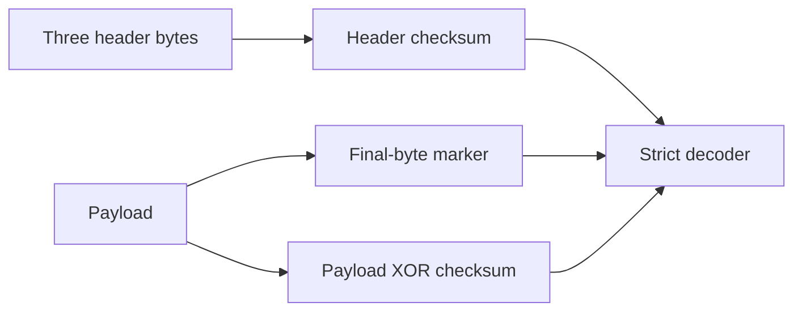

# SPECS Protocol Codec and Vector Parser

`specs_protocol` encodes and validates SPECS serial frames and recovers headers from archived simulation transaction text. It makes the long-frame boundary and reported-count behavior explicit.

---

## Why this exists

1. SPECS uses I2C-like start and stop conditions but is not an ordinary byte-oriented I2C transaction. Generic I2C decoders cannot represent its final-payload marker bit.
2. The RTL comment and implementation disagree about long frames. The implemented rule is `read_count > 0x80`, not a special case for 255.
3. Archived vectors provide useful evidence, but manually reading transaction words is error-prone. The parser recovers their three-byte headers and computes the same count and checksum properties as the codec.

---

## How it works

A frame has three header bytes, one header-checksum byte, payload bytes, and one payload-checksum byte. Each byte is transmitted least-significant bit first. A ninth bit marks only the final payload byte.



The header checksum is the XOR of the high and low nibbles of the first three bytes, combined with the high nibble of the fourth byte. The payload checksum is the XOR of all payload bytes. Header bytes and the trailer are excluded from the payload checksum. Frame and iterable materialization is limited to 65,536 words to reject accidental unbounded input.

The long-frame rules are:

| Read count | Long frame | Reported count |
|---|---|---|
| `0x7F` | No | 127 |
| `0x80` | No | 0 |
| `0x81` | Yes | 1 |
| `0xFF` | Yes | 127 |

---

## Usage

```python
from ablation.analyzers.specs_protocol import encode_frame, decode_frame

words = encode_frame([0x55, 0x02, 0x01], [0xDE, 0xAD, 0xBE, 0xEF])
print([f'{word.value:02X}' for word in words])
header, payload = decode_frame(words)
```

Output:

```
['55', '02', '01', '03', 'DE', 'AD', 'BE', 'EF', '22']
```

Parse archived simulation text:

```python
from ablation.analyzers.specs_protocol import parse_simulation_headers

headers = parse_simulation_headers(vector_text)
for item in headers:
    print(item.header, item.read_count, item.long_frame,
          item.reported_count, item.computed_header_checksum)
```

The parser removes `//` comments and reads transaction headers following `0x76543210` markers. Archived vectors with counts 129 and 130 are classified as long frames.

---

## Exhaustive RTL boundary simulation

`analysis/specs-protocol/run_rtl_boundaries.py` complements the codec and archived vectors with dynamic execution of the original `slave_receiver` Verilog. It uses the pinned Icarus 12.0 package and drives complete serial frames rather than forcing `wrdcntreg`, `slave_dec_lgfram`, or `lt_inhb_ser`.

The bench tests all 256 read-count values and performs five checks per value: native checksum acceptance, long-frame classification, emitter inhibit, reported count, and I2C mode selection. The result is 1,280 passing checks, 127 long-frame cases, and zero checksum errors. Explicit observations are:

```text
count=7f long=0 inhibit=0 reported=7f checksum_error=0
count=80 long=0 inhibit=0 reported=00 checksum_error=0
count=81 long=1 inhibit=1 reported=01 checksum_error=0
count=ff long=1 inhibit=1 reported=7f checksum_error=0
```

Run it with:

```bash
TMPDIR=/home/cowboy/ablation \
  python3 /media/cowboy/research/CERN/analysis/specs-protocol/run_rtl_boundaries.py
```

The original receiver has two legacy instance names that collide with nets under Icarus. The runner writes a build-only `slave_receiver_sim.v` with `bcount_counter` and `wrcount_counter` substituted for those instance names. Original source and logic are unchanged and their hashes are pinned.

The test uses a valid third header byte chosen so both the codec's fourth-byte checksum model and the receiver's early third-byte sampling accept the frame. Tracing showed that the receiver compares the third header byte's low nibble at the following word boundary. A nonzero third byte can therefore expose different master/receiver checksum accumulation behavior. This interoperability anomaly is separate from the long-frame rule and is not hidden by the successful boundary result.

Generated evidence is in `rtl-boundary-findings.json` and `rtl-boundary-sim.log`. This is focused RTL verification, not synthesis, timing closure, a complete master/slave board simulation, or hardware testing.

---

## False positives

A transaction-like value in arbitrary text is not necessarily a simulation header. The caller must select the correct vector format and artifact. The parser only interprets headers after the documented marker.

XOR checksums are integrity checks, not authentication. They detect single-bit corruption in the tested frame model, but some arbitrary byte substitutions preserve the checksum. A successful decode does not prove that a frame is authentic or semantically valid for a particular slave.

---

## Pipeline position

**Before this module:** Recover the SPECS transaction text or frame words and preserve the source artifact.

**After this module:** Compare decoded headers and count behavior against RTL, simulation evidence, or a focused hardware test. Dynamic HDL simulation remains separate from vector parsing.

---

## Reading findings

| Field | Content |
|:---|:---|
| `SpecsWord.value` | Transmitted byte value |
| `SpecsWord.last` | Final-payload marker bit |
| `header` | Three recovered header bytes |
| `read_count` | Second header byte |
| `long_frame` | Result of `read_count > 0x80` |
| `reported_count` | Result of `read_count & 0x7F` |
| `computed_header_checksum` | Model-generated four-bit header checksum |

---

## See also

- [VerilogSemantic](verilog-semantic.md)
- [LPGBT Protocol Decoders](lpgbt-decoder.md)
