# SqlSinkScanner

Detect raw SQL injection in x86-64 ELF binaries that call the MySQL C API `mysql_query`, `mysql_real_query` or SQLite3 `sqlite3_exec`, `sqlite3_prepare_v2`, `sqlite3_prepare` directly: tracing the SQL string argument backward from each call site to classify its provenance as `INJECTABLE`, `INJECTABLE_LITERAL`, `RODATA_CONST`, `SAFE_NUMERIC`, `ARG_PROPAGATED`, or `UNKNOWN`.

---

## Why this exists <sup>[↑](#sqlsinkscanner)</sup>

1. **`FormatStringScanner` misses the SQL injection pattern because `snprintf` is safe in isolation: the danger is `snprintfbuf, sizeof(buf, "WHERE login='%s'", username); mysql_queryconn, buf`.** `FormatStringScanner` reports a finding when a format string contains `%s` and the buffer is passed to a dangerous output function. It does not model the SQL API call chain: `snprintf` writes to a local buffer; `mysql_query` receives that buffer as its SQL argument. Detecting this requires chaining: find SQL sink → trace SQL arg register RSI, arg1 backward → find the `snprintf` call that populated the buffer → inspect the format string.

2. **SQL sink PLT dead-import detection avoids scanning binaries where SQL APIs are imported but never called.** Before scanning any instructions, `SqlSinkScanner` counts how many call sites each SQL PLT stub has (`_count_plt_callers()`). A sink with zero callers is a "dead import", it is recorded in the report but no instruction scan is performed. This prevents both false positives where a PLT-imported symbol happens to match a SQL API name but is never invoked and wasted scan time on binaries that import SQL headers but use a different database layer at runtime.

3. **The `ARG_PROPAGATED` verdict identifies SQL injection via caller control rather than format strings.** When the SQL string argument traces back to an entry-point register RDI, RSI, RDX, RCX, R8, R9 at function entry, the SQL string comes from the caller: possibly from user-controlled data. This is the same severity as `INJECTABLE` but requires taint tracking from the call site back through the call chain rather than format string inspection. `ARG_PROPAGATED` findings require `TaintTracker` follow-up.

---

## How it works <sup>[↑](#sqlsinkscanner)</sup>



### Verdict definitions <sup>[↑](#sqlsinkscanner)</sup>

```mermaid
flowchart TD
    A(["SqlSinkScanner.from_path(path)\nor .from_context(ctx)"]):::input --> B["_init():\n_extract_plt_x86(): {plt_va: symbol_name}\n_extract_func_starts(): function start VAs\nRODATA sections: {(va_start, va_end)}\n_count_plt_callers(): {plt_va: caller_count}\n_init_snprintf_plts(): {snprintf_plt_va: fmt_arg_pos}"]:::primary
    B:::primary --> C["scan():\nBuild active_sinks = {plt_va: (name, arg_pos)}\n  for each SQL sink in _SQL_SINKS (5 sinks)\n  plt_caller_count == 0 → dead_sinks list (report only)\nScan all SHF_EXECINSTR sections for 0xE8 rel32 calls\n  target in active_sinks → append (call_va, plt_va, name)"]:::secondary
    C:::secondary --> D["Per call site:\n_enclosing_func_va(call_va): nearest func_start ≤ call_va\nDisasm up to _MAX_FN_SZ=8192 bytes from func_va\nFind call instruction index in disassembly\n_classify_sql_arg(insns, call_idx) → (verdict, desc, fmt_str, fmt_va)"]:::tertiary
    D:::tertiary --> E["_classify_sql_arg: walk backward up to _LOOKBACK=40 instructions\nTrack target register (starts as 'rsi' = arg1 for all 5 sinks)\nLEA target, [rip+N]:\n  N in RODATA → read c-string → check %s → INJECTABLE_LITERAL or RODATA_CONST\n  N not in RODATA → UNKNOWN\n  [rbp/rsp+N] → _find_snprintf_for_slot(insns, call_idx, slot)\nMOV target, <entry_reg> → ARG_PROPAGATED\nMOV target, <other_reg> → follow chain (update target, continue loop)\nMOV target, [rbp/rsp+N] → _find_snprintf_for_slot()\nEnd of lookback → UNKNOWN"]:::tertiary
    E:::tertiary --> F(["_find_snprintf_for_slot(insns, from_idx, slot):\nScan back up to 2×_LOOKBACK=80 instructions\nFind CALL to snprintf_plt (fmt_arg_pos known)\nWalk back from snprintf call to find fmt argument:\n  LEA [rip+N] in RODATA → read fmt string\n  check _STRING_SPECIFIERS (%s) → INJECTABLE\n  check _NUMERIC_SPECIFIERS (%d/%u/etc) → SAFE_NUMERIC\n  else → RODATA_CONST\n  MOVABS imm64 in RODATA → same checks"]):::output
    classDef input     fill:#0d47a1,stroke:#1565c0,color:#fff
    classDef primary   fill:#e65100,stroke:#bf360c,color:#fff
    classDef secondary fill:#004d40,stroke:#00695c,color:#fff
    classDef tertiary  fill:#4a148c,stroke:#6a1b9a,color:#fff
    classDef neutral   fill:#37474f,stroke:#546e7a,color:#fff
    classDef output    fill:#1b5e20,stroke:#2e7d32,color:#fff
    linkStyle 0 stroke:#bf360c,stroke-width:2px
    linkStyle 1 stroke:#00695c,stroke-width:2px
    linkStyle 2 stroke:#6a1b9a,stroke-width:2px
    linkStyle 3 stroke:#6a1b9a,stroke-width:2px
    linkStyle 4 stroke:#2e7d32,stroke-width:3px
```

| Verdict | Severity | Meaning |
|---|---|---|
| `INJECTABLE` | HIGH | `snprintf` format string contains `%s`; SQL string is format-built from a non-RODATA source |
| `INJECTABLE_LITERAL` | HIGH | SQL string is a RODATA literal that already contains `%s` for example `"WHERE id='%s'"` |
| `ARG_PROPAGATED` | HIGH | SQL string came from a function entry-point register: caller may control it |
| `UNKNOWN` | MEDIUM | Provenance not resolved within the 40-instruction lookback window |
| `SAFE_NUMERIC` | LOW | Format string uses only `%d`/`%u`/`%x`: no string interpolation |
| `RODATA_CONST` | LOW | SQL string is a fixed RODATA literal with no format specifiers |

### SQL sinks covered <sup>[↑](#sqlsinkscanner)</sup>

| Symbol | SQL arg position | Notes |
|---|---|---|
| `mysql_query` | arg1 (RSI) | `mysql_queryMYSQL *conn, const char *q` |
| `mysql_real_query` | arg1 (RSI) | `mysql_real_queryMYSQL *conn, const char *q, unsigned long len` |
| `sqlite3_exec` | arg1 (RSI) | `sqlite3_execsqlite3 *db, const char *sql, ...` |
| `sqlite3_prepare_v2` | arg1 (RSI) | `sqlite3_prepare_v2sqlite3 *db, const char *zSql, ...` |
| `sqlite3_prepare` | arg1 (RSI) | `sqlite3_preparesqlite3 *db, const char *zSql, ...` |

---

## Usage <sup>[↑](#sqlsinkscanner)</sup>

```python
from ablation.analyzers.sql_sink_scanner import SqlSinkScanner, INJECTABLE, ARG_PROPAGATED

# From path
scanner = SqlSinkScanner.from_path('/path/to/webapp_binary')
findings = scanner.scan()
print(scanner.report(findings))

# Filter to injection candidates only
injections = [f for f in findings if f.verdict in (INJECTABLE, INJECTABLE_LITERAL)]
for f in injections:
    print(f"[HIGH] func=0x{f.func_va:x} call=0x{f.call_va:x} sink={f.sink_name}")
    print(f"  fmt={f.fmt_string!r}")

# ARG_PROPAGATED requires TaintTracker follow-up
propagated = [f for f in findings if f.verdict == ARG_PROPAGATED]
for f in propagated:
    print(f"[HIGH ARG] func=0x{f.func_va:x} → {f.sink_name}: {f.description}")

# From BinaryContext
from ablation.analyzers.binary_context import BinaryContext
ctx = BinaryContext.load_or_build('/path/to/binary')
scanner2 = SqlSinkScanner.from_context(ctx)
findings2 = scanner2.scan()

# CLI — exits with code 2 when HIGH findings exist
# python3 -m ablation.analyzers.sql_sink_scanner /path/to/binary
```

---

## Example output <sup>[↑](#sqlsinkscanner)</sup>

```
SqlSinkScanner: /path/webapp_binary
  Dead imports (0 callers): sqlite3_prepare, sqlite3_prepare_v2

  [INJECTABLE] (2 site(s))
    HIGH    INJECTABLE              func@0x40a2c0  call@0x40a3f8  mysql_query
              fmt='SELECT * FROM users WHERE login=\'%s\' AND pass=\'%s\''
    HIGH    INJECTABLE              func@0x40b120  call@0x40b2a0  mysql_query
              fmt='INSERT INTO sessions (user_id, token) VALUES (%d, \'%s\')'

  [ARG_PROPAGATED] (1 site(s))
    HIGH    ARG_PROPAGATED          func@0x40c400  call@0x40c540  sqlite3_exec
              from entry register rsi

  [RODATA_CONST] (3 site(s))
    LOW     RODATA_CONST            func@0x40d000  call@0x40d080  mysql_query
              fmt='SELECT COUNT(*) FROM config'
```

---

## False positives <sup>[↑](#sqlsinkscanner)</sup>

**`INJECTABLE` verdict on format strings where the `%s` argument is a hardcoded RODATA value.** The scanner checks whether the format string has `%s`, it does not verify whether the string argument passed to `%s` is user-controlled or a fixed constant. A call like `snprintf(buf, N, "WHERE type='%s'", "admin"); mysql_queryconn, buf` is `INJECTABLE` because the format string has `%s`, but the argument `"admin"` is fixed. After identifying an `INJECTABLE` finding, verify with `TaintTracker` that the `%s` argument register at the `snprintf` call is user-influenced.

**`ARG_PROPAGATED` stops at function entry: the argument may be a fixed constant at the call site.** The scanner traces the SQL argument backward and stops when it finds an entry-point register. Whether the register contains user data depends on the caller. An `ARG_PROPAGATED` finding at a library helper function called with a hardcoded literal from `main()` is a false positive. Use `TaintTracker.run_interprocedural()` to trace from the actual data source.

**Lookback window of 40 instructions misses provenance for long function prologues.** Functions with complex setup code before the SQL call > 40 instructions between the argument load and the call site will produce `UNKNOWN` rather than `INJECTABLE` or `RODATA_CONST`. If the binary has many `UNKNOWN` findings, try `SqlSinkScanner.from_context(ctx)` which has access to the full function list for better function boundary resolution, or manually inspect the function with the Capstone disassembly.

---

## Pipeline position <sup>[↑](#sqlsinkscanner)</sup>

**Before this module:** Run `SinkArgClassifier.from_path(elf).classify_all()` to identify which call sites are `RODATA_CONST` vs `ARG_PROPAGATED` across all sinks. This establishes the baseline before focusing on SQL-specific chaining. `SqlSinkScanner` provides the SQL-chain-specific analysis that `SinkArgClassifier` does not cover.

**After this module:** For `INJECTABLE` and `INJECTABLE_LITERAL` findings: byte-verify the call VA with `data = open(binary,'rb').read(); off = va - base; assert data[off:off+1] == b'\xe8'`. Confirm the format string VA with `ctx.name(fmt_va)`. For `ARG_PROPAGATED` findings: run `TaintTracker.run_interprocedural(depth=4)` seeding the SQL function's arg registers and confirm that user-controlled input HTTP parameter, socket data reaches the seed. Register confirmed findings with `FindingRegistry.register()` and record in `re/<vendor>/<target>_re.py`.

---

## Reading findings <sup>[↑](#sqlsinkscanner)</sup>

| Field | Content |
|:---|:---|
| `finding.verdict` | Classification of the SQL string provenance: primary triage signal |
| `finding.sink_name` | MySQL or SQLite3 function name that received the SQL string |
| `finding.call_va` | Virtual address of the SQL sink call instruction |
| `finding.func_va` | Virtual address of the enclosing function |
| `finding.fmt_string` | Resolved format string from RODATA (empty if `ARG_PROPAGATED` or `UNKNOWN`) |
| `finding.fmt_va` | RODATA virtual address of the format string 0 if not resolved |
| `finding.severity` | `HIGH` INJECTABLE/INJECTABLE_LITERAL/ARG_PROPAGATED, `MEDIUM` (UNKNOWN), `LOW` SAFE/RODATA |

---

## See also <sup>[↑](#sqlsinkscanner)</sup>

- [Sink Arg Classifier](sink-arg-classifier.md): classify all call sites not just SQL as RODATA_CONST/ARG_PROPAGATED/UNKNOWN before running this scanner
- [Taint Analysis](taint-analysis.md): trace ARG_PROPAGATED findings from user input to the SQL sink
- [Format String Analysis](format-string-analysis.md): format string detection for non-SQL output sinks
