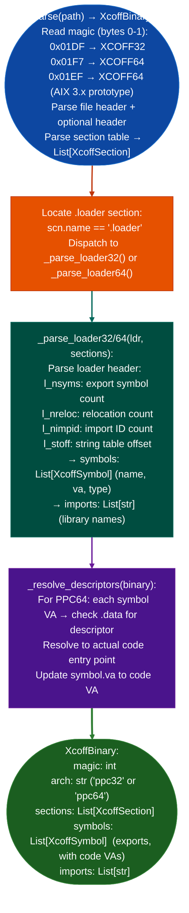

# Standalone XCOFF Symbol Resolution

Parse IBM AIX XCOFF32 and XCOFF64 executables: extracting import and export symbol names with virtual addresses from the `.loader` section which survives stripping: without requiring a full `BinaryContext` session, via `ablation/core/xcoff_parser.py`.

---

## Why this exists

1. **LIEF does not support XCOFF.** Calling `lief.parse()` on an XCOFF binary returns `None`. `BinaryContext.load_or_build()` falls through to a default `x86_64` context with no sections, no symbols, and no function starts. Every prior AIX analysis session using the standard stack was silently broken: the context appeared valid but contained no binary data. `xcoff_parser.py` fills this gap with native Python XCOFF parsing.

2. **XCOFF `.loader` section survives stripping.** AIX production builds typically have `nsyms == 0` in the file header: all debug symbols are stripped, but the `.loader` section is always present and contains all import and export symbol names with their virtual addresses. `XcoffBinary.symbols` provides the export list; `XcoffBinary.imports` provides the import list. Both are derived exclusively from `.loader`, making this parser effective on fully-stripped XCOFF binaries.

3. **`_resolve_descriptors()`** handles the PPC64 ELFv1 function descriptor pattern: AIX PPC64 function pointers point to a descriptor struct `{entry_va, TOC_ptr, env_ptr}`, not directly to code. Without descriptor resolution, function VAs appear to point to the descriptor, not the code entry point. `xcoff_parser.py` resolves these transparently so that all symbol VAs in `XcoffBinary.symbols` point to actual code.

---

## How it works



---

## Usage

```python
from ablation.core.xcoff_parser import parse

binary = parse('/path/to/aix_executable')
print(f"XCOFF magic: {binary.magic:#x}  arch: {binary.arch}")
print(f"Exports: {len(binary.symbols)}")
for sym in binary.symbols:
    print(f"  {sym.name}  va={sym.va:#x}  type={sym.type}")

print(f"Imports ({len(binary.imports)}): {binary.imports[:5]}")
```

---

## Example output

The following illustrates XCOFF symbol resolution output format.

```
XCOFF magic: 0x01f7  arch: ppc64

Exports: <N>

  main               va=0x10000480  type=XTY_LD
  setup_network      va=0x10001200  type=XTY_LD
  __init_section     va=0x10000350  type=XTY_SD
  _start             va=0x10000400  type=XTY_LD

Imports (<M>): ['libc.a(shr.o)', 'libpthread.a(shr.o)', ...]
```

---

## False positives

**`_resolve_descriptors()` assumes standard PPC64 function descriptor layout**: `{entry_va, TOC_ptr, env_ptr}`. Non-standard descriptors or hand-crafted assembly that does not follow the ELFv1 calling convention will produce incorrect code VAs. Verify descriptor resolution by checking that the resolved VA points to a recognizable PPC64 prologue.

**XCOFF32 with `magic == 0x01DF` on big-endian AIX 4.x**: `BinaryContext` must be initialized with `arch='ppc32'` and `big_endian=True` after parsing, since `xcoff_parser.py` provides binary metadata but does not initialize a `BinaryContext` automatically.

---

## Pipeline position

Run `parse()` before `BinaryContext` initialization on any AIX XCOFF binary. Pass the resulting `XcoffBinary.symbols` to `ctx.set_name()` to populate the name registry before taint analysis. Without this step, all function addresses in the binary are anonymous.

---

## Reading output

`load_xcoff(path)` returns an `XcoffBinary` with `.exports` and `.imports` lists of `XcoffSymbol`.

`XcoffBinary` attributes: `path` (str), `arch` (`'ppc32'`/`'ppc64'`), `entry` (int), `text_start` (int), `data_start` (int), `toc_va` (int), `sections` (`List[XcoffSection]`), `exports` and `imports` (`List[XcoffSymbol]`).

Each `XcoffSymbol` entry has:

| Attribute | Content |
|:---|:---|
| `name` | Symbol name string |
| `va` | Descriptor VA for functions or data VA; 0 for imports |
| `lib` | Import library name: non-empty for imports, empty for exports |
| `smclas` | Storage mapping class integer |
| `code_va` | Resolved code VA set after descriptor resolution, 0 otherwise |
| `is_import` | Property: `True` if `lib` is non-empty |

`XCOFFExecutableAnalyzer.from_path(path).exports_table()` returns `Dict[str, int]`: symbol name → code VA for all exported functions.

---

## See also

- [Persistent Analysis Context](persistent-analysis-context.md): `BinaryContext.load_or_build()` that uses `xcoff_parser.py` for AIX targets
- [PPC64 Taint Tracking](tls-session-downgrade-surfaces.md): `TaintTrackerPPC64` for AIX/POWER analysis after XCOFF symbol resolution
