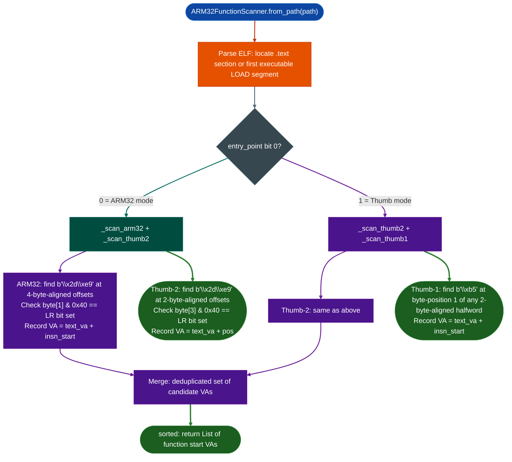

# Stripped Function Discovery

Recover function entry points in stripped ARM32 ELF binaries: where `.eh_frame`, symbol tables, and debug information are absent: by scanning the `.text` section for architecture-specific PUSH prologue patterns in ARM32, Thumb-2, and Thumb-1 instruction encodings.

---

## Why this exists

1. **Stripped ARM32 firmware has no reliable function boundary information.** On x86-64, `.eh_frame` records unwind information for every function, and `BinaryContext` uses it to recover function starts even in stripped binaries. On ARM32, `.eh_frame` is frequently absent in embedded firmware Fortinet switches, older Cisco routers, embedded IoT devices. Without it, `func_starts` is populated only from export symbols and call targets: missing many internal functions entirely.

2. **ARM32 and Thumb interworking requires separate scanning strategies.** ARM32 binaries may contain both ARM 4-byte instructions and Thumb 2-byte or 4-byte Thumb-2 code regions. The PUSH-with-LR prologue encodes differently in each mode: ARM32 uses `STMFD r13!, {rN.., lr}` as a 4-byte word; Thumb-2 uses `STMDB SP!, {rN.., lr}` as a 32-bit Thumb encoding; Thumb-1 uses a 16-bit `PUSH {rlist, lr}` halfword. A single scan pattern cannot cover all three, this tool runs mode-appropriate passes.

3. **False positive suppression is critical for ARM32/Thumb mixed binaries.** The Thumb-1 high-byte `0xB5` (the bit that marks `PUSH {rlist, lr}`) appears at non-aligned positions inside ARM32 `BL` instruction words. Without alignment-aware filtering, a Thumb-1 scan on an ARM32 binary would generate hundreds of false function starts at branch target encodings. This scanner suppresses Thumb-1 scanning in ARM32 mode entirely, relying on alignment checks to clean up edge cases in Thumb-2 scanning.

---

## How it works

The scanner determines the instruction set mode from the binary's entry point: if bit 0 of the entry point is set, the binary starts in Thumb mode; if clear, ARM32 mode. Two distinct scan paths follow:



### ARM32 prologue pattern

ARM32 `STMFD r13!, {rN.., lr}` Push multiple registers including LR onto the stack encodes as:

```
[rlist_lo] [rlist_hi | 0x40] [0x2D] [0xE9]
```

In little-endian memory, bytes 2–3 are always `\x2d\xe9`. The LR bit register 14, bit 14 of the register list field lives in bit 6 of byte 1 (`text[insn_start + 1] & 0x40`). The scanner searches for the `\x2d\xe9` sentinel, steps back 2 bytes to the instruction start, checks 4-byte alignment, and checks the LR bit.

### Thumb-2 prologue pattern

Thumb-2 `STMDB SP!, {rN.., lr}` is a 32-bit Thumb-2 instruction. The first halfword is `0xE92D` (encoded as `\x2d\xe9` in little-endian), identical to the sentinel used in ARM32 scanning. The register list is in the second halfword; the LR bit is bit 14 of that halfword, which lands at `text[pos + 3] & 0x40`. Alignment is 2 bytes (Thumb) rather than 4 (ARM32).

### Thumb-1 prologue pattern

Thumb-1 `PUSH {rlist, lr}` is a 16-bit instruction encoded as:
```
[rlist] [0xB5]
```
The `0xB5` byte bit 8 = LR, bits 13–15 = `101` for the PUSH opcode is the high byte of the little-endian halfword. The scanner finds `\xb5` at byte position 1 of any 2-byte-aligned halfword. This scan is disabled in ARM32 mode because `\xb5` appears inside ARM32 `BL` instruction words at non-aligned positions that would otherwise be flagged.

---

## ARM32FunctionScanner

```python
from ablation.analyzers.arm32_function_scanner import ARM32FunctionScanner
from ablation.analyzers.binary_context import BinaryContext

# Standalone scan
scanner = ARM32FunctionScanner.from_path('/fw/cisco/arm32_agent')
starts = scanner.scan()
print(ARM32FunctionScanner.report(starts))
# ARM32FunctionScanner: 843 function starts found
#   range: 0x10000 – 0x48f000

# Inject into BinaryContext to extend func_starts
ctx = BinaryContext.load_or_build('/fw/cisco/arm32_agent')
scanner = ARM32FunctionScanner.from_path('/fw/cisco/arm32_agent')
added = scanner.inject_into_context(ctx)
print(f"Added {added} new function starts to BinaryContext")
# Added 312 new function starts to BinaryContext
```

---

## Usage

```python
from ablation.analyzers.arm32_function_scanner import ARM32FunctionScanner
from ablation.analyzers.binary_context import BinaryContext

ctx = BinaryContext.load_or_build('/fw/fortiap/httpd')

# Before injection: func_starts may be sparse
print(f"Before: {len(ctx.func_starts)} function starts")

# Run prologue scan and inject
scanner = ARM32FunctionScanner.from_path('/fw/fortiap/httpd')
added = scanner.inject_into_context(ctx)
print(f"After:  {len(ctx.func_starts)} function starts (+{added} from prologue scan)")

# Save the expanded context for next session
ctx.save_cache()

# Now run full analysis with complete function starts
from ablation.analyzers.heap_vuln_scanner import HeapVulnScanner
heap = HeapVulnScanner.from_context(ctx)
findings = heap.scan()
```

---

## Example output

```
ARM32FunctionScanner: 843 function starts found
  range: 0x10028 – 0x485fcc

Injection: added 312 new function starts to BinaryContext
  func_starts before: 531
  func_starts after:  843
```

---

## False positives

**Non-function PUSH prologues.** Compiler-generated code occasionally emits `PUSH {rN.., lr}` inside switch statement jump tables or initializer blocks that are not function entries. These produce valid PUSH encodings at the right alignment but are not actual function starts. The count will be slightly inflated typically 1–5% above the true function count. Manual disassembly of suspicious entries quickly confirms whether they are entry points.

**Thumb-2 in ARM32 mode.** Mixed ARM/Thumb binaries (using `BX`/`BLX` for interworking calls) contain both ARM and Thumb code in the same `.text` section. The Thumb-2 scanner runs in both modes, but its alignment check 2-byte alignment is less restrictive than the ARM32 check 4-byte alignment. In practice, Thumb-2 PUSH prologues in ARM regions are rare but possible when ARM code calls into a Thumb function inline without a trampoline.

**ELF `.text` vs LOAD segment fallback.** When `.text` is absent some embedded RTOSs strip section headers entirely, the scanner falls back to the first executable LOAD segment. This is usually correct but may include more bytes than the true code section if the LOAD segment spans both code and data.

---

## Pipeline position

**Before this module:** `BinaryContext.load_or_build()` to establish the baseline `func_starts` from `.eh_frame` and export symbols. Check `lenctx.func_starts`: if it is low relative to binary size for example fewer than 100 functions in a 1MB ARM32 binary, prologue scanning is needed.

**After this module:** `inject_into_context(ctx)` followed by `ctx.save_cache()` to persist the expanded function list. Then run `HeapVulnScanner`, `FormatStringScanner`, `TaintTracker`, and other tools that consume `func_starts`: they will now have complete coverage.

---

## Reading findings

| Field | Content |
|:---|:---|
| Return value of `scan()` | Sorted `List[int]` of candidate function start VAs |
| Return value of `inject_into_context()` | Count of VAs newly added to `ctx.func_starts` already-known VAs excluded |
| `report(starts)` | Human-readable summary: count and VA range |

---

## See also

- [Binary Context](binary-context.md): provides baseline `func_starts`; inject results here
- [Stripped Go x86-64 Boundaries](stripped-go-x86-64-boundaries.md): equivalent for stripped Go x86-64 binaries pclntab recovery
- [Flat-ROM Function Discovery](flat-rom-function-discovery.md): bare-metal ROM with no ELF headers
- [ARM32 Taint Analysis](arm32-taint-analysis.md): downstream consumer of the expanded `func_starts` list
- [Interprocedural Argument Provenance](interprocedural-argument-provenance.md): uses ARM32 register annotator with full function coverage
