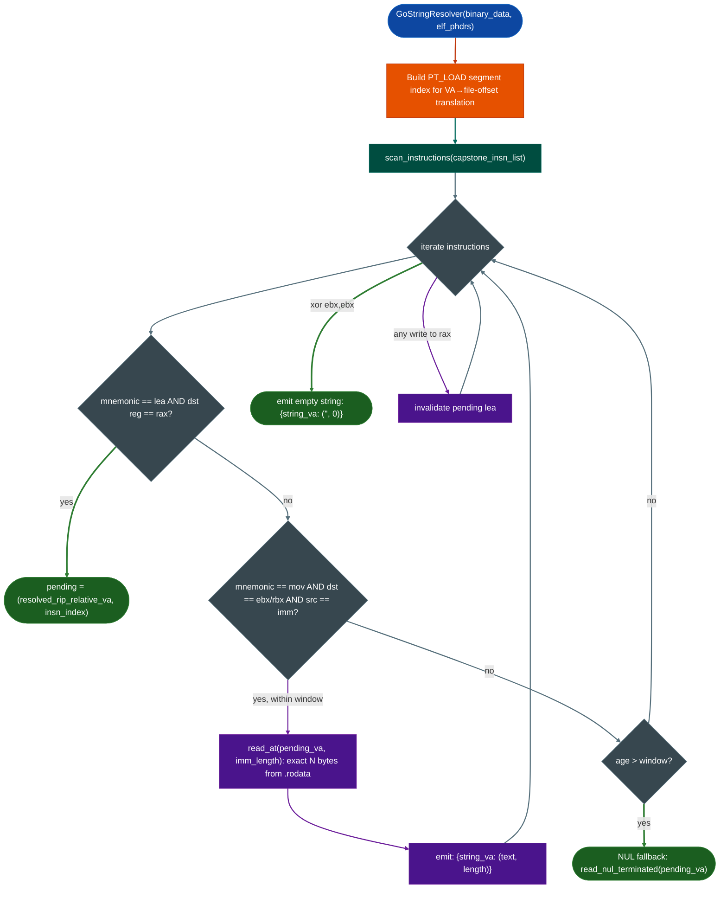

# Stripped Go x86-64 Boundaries

Recover function entry points and accurate string contents from stripped Go 1.17+ AMD64 binaries by reading the pclntab (Go's plan-9-derived source location table) and resolving non-NUL-terminated string literals using the `lea rax / mov ebx` load-pattern from the Go AMD64 register ABI.

---

## Why this exists

1. **Stripped Go binaries break `.eh_frame`-based function recovery.** Go's runtime stores its own function boundary information in the `pclntab` section (`.gopclntab`): a compressed program counter to line number table that encodes every function start VA, function end VA, and source location. When a Go binary is stripped (`-ldflags="-s -w"`), the `.symtab` is removed but the `pclntab` is typically preserved because the Go runtime uses it for stack unwinding and panic formatting. This module reads the pclntab to recover function boundaries even when all debug symbols are gone.

2. **Go strings are not NUL-terminated: they are length-prefixed.** In C, strings end with a NUL byte; `strlen()` and `BinaryContext`'s string extractor both rely on this convention. Go strings are Go runtime `string` structs: a `data_ptr, length` pair. The string bytes in `.rodata` have no NUL terminator, so the C-string extractor either truncates the string early (if the next string's first byte happens to be a word boundary) or reads into adjacent data. The correct reading requires finding the `mov ebx, N` length hint at the call site.

3. **Go 1.17+ uses a register-based AMD64 ABI that changes argument passing.** Before Go 1.17, the Go ABI passed all arguments on the stack. From Go 1.17, Go adopted a register-based ABI for AMD64 where the first argument is in `rax` (pointer) and the second in `rbx` (length). A string argument is passed as the `rax, rbx` pair. Recognizing this pattern at call sites lets Ablation determine accurate string lengths at analysis time.

---

## How it works

### Go string resolution



**VA to file-offset translation** uses the ELF PT_LOAD segment list: for each segment, the scanner checks if the target VA falls within `[p_vaddr, p_vaddr + p_filesz)` and computes `file_offset = va - p_vaddr + p_offset`.

**Window expiration fallback.** If no `mov ebx` is found within `window` default: 4 instructions after the `lea rax`, the resolver falls back to NUL-terminated reading capped at `fallback_max_len` bytes default: 256. This handles cases where the Go runtime itself uses the string in a context where the compiler emits a different pattern.

**Invalidation.** Any instruction that writes to the `rax` family after a pending `lea rax` invalidates the pending state: a new `lea rax` may follow.

### pclntab-based function boundary recovery

The Go pclntab `runtime.pclntab`, stored in `.gopclntab` encodes all function start addresses. Even in stripped binaries, this table is preserved for the Go runtime. The `GoGoRetriever` companion module, `go_subprocess_scanner.py` reads the pclntab and injects the recovered function starts into `BinaryContext.func_starts` via `ctx.func_starts += recovered_starts`.

---

## Usage

```python
import lief
from ablation.analyzers.go_string_resolver import GoStringResolver

# Load binary
with open('/fw/target/agent_go', 'rb') as f:
    data = f.read()

binary = lief.parse(data)

# Build PT_LOAD segment list from ELF
segs = []
for seg in binary.segments:
    if str(seg.type) == 'SEGMENT_TYPES.LOAD':
        segs.append({
            'p_type': 1,
            'p_vaddr': seg.virtual_address,
            'p_offset': seg.file_offset,
            'p_filesz': seg.physical_size,
        })

resolver = GoStringResolver(data, segs)

# Scan a function's instructions
import capstone
md = capstone.Cs(capstone.CS_ARCH_X86, capstone.CS_MODE_64)
md.detail = True

# Get function bytes (example: function at 0x22ccc0)
func_va = 0x22ccc0
func_bytes = data[func_va - binary.imagebase : func_va - binary.imagebase + 0x200]
insns = list(md.disasm(func_bytes, func_va))

strings = resolver.scan_instructions(insns)
for va, (text, length) in strings.items():
    print(f"  0x{va:x}  len={length}  {text!r}")

# Direct read at known VA and length
text, length = resolver.read_at(0x48a000, 32)
print(f"  Direct read: {text!r}")
```

---

## Integration with BinaryContext

```python
from ablation.analyzers.binary_context import BinaryContext
from ablation.analyzers.go_subprocess_scanner import GoGoRetriever

# Step 1: Load context (func_starts may be incomplete for Go binary)
ctx = BinaryContext.load_or_build('/fw/target/agent_go')
print(f"Before: {len(ctx.func_starts)} function starts")

# Step 2: Recover function boundaries from pclntab
retriever = GoGoRetriever('/fw/target/agent_go')
new_starts = retriever.recover_function_starts()
added = len([va for va in new_starts if va not in set(ctx.func_starts)])
ctx.func_starts = sorted(set(ctx.func_starts) | set(new_starts))
ctx.save_cache()
print(f"After: {len(ctx.func_starts)} function starts (+{added} from pclntab)")
```

---

## Example output

```
[go_string_resolver] scan_instructions: 14 strings resolved from 38 instructions

  0x48a000  len=17  'recv_packet_error'
  0x48a011  len=22  'unexpected frame type: '
  0x48a027  len=31  'connection reset by remote peer'

[go_subprocess_scanner] pclntab: 2847 function boundaries recovered
  Before: 0 function starts (stripped — no .symtab)
  After:  2847 function starts
```

---

## False positives

**Non-string `lea rax` / `mov ebx` sequences.** Not every `lea rax, [rip+N]` is a string pointer. If the `rax` value points into code rather than `.rodata`, `read_at()` will return bytes that happen to be printable text but are not strings. Verify by checking that the VA falls in a `.rodata` or `__DATA_CONST` segment, not `.text`.

**NUL-fallback over-reads.** When the window expires and the fallback NUL scan runs, it reads up to `fallback_max_len` bytes default 256. If two Go strings are contiguous in `.rodata` without any NUL separating them which is normal, the NUL scan will merge them. The length-hint path avoids this entirely; the fallback is accurate only when the string happens to be followed by a NUL.

**pclntab false boundaries.** In binaries with multiple Go versions linked together uncommon but possible with CGo, the pclntab may include function entries that were inlined or eliminated by the linker. A small percentage of recovered starts will point to code that is not a function entry in the executable version. These produce no false positives in HeapVulnScanner empty disassembly but inflate the function count.

---

## Pipeline position

**Before this module:** `BinaryContext.load_or_build()` to establish baseline context. Detect a Go binary by checking for `ctx.plt` entries containing `runtime.` prefixes or by looking for `__gopclntab` in section names.

**After this module:** Inject recovered function starts into `ctx.func_starts` and call `ctx.save_cache()`. Then run `HeapVulnScanner`, `FormatStringScanner`, and other tools on the complete function set.

---

## Reading findings

| Field | Content |
|:---|:---|
| `scan_instructions()` return | `{string_va: text, length}` dict; `text=None` entries excluded |
| `read_atva, length` return | `text, length` tuple; `None, 0` on failure |
| `read_nul_terminated(va)` return | `text, length` tuple; `None, 0` on failure |
| pclntab recovered starts | `List[int]` of function entry VAs |

---

## See also

- [Binary Context](binary-context.md): inject recovered function starts here
- [Stripped Function Discovery](stripped-function-discovery.md): equivalent prologue-scan for ARM32 Go binaries
- [Semantic Code Search](semantic-code-search.md): use resolved string literals to improve function descriptions in the corpus
- [Taint Analysis](taint-analysis.md): trace recovered function entry points as taint sources
