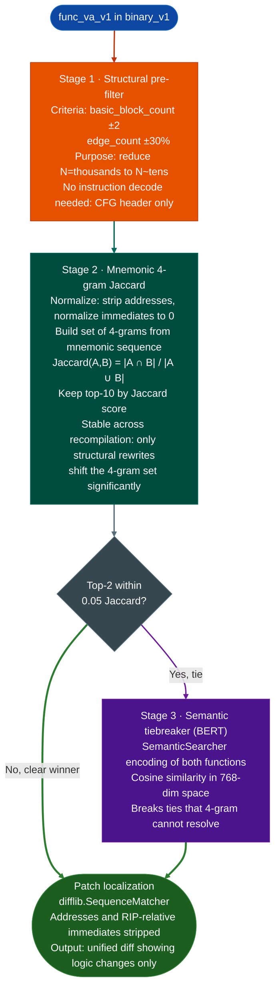
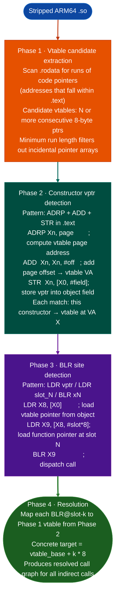

# Structural Analysis Modules

Cross-version function tracking, weighted multi-signal similarity, C++ vtable reconstruction, and matrix-profile binary diffing.

---

## Why this exists

Three problems blocked systematic cross-version RE:

**1. Binary VAs change between firmware releases.**
When a vendor patches a vulnerability, the fixed function may be at a completely different address in the new build. Symbol names are stripped. There is no stable identifier. VersionDelta finds the function by its structural shape across releases so the confirmed name overlay can be ported forward without re-doing the entire analysis.

**2. PLT-call Jaccard matches only ~12% of functions.**
A function with zero or one external PLT call has no meaningful PLT-overlap score. Most functions fall in this category. StructuralSim replaces single-signal PLT Jaccard with a five-signal composite that works on any function regardless of its call density: opcode histogram, immediate value overlap, PLT calls, branch density, and size proximity.

**3. C++ virtual dispatch in stripped binaries is opaque.**
`BLR xN` has no symbol. The object's class is stripped. VtableResolver recovers the vtable layout from `.rodata` pointer arrays and constructor `ADRP+ADD+STR` sequences, then resolves every BLR site to its concrete target function set.

---

## VersionDelta

**File:** `ablation/analyzers/version_delta.py`



### Usage

```python
from ablation.analyzers.version_delta import VersionDelta

vd = VersionDelta(
    binary_v1='/path/to/firmware_v1.so',
    binary_v2='/path/to/firmware_v2.so',
)

result = vd.track(func_va_v1=0x1000)
print(f"Homolog in v2: 0x{result.va_v2:x}  confidence={result.confidence:.2f}")
print(f"Stage resolved at: {result.stage}")   # structural / 4gram / bert
print(result.patch_diff)

# Batch: all changed functions between two versions (ranked by change_score)
changed = vd.changed_functions(top_n=50)
for fn in changed:
    print(f"0x{fn.va_v1:x} -> 0x{fn.va_v2:x}  change_score={fn.change_score:.3f}")
```

### Confidence interpretation

| Confidence | Meaning |
|---|---|
| >= 0.90 | Near-certain match |
| 0.70 - 0.90 | Likely match; verify with strings_in_func |
| 0.50 - 0.70 | Possible match; manual verification recommended |
| < 0.50 | Ambiguous; function may have been split, merged, or removed |

Functions with `change_score >= 0.20` had meaningful code changes, not just recompilation address shifts.

### Anchor scan implementation variant classification

```python
from ablation.analyzers.version_delta import AnchorScanResult, ERA_DISCRIMINATOR_ANCHORS

result = vd.run_anchor_scan('/path/to/binary')
for anchor_name, scan_result in result.items():
    if scan_result.found:
        print(f"  {anchor_name}: impl_v{scan_result.era} at offset 0x{scan_result.hit_offset:x}")
```

Masked byte-pattern anchors classify the implementation variant. Useful for large corpora 28+ builds of the same firmware component to distinguish ELF32 vs ELF64 calling conventions and major-version register-allocation differences.

---

## StructuralSim

**File:** `modules/structural_sim.py`

### Five-signal composite

| Signal | Weight | Details |
|---|---|---|
| Opcode category histogram | 0.35 | Cosine similarity on 15-category frequency vector: DATA, ARITH, BIT, CMP, BRANCH, CALL, RET, FRAME, MEMOP, FLOAT, SIMD, NOP, SYSCALL, MISC, OTHER |
| Immediate value Jaccard | 0.30 | Shared integer constants `0x100–0xFFFFFFFF`: struct offsets, magic bytes, buffer sizes. RIP-relative offsets filtered position-dependent. |
| PLT call overlap | 0.20 | Shared external function call set only when either function has named calls |
| Branch density proximity | 0.10 | Control flow shape: linear / switch / loop-heavy |
| Size proximity | 0.05 | Instruction count ratio |

Weights are normalized when a signal is absent for example no named PLT calls → weight redistributed to remaining signals.

Why immediates unlock cross-version matching: struct field offsets, magic constants, and buffer sizes survive recompilation. `cmp rax, 0x1000` 4KB limit check is a stable fingerprint across optimization levels. PLT-only matching fails on functions that call no external symbols; immediate-value overlap works on all of them.

```python
from modules.structural_sim import (
    extract_fingerprint,
    fingerprint_sim,
    find_structural_orphans,
    score_distribution,
    FunctionFingerprint,
)

# Build fingerprints from pre-disassembled instruction lists
fp_a = extract_fingerprint(
    va=0x1000,
    insns=["mov rdi, rsp", "call memset", "cmp rax, 0x1000"],
    calls=["memset"],
)
fp_b = extract_fingerprint(va=0x1200, insns=[...], calls=[...])

score = fingerprint_sim(fp_a, fp_b)
print(f"Composite similarity: {score:.3f}")

# Cross-version orphan detection (functions in B with no close match in A)
orphans = find_structural_orphans(corpus_a, corpus_b, threshold=0.40)
for o in orphans[:10]:
    print(f"0x{o['va']:x}: best_score={o['best_score']} calls={o['calls']}")

# Calibrate threshold from score distribution
dist = score_distribution(corpus_a, corpus_b, sample_n=500)
print(f"p10={dist['percentiles']['p10']}  p50={dist['percentiles']['p50']}")
```

A composite score >= 0.70 across two different vendors' binaries means the functions share a common ancestor same open-source library or standard protocol implementation. When one vendor's version has a confirmed vulnerability, that score predicts whether the other vendor carries the same flaw.

---

## VtableResolver

**File:** `ablation/analyzers/vtable_resolver.py`

Static vtable reconstruction and BLR indirect call resolution for stripped ARM64 binaries.



```python
from pathlib import Path
import lief
from ablation.analyzers.vtable_resolver import (
    extract_vtable_regions, detect_ctor_vptr_inits,
    detect_blr_sites, resolve_blr_sites,
)

raw    = Path('/path/to/libwechatnetwork.so').read_bytes()
binary = lief.parse('/path/to/libwechatnetwork.so')

def _sec(name):
    for s in binary.sections:
        if s.name == name: return s

text_sec    = _sec('.text')
drelro_sec  = _sec('.data.rel.ro')

text_va, text_size  = text_sec.virtual_address, text_sec.size
drelro_va           = drelro_sec.virtual_address
drelro_sz           = drelro_sec.size
text_data           = raw[text_va : text_va + text_size]

# Phase 1: candidate vtable regions in .data.rel.ro
vtable_regions = extract_vtable_regions(
    binary, text_va, text_size, drelro_va, drelro_sz)

# Phase 2: constructor vptr stores (ADRP+ADD+STR pattern)
vtable_vas = {vt.va for vt in vtable_regions}
ctor_inits = detect_ctor_vptr_inits(text_data, text_va, text_size, vtable_vas)

# Phase 3 + 4: find and resolve BLR dispatch sites
blr_sites = detect_blr_sites(text_data, text_va, text_size)
resolve_blr_sites(blr_sites, vtable_regions, ctor_inits)  # fills resolved_targets in place

for vt in vtable_regions:
    print(f"vtable 0x{vt.va:x}: {len(vt.slots)} slots")
    for i, slot_va in enumerate(vt.slots):
        print(f"  slot[{i}] -> 0x{slot_va:x}")

for site in blr_sites:
    if site.resolved_targets:
        print(f"BLR@0x{site.blr_pc:x} slot+0x{site.slot_offset:x} -> "
              f"{[hex(t) for t in site.resolved_targets]}")
```

---

## MatrixProfileDiff STOMP algorithm

**File:** `ablation/analyzers/matrix_profile_diff.py`

Matrix Profile-based sequence anomaly detection for binary diffing. Finds the most changed subsequence between two function instruction sequences using the STOMP algorithm.

### How STOMP works

The matrix profile of a sequence T is a vector where entry i holds the z-normalized Euclidean distance from subsequence T[i..i+m] to its nearest neighbor in T. For binary diffing, two sequences T1 v1 instructions and T2 v2 instructions are compared: the cross-matrix-profile between T1 and T2 finds the subsequence in T1 whose nearest match in T2 is most distant; that is the most changed region.

```
  T1 = [mnem_v1_0, mnem_v1_1, ..., mnem_v1_n]
  T2 = [mnem_v2_0, mnem_v2_1, ..., mnem_v2_m]

  z-normalized subsequence:
    mean = sum(T[i:i+m]) / m
    std  = sqrt(sum((T[i:i+m] - mean)^2) / m)
    z_T[i] = (T[i:i+m] - mean) / std

  Cross-matrix-profile:
    MP[i] = min over j: dist(z_T1[i], z_T2[j])

  Anomaly region:
    (start_idx, end_idx) = argmax(MP)   -- highest min-distance = most changed
```

STOMP processes this incrementally in O(n log n) by reusing the dot products from step i to compute step i+1, avoiding the O(n²m) naive cost.

```python
from ablation.analyzers.matrix_profile_diff import MatrixProfileDiff

diff = MatrixProfileDiff()
result = diff.compare_functions(
    insns_v1=[(va, mnem, op) for va, mnem, op in func_v1_insns],
    insns_v2=[(va, mnem, op) for va, mnem, op in func_v2_insns],
)
print(result.anomaly_region)   # (start_idx, end_idx) of most-changed subsequence
print(result.change_score)     # 0.0 = identical, 1.0 = completely different
```

MatrixProfileDiff complements VersionDelta when the changed region is a long insertion or deletion rather than a point substitution. VersionDelta's `difflib` output is better for single-instruction substitutions. STOMP is better for finding inserted bounds checks 3-5 new instructions in a loop body or removed authentication blocks.

---

## FORGE audit: structural_sim.py

Gate: **PASSED**. No HIGH or CRITICAL findings. No code changes needed.

- No file I/O: `extract_fingerprint()` and `fingerprint_sim()` operate on in-memory disassembly instruction lists and numpy arrays. `find_structural_orphans()` and `score_distribution()` iterate over lists of `FunctionFingerprint` NamedTuples.
- No bare `except:`. No `try/except` blocks in the module at all: pure computation.
- No lief.parse(). No subprocess. No HTTP reads.
- Division-by-zero guards: `maxfp_a.n_insns, 1` size ratio, `if na > 0 and nb > 0` cosine sim, `max(len(named_a | named_b), 1)` PLT Jaccard, `if total_w == 0` weight normalization.

---

## How it works

The four modules are independent but follow a common pattern: each module reads from disassembly instruction lists, CFG edges, section bytes and returns typed result objects. `VersionDelta.track()` runs a three-stage pipeline: structural pre-filter on CFG shape, mnemonic 4-gram Jaccard, and BERT semantic tiebreaker. `StructuralSim.fingerprint_sim()` computes a five-signal weighted composite over pre-built `FunctionFingerprint` NamedTuples. `VtableResolver` runs four static phases over raw binary bytes and builds a resolved call graph with no symbol information. `MatrixProfileDiff.compare_functions()` applies the STOMP algorithm to normalized mnemonic sequences and returns the highest-distance subsequence as the anomaly region. None of the four modules perform file I/O, network calls, or subprocess execution.

---

## Usage

```python
from ablation.analyzers.version_delta import VersionDelta
from modules.structural_sim import extract_fingerprint, fingerprint_sim

# Track a function across firmware versions
vd = VersionDelta(
    binary_v1='/path/to/firmware_v1.so',
    binary_v2='/path/to/firmware_v2.so',
)
result = vd.track(func_va_v1=0x1000)
print(f"Homolog in v2: 0x{result.va_v2:x}  confidence={result.confidence:.2f}")

# Rank all changed functions between versions
changed = vd.changed_functions(top_n=50)
for fn in changed:
    print(f"0x{fn.va_v1:x} -> 0x{fn.va_v2:x}  change_score={fn.change_score:.3f}")
```

For ARM64 vtable resolution, see the `## VtableResolver` section above which uses `extract_vtable_regions()`, `detect_blr_sites()`, and `resolve_blr_sites()` from `ablation.analyzers.vtable_resolver`.

---

## Example output

```
# VersionDelta
VersionDelta  firmware_v1.so → firmware_v2.so
  track(0x1000)  homolog=0x10a0  confidence=0.87  stage=4gram
  patch_diff:
    - cmp rax, 0x1000
    + cmp rax, 0x2000  (size limit increased: 4096 → 8192)

# StructuralSim
fingerprint_sim(fp_a, fp_b) → 0.847

# MatrixProfileDiff
compare_functions(insns_v1, insns_v2)
  change_score=0.74  anomaly_region=(14, 22)  (8 instructions)
```

---

## False positives

See the individual module pages for module-specific false positive scenarios:
- **VersionDelta**: BERT tiebreaker may still produce confidence 0.50–0.65 when two functions are nearly structurally identical and differ only in semantic content. Manual patch diff verification is required in this range.
- **StructuralSim**: Small wrapper functions < 15 instructions, no PLT calls frequently exceed the 0.70 threshold against unrelated functions due to opcode histogram alignment. Follow high-score pairs with a semantic check.
- **VtableResolver**: Constructor vptr stores that use register-indirect `STR xN, [xM]` field offset not a compile-time constant are not detected by the `ADRP+ADD+STR` pattern. BLR sites served by these constructors remain unresolved.
- **MatrixProfileDiff**: Functions shorter than the window size `m` cannot be profiled. `change_score=None` is returned for pairs where either function has fewer than `m` instructions.

---

## Pipeline position

**Before this module:** `BinaryContext.load_or_build()` for both firmware versions. Capstone disassembly of each function for `StructuralSim` and `MatrixProfileDiff`. Raw binary bytes and a parsed LIEF binary for `VtableResolver`.

**After this module:** Homolog matches from `VersionDelta` feed `ctx.set_name()` to port confirmed names forward. Orphans from `StructuralSim.find_structural_orphans()` and changed regions from `MatrixProfileDiff` become candidates for `TaintTracker` and `FindingRegistry`. Resolved BLR targets from `VtableResolver` eliminate indirect call ambiguity for `SemanticSearcher` and taint analysis.

---

## Reading output

Each module returns its own typed result. See the module-specific pages for field details:

- `FuncMatcher(ctx).find_homologseed_features, target_functions` → `Optional[HomologMatch]`: best structural match in the target binary. See [Version Delta](version-delta.md).
- `fingerprint_simfp_a, fp_b` → `float [0.0, 1.0]`. See [Structural Sim](structural-sim.md).
- `resolve_blr_sites(ctx)` → `List[BLRSite]`. See [ARM64 Virtual Call Resolution](arm64-virtual-call-resolution.md).

---

## See also

- [BinaryContext](binary-context.md): session foundation for all analysis
- [SemanticSearch](semantic-search.md): function candidate identification
- [FindingRegistry](registry.md): persistent finding storage
