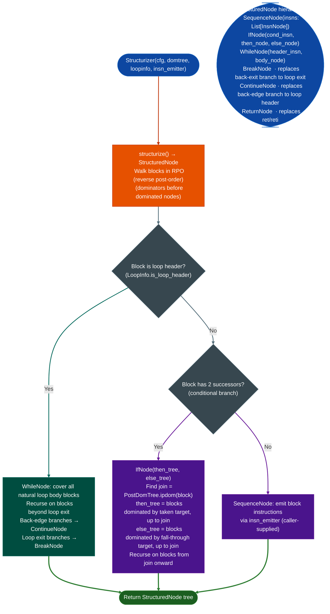

# Structured Control-Flow Recovery

Convert a flat basic-block CFG into a tree of structured control-flow nodes `Sequence`, `If`, `While` using dominator-driven Relooper reconstruction: producing source-level equivalent control flow from compiled MCU/ECU firmware without `goto` statements.

---

## Why this exists

1. **Binary lifters that emit a flat instruction sequence produce unreadable pseudo-code when the original source had loops and conditional branches: every branch becomes a `goto`, making comprehension harder than reading the disassembly.** `Structurizer` converts the CFG into `IfNode`, `WhileNode`, `SequenceNode`, `BreakNode`, and `ContinueNode` types that directly correspond to C source-level constructs. The output is equivalent to the original C control flow without relying on debug information.

2. **All compiled automotive firmware AUTOSAR classic, plain-C ECU code produces *reducible* CFGs: every back edge has a unique dominating loop header.** This property is required by the dominator-driven Relooper algorithm. Reducibility allows a simpler reconstruction than the full Emscripten Relooper needed for irreducible CFGs. For the ECU targets C166, V850, SH-2A, Renesas RL78 that `Structurizer` primarily targets, reducibility holds universally.

3. **`PostDomTree` provides the immediate post-dominator for every block: the `join` block where control flow reconverges after an `if`/`else`.** Without the post-dominator tree, recovering the `IfNode` structure requires heuristics looking for convergence blocks. `PostDomTree.ipdom(n)` gives the exact join block, enabling `Structurizer` to emit `IfNodethen_tree, else_tree` with the correct subtrees bounded to the join point.

---

## How it works



---

## Usage

```python
from ablation.analyzers.structurizer import Structurizer
from ablation.analyzers.cfg_builder import CFGBuilder
from ablation.analyzers.dataflow_engine import DomTree, LoopInfo
from ablation.analyzers.xref_graph import XRefGraph

xg = XRefGraph.from_path('/path/to/target.elf')
xg.build()

builder = CFGBuilder('/path/to/target.elf', xg=xg)
cfg = builder.build_function(func_va=0x401200)

# Build dominator tree and loop info
domtree = DomTree(cfg)
loopinfo = LoopInfo(cfg, domtree)

# Instruction emitter (converts (va, mnem, ops) to InsnNode text)
def emitter(insn):
    va, mnem, ops = insn
    return f"{va:#x}  {mnem}  {ops}"

s = Structurizer(cfg, domtree, loopinfo, emitter)
tree = s.structurize()
print(tree.render())   # renders indented structured pseudo-code
```

---

## Example output

The following illustrates the structured output format for a simple function. Actual structure depends on the function's CFG.

```
<func-va>:
  <va>  mov r0, <arg>
  <va>  cmp r0, 0
  if (r0 == 0):
    <va>  bl <error_handler>
    return
  else:
    while True:
      <va>  ldr r1, [r0]
      <va>  cmp r1, #0
      if (r1 == 0): break
      <va>  bl <process_entry>
      <va>  add r0, r0, #4
  <va>  mov r0, #0
  return r0
```

---

## False positives

**`Structurizer` requires a reducible CFG: irreducible CFGs those with multiple back-edges to the same header block from different blocks produce incorrect output.** Check `LoopInfo.is_irreducible()` before calling `structurize()`. Irreducible CFGs occasionally appear in hand-written assembly or heavily optimized C; for these, emit a flat sequence with `goto` labels instead.

**`PostDomTree.ipdom(n)` returns `None` for blocks with no post-dominator blocks on infinite loops, or blocks that are always dead code.** `Structurizer` treats a `None` post-dominator as an `IfNode` with no join block: the then-path runs to the end of the function. Verify manually when `ipdom` returns `None` for a conditional branch block.

---

## Pipeline position

Run `Structurizer` as the final pass before presenting lifted output to a human analyst: after `Ppc32Lifter`, `Ppc476Decompiler`, or `BinaryLifter` has produced a flat instruction sequence. The structured output is for human consumption, not for downstream automated analysis. `TaintTracker` and `SinkArgClassifier` operate on the flat CFG, not on the structured tree.

---

## See also

## Reading output

`Structurizer(cfg).structure()` returns the root `StructuredNode` of the AST. `Structurizer(cfg).emitinsn_emitter` returns the full pseudocode string.

`StructuredNode` subclass types:

| Node type | Fields | Meaning |
|:---|:---|:---|
| `SequenceNode` | `children: List[StructuredNode]` | Ordered sequence of child nodes |
| `InsnNode` | `block_start: int`, `insns: list`, `is_loop_header: bool` | A single basic block's instructions |
| `IfNode` | `cond_block: int`, `then_body`, `else_body`, `join_block` | `if/else` construct |
| `WhileNode` | `header_block: int`, `body`, `exit_block` | `while` loop |
| `BreakNode` | *no fields* | `break`: exits innermost loop |
| `ContinueNode` | *no fields* | `continue`: jumps to loop header |
| `ReturnNode` | `block_start: int`, `insns: list` | `return` from function |

---

## See also

- [Control-Flow Graph Construction](control-flow-graph-construction.md): produces `CFG` that Structurizer consumes
- [CFG Fixpoint Dataflow](cfg-fixpoint-dataflow.md): `DomTree`, `LoopInfo` from `dataflow_engine.py`
- [PPC32/PPC476 Dedicated Lifting](ppc32-ppc476-dedicated-lifting.md): `Ppc476Decompiler` uses Structurizer for decompiler output
- [Binary Lifter](binary-lifter.md): `BinaryLifter` structural backends use Structurizer for ARM32/MIPS/etc.
