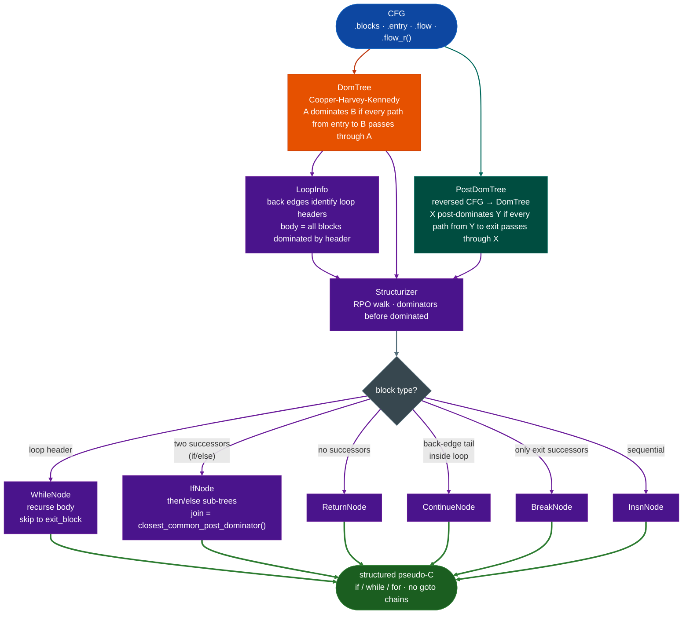

# Structurizer: Dominator-Based Structured Control Flow

**File:** `ablation/analyzers/structurizer.py` 
**Added:** v2.65.0

---

## Why this exists

Three things were not possible before in Ablation:

**1. No structured output for any ISA.** Every CFG-backed lifter in Ablation produced
goto-based IR: `if (T) goto loc_1a20;`. The structurizer converts that to `if/while/for`
pseudo-C, making function logic readable without manually tracing goto chains across the
decompiler output.

**2. No post-dominator tree.** Finding the "join" block after an if/else diamond requires
knowing which block every branch path converges on. That is the immediate post-dominator.
No existing Ablation module computed post-dominators. `PostDomTree` fills that gap by
reversing the CFG and running the standard `DomTree` algorithm on the reversed graph.

**3. No ISA-neutral decompiler pass.** The structurizer works on any CFG that exposes
`.blocks`, `.entry`, `.flow`, `.flow_r()`: the same interface as `dataflow_engine.CFG`.
`cfg_sh2a`, `cfg_v850`, and any future ECU-family CFG module can plug straight in
without writing an ISA-specific structurizer.

---

## Algorithm

All compiled automotive firmware AUTOSAR classic, bare-metal ECU C produces reducible
CFGs: every back edge has a unique dominating header. The structurizer exploits this:

1. Compute: DomTree Cooper-Harvey-Kennedy, LoopInfo natural loops from back edges,
 PostDomTree (reversed-CFG DomTree).
2. **Walk RPO** dominators before dominated nodes:
 - Block is a loop header → emit `WhileNode`, recurse into loop body, skip past exit.
 - Block has two successors (if/else) → find join via `PostDomTree`, emit `IfNode`
 with then/else sub-trees, continue from join block.
 - Block has no successors → emit `ReturnNode`.
 - Otherwise → emit `InsnNode` sequential, continue.
3. Back-edge-tail blocks inside a loop body become `ContinueNode`; blocks whose only
 successors are outside the loop become `BreakNode`.

This is O(n) in the number of basic blocks. It converges in one pass because RPO
guarantees dominators are visited before dominated nodes.



---

## Usage

```python
from ablation.analyzers.ecu_sh2a_decoder import EcuSH2aDecoder
from ablation.analyzers.cfg_sh2a import build_cfg
from ablation.analyzers.structurizer import Structurizer

with open("sh7058_ecu.bin", "rb") as f:
    rom = f.read()

dec = EcuSH2aDecoder(rom, base_va=0)
insns = dec.disassemble(0, len(rom))
cfg = build_cfg(insns, entry=0x1000)
s = Structurizer(cfg)

# Walk the tree
tree = s.structure()

# Emit pseudo-C using SH-2A state machine
from ablation.analyzers.binary_lifter import BinaryLifter
lifter = BinaryLifter.from_path("sh7058_ecu.bin", arch="sh2a")
# The lifter calls s.emit() automatically via _lift_sh2a.

# Direct use with a custom emitter
def my_emitter(insn):
    return f"{insn.mnemonic}  /* {insn.offset:#x} */"

print(s.emit(my_emitter, func_name="can_rx_handler"))
```

Example output before: linear lifter, after: structurizer:

**Before v2.63.0, goto-based:**
```
// can_rx_handler @ 0x2400
{
  uint32_t v0 = parse_can_frame(arg0, arg1, arg2, arg3);
  if (!T) goto loc_2410;
  *(uint32_t*)v0 = 0x1;
  goto loc_2418;
  loc_2410:
  *(uint32_t*)v0 = 0x0;
  loc_2418:
  return v0;
}
```

**After v2.65.0+, structured:**
```
// can_rx_handler @ 0x2400
{
  uint32_t v0 = parse_can_frame(arg0, arg1, arg2, arg3);
  if (/* cond @ 0x2404 */) {
    *(uint32_t*)v0 = 0x1;
  } else {
    *(uint32_t*)v0 = 0x0;
  }
  return v0;
}
```

---

## API

### `Structurizer(cfg)`

| Constructor arg | Description |
|---|---|
| `cfg` | Any object with `.blocks`, `.entry`, `.flow`, `.flow_r()` |

| Method | Returns | Description |
|---|---|---|
| `structure()` | `StructuredNode` | Build and return the structured tree |
| `emitinsn_emitter, func_name` | `str` | Render tree to pseudo-C |

### Node types

| Node | Fields | Meaning |
|---|---|---|
| `SequenceNode` | `children: List[StructuredNode]` | Ordered sequence |
| `InsnNode` | `block_start: int`, `insns: list` | One basic block's instructions |
| `ReturnNode` | `block_start: int`, `insns: list` | Function return block |
| `WhileNode` | `header_block: int`, `body: StructuredNode`, `exit_block: int` | `while` loop |
| `IfNode` | `cond_block: int`, `then_body`, `else_body`, `join_block` | `if/else` |
| `BreakNode` |: | Loop `break` |
| `ContinueNode` |: | Loop `continue` |

### `PostDomTree(cfg)`

| Method | Returns | Description |
|---|---|---|
| `ipdom(n)` | `int \| None` | Immediate post-dominator of block `n` |
| `post_dominates(a, b)` | `bool` | True if `a` post-dominates `b` |
| `closest_common_post_dominator(a, b)` | `int \| None` | Join point for if/else |

---

## Limitations

- **Irreducible CFGs**: the structurizer assumes the CFG is reducible (all compiled
 automotive C firmware is reducible). Obfuscated firmware or hand-written assembly
 with multiple-entry loops may produce incorrect output. Use `LoopInfo.is_reducible()`
 to check before running the structurizer.
- **Condition expressions**: `IfNode.cond_block` and `WhileNode.header_block` are
 annotated as `/* cond @ 0x... */` in the emitted pseudo-C. The T-bit value is not
 tracked across instructions. A future pass (`SH2aCondTracker`) can fill this in.
- **Switch/jump table dispatch**: indirect jumps decoded as MISC produce open blocks
 that appear in the structurizer as a plain `InsnNode` sequence without any branch
 annotation.

---

## How it works

`Structurizer.run(cfg)` converts a basic-block CFG into a structured control-flow tree. Uses dominator-tree analysis to identify loop headers and if–else branch pairs, then folds them bottom-up into `Sequence`, `If`, and `While` AST nodes. The output tree is equivalent to the source-level control flow: suitable for pattern-matching against known vulnerability structures without manual CFG traversal. Used by `MCUAnalyzer` for ECU/MCU firmware where the CFG is small and structured recovery is accurate.

---

## Example output

```
# Structurizer.emit(func_name, insn_emitter) output:
// parse_header @ 0x12000
{
  r3 = arg0;
  r4 = *(uint32_t*)(r3 + 0);
  if (/* cond @ 0x12010 */) {
    r3 = 0;
  } else {
    r5 = r4 + 1;
    while (/* cond @ 0x12040 */) {
      r4 = *(uint32_t*)(r3 + 0x4);
      r3 = r3 + 0x8;
    }
    break;
  }
}
```

---

## False positives

**Irreducible CFGs.** `Structurizer` relies on dominator-tree analysis, which works correctly only for reducible CFGs. Binaries compiled without optimization common in ECU firmware sometimes contain irreducible CFGs due to computed gotos or `setjmp`/`longjmp`. `Structurizer.structure()` raises `StructurizationError` for irreducible CFGs: fall back to raw basic-block listing.

---

## Pipeline position

**Before this module:** Build the basic-block CFG with the appropriate arch-specific CFG builder such as `cfg_builder.build_cfg()` for x86-64 and `build_cfg_sh2a()` for SH-2A.

**After this module:** Pass the structured tree to `Ppc32Lifter` or `BinaryLifter` to emit pseudocode, or pattern-match directly against the `IfNode`/`WhileNode`/`SequenceNode` tree structure.

---

## Reading output

`Structurizer(cfg).structure()` returns the root `StructuredNode` of the recovered control-flow tree. Concrete node types:

| Node type | Fields | Meaning |
|:---|:---|:---|
| `SequenceNode` | `children: List[StructuredNode]` | Linear sequence of nodes |
| `InsnNode` | `insn` | Single SH-2A instruction |
| `IfNode` | `condition, then_branch, else_branch` | `if/else` region |
| `WhileNode` | `condition, body` | Loop region |
| `BreakNode` |: | `break` out of enclosing loop |
| `ContinueNode` |: | `continue` to loop header |
| `ReturnNode` |: | Function return |

---

## See also

- [BinaryContext](binary-context.md): session state and function/import index
- [TaintAnalysis](taint-analysis.md): dataflow tracking on resolved functions
- [SemanticSearch](semantic-search.md): behavioral candidate search on the binary
