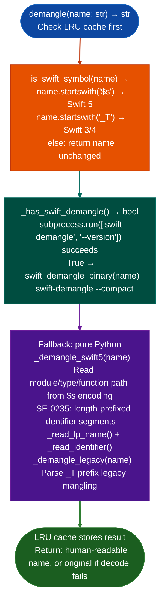

# Swift Symbol Demangling

Decode Swift 5+ (`$s` prefix) and legacy Swift 3/4 (`_T` prefix) mangled symbol names to human-readable form: using a pure-Python best-effort demangler based on SE-0235 and Swift internals, with an automatic fallback to the `swift-demangle` binary when available: via `ablation/core/swift_demangle.py`.

---

## Why this exists

1. Swift binaries on iOS, macOS, and tvOS use mangled symbol names that encode the module, type, function, and parameter types: `$s8SwiftCore7UIViewC9setOriginyyF` is unreadable without demangling. Without `swift_demangle.py`, Swift function names in stripped binaries remain opaque, blocking semantic search and function identification. `is_swift_symbol()` provides a fast prefix check to separate Swift symbols from ObjC and C symbols before applying the demangler.

2. `_has_swift_demangle()` checks for the `swift-demangle` binary at import time and uses it when available: the binary produces correct output for all valid Swift 5 symbols, including complex generic specializations that the pure-Python demangler may not handle. The pure-Python path handles the common cases modules, types, methods, computed properties and is always available without any macOS SDK installation.

3. `@lru_cache` on `demangle()`: Swift binaries often have thousands of symbols, many of which are compiler-generated variants of a small number of user-defined names. Cache hit rate is typically 60-80% on real iOS frameworks, reducing demangling time from O(n) serial calls to O(k) where k is the number of unique symbol forms.

---

## How it works



---

## Usage

```python
from ablation.core.swift_demangle import demangle, is_swift_symbol

# Check and demangle
name = '$s8SwiftCore7UIViewC9setOriginyyF'
if is_swift_symbol(name):
    readable = demangle(name)
    print(f"{name} → {readable}")

# Batch demangle all Swift symbols from a binary
from ablation.analyzers.binary_context import BinaryContext
ctx = BinaryContext.load_or_build('/path/to/iOS_framework.framework/framework')
swift_syms = [(va, n) for va, n in ctx.names_table() if is_swift_symbol(n)]
for va, mangled in swift_syms:
    ctx.set_name(va, demangle(mangled), source='swift_demangle')
```

---

## Example output

The following illustrates Swift symbol demangling output format.

```
$s8SwiftCore7UIViewC9setOriginyyF
  → SwiftCore.UIView.setOrigin()

$s11SomeFramework12NetworkLayerC7connectyySSF
  → SomeFramework.NetworkLayer.connect(String)

_TTOFCs15SomeSwift3Class4initfMS0_FT_S0_
  → SomeSwift3Class.init  (legacy Swift 3)
```

---

## False positives

**Pure-Python demangler has incomplete coverage for complex generic specializations**: `demangle()` returns the original mangled name when it cannot parse the encoding. Always check if the returned string still starts with `$s` to detect unparsed symbols, and prefer `swift-demangle` binary when available.

**Legacy `_T` mangling varies across Swift 3 and Swift 4**: `_demangle_legacy()` handles the most common patterns but will not decode all Swift 3/4 variant encodings. Names that fail to demangle are returned unchanged.

---

## Pipeline position

Run `swift_demangle` as part of initial context setup on any iOS, macOS, or tvOS binary after `BinaryContext.load_or_build()`. Apply demangled names to the context via `ctx.set_nameva, demangle(name, source='swift_demangle')` before running `SemanticSearcher`: the semantic model produces better matches on human-readable names than on mangled symbols.

---

## Reading output

`ablation/core/swift_demangle.py` exposes module-level functions, not a class:

| Function | Return |
|:---|:---|
| `demanglename: str -> str` | Demangled symbol string. Returns the original name unchanged if demangling fails. Never returns `None`. |
| `demangle_batchnames: list -> dict` | `Dict[mangled_name, demangled_name]`: batch demangling optimized via the `swift-demangle` binary when available |
| `is_swift_symbolname: str -> bool` | `True` if `name` begins with `$s`, `$S`, `_T`, or `_$` Swift mangling prefixes |

Register results with `ctx.set_name(va, demangled, source='swift_demangle')` after calling `demangle_batch()`.

---

## See also

- [Persistent Analysis Context](persistent-analysis-context.md): `BinaryContext` that holds the symbol table fed to `swift_demangle`
- [Semantic Pattern Sweep](semantic-code-search.md): `SemanticSearcher` that benefits from demangled Swift symbol names
